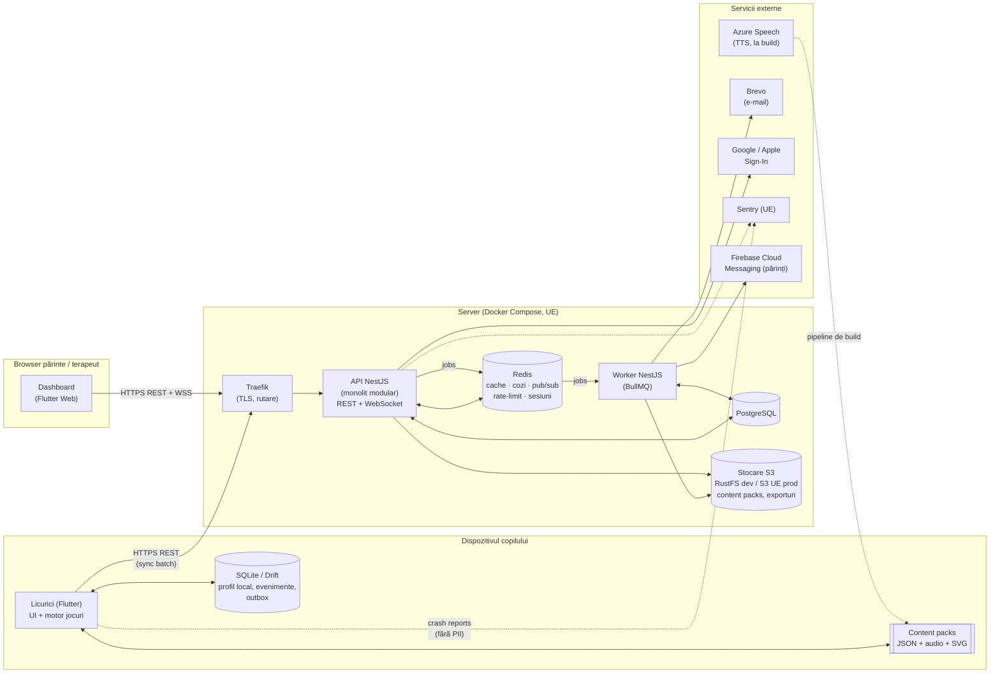

# ✨ Licurici — platformă educativă pentru copii (teză de licență)

> **Licurici** = aplicație **Flutter** pentru copii (grădiniță + clasele 1–4, curriculum Moldova/România),
> prietenoasă cu autismul, cu **~58 de jocuri educative**, care funcționează **offline** și se
> sincronizează cu un **backend dockerizat** (NestJS + PostgreSQL + Redis + BullMQ + stocare S3),
> plus un **panou web pentru părinți / terapeuți**. Conform **GDPR** și **Legii RM nr. 195/2024**
> privind protecția datelor cu caracter personal.

Acest README este **sursa unică de adevăr** a proiectului: ce construim, de ce, cum, ce e gata și
ce urmează. Oricine (om sau asistent de cod) intră în repo trebuie să citească **întâi §0 și §22**.

---

## Cuprins

0. [Pe scurt — starea proiectului](#0-pe-scurt--starea-proiectului)
1. [Cerințele coordonatorului → cum le acoperim](#1-cerințele-coordonatorului--cum-le-acoperim)
2. [Viziunea produsului](#2-viziunea-produsului)
3. [Prototipul existent (Electron) — ce păstrăm](#3-prototipul-existent-electron--ce-păstrăm)
4. [Arhitectura sistemului](#4-arhitectura-sistemului)
5. [Structura repo-ului (monorepo țintă)](#5-structura-repo-ului-monorepo-țintă)
6. [Stack tehnologic](#6-stack-tehnologic)
7. [Decizii arhitecturale argumentate (ADR)](#7-decizii-arhitecturale-argumentate-adr)
8. [Mecanisme de comunicare](#8-mecanisme-de-comunicare)
9. [Pattern-uri de proiectare](#9-pattern-uri-de-proiectare)
10. [Redis — ce, unde, de ce](#10-redis--ce-unde-de-ce)
11. [Modelul de date](#11-modelul-de-date)
12. [API (schiță)](#12-api-schiță)
13. [Protecția datelor: GDPR + Legea 195/2024](#13-protecția-datelor-gdpr--legea-1952024)
14. [Design vizual (nivel AutiSpark)](#14-design-vizual-nivel-autispark)
15. [Motorul de jocuri în Flutter + animații](#15-motorul-de-jocuri-în-flutter)
16. [Catalogul de jocuri (58)](#16-catalogul-de-jocuri-58)
17. [Servicii externe](#17-servicii-externe)
18. [Docker & rulare locală](#18-docker--rulare-locală)
19. [Testare & calitate](#19-testare--calitate)
20. [Performanță & optimizare](#20-performanță--optimizare)
21. [Roadmap (Sem. 1 = 70%)](#21-roadmap-sem-1--70)
22. [Ghid de lucru în repo (convenții + Definition of Done)](#22-ghid-de-lucru-în-repo)
23. [Cercetarea pentru teză](#23-cercetarea-pentru-teză)
24. [Surse](#24-surse)

---

## 0. Pe scurt — starea proiectului

| Zonă | Stare | Note |
|------|-------|------|
| Prototip desktop (Electron, JS) | ✅ funcțional | 44 jocuri, motor de dificultate, Aventură, voce RO. **Referință** pentru portare (vezi §3). |
| Monorepo (`apps/`, `packages/`, `backend/`, `infra/`, `docs/`, `legacy/`) | ✅ | Workspace Dart (pub workspaces) la rădăcină. |
| `packages/licurici_core` (Dart pur) | 🟨 | Dificultate portată 1:1 din JS (teste de paritate), regulă adaptivă, modelul jocurilor (`ChoiceGame` = metadate în constructor), **16 jocuri `choice`** (`lib/src/games/<materie>.dart`, inclusiv `social.dart`: EMO3–EMO6), **modelul de dezvoltare** (`development.dart`: arii + trasee de trepte; `trial.dart`: `Trial`, `PromptLevel` P0–P4, `PromptLadder`, `MasteryCriterion`, `EloRating`), **mecanica `reaction`** (`reaction.dart`: `pescarul` go/no-go, `prinde-licuriciul`, niveluri procedurale nemărginite + KPI comisii/omisiuni/TR), **`sequence`** (`sequence.dart`: `simon`, span 2→7, ordine inversă), **`memory`** (`memory.dart`: `perechi`), **`dragDrop`** (`sorting.dart`: `sortam`), **sesiunea** (`recorder.dart`: `SessionRecorder`; `report.dart`: `SessionRecord` + `SessionReport` + rezumate; `progress.dart`: progres pe trepte din sesiuni; `session.dart`: `SessionPlanner`), `demo.dart`, `transfer.dart` (export/import). `tool/voice_coverage.dart`. 162 de teste. |
| `packages/game_content` | 🟨 | 329 SVG OpenMoji, **ilustrații pictate** (`art/illustrations/`: mascotă, arii, jocuri, fundaluri pe straturi, sprite-uri, fețe de emoții, obiecte, abțibilduri — WebP), **sunete generate din cod** (`audio/sfx/`), **1241 de clipuri voce RO** (acoperire 100% a frazelor rostite), font Nunito. Conținutul jocurilor e încă în Dart (`content.dart`) → de mutat în JSON. |
| Aplicația copil — Flutter | 🟨 | **Landscape** (telefon + tabletă, ADR-023), ecran de pornire cu pre-încărcare, ecran principal cu jocuri derulate orizontal, mecanica `choice` cu animații (§15.1) pe două panouri, variante cu grupuri de obiecte, mascota desenată în cod, voce, modul calm. **Sesiunea se înregistrează și se salvează local (Drift, ADR-004)**: fiecare rundă din `choice`/`reaction`/`simon` = `Trial` (latență, ajutor, ce a ales), pauze, „Cum te simți?” la primul joc și la „Gata pe azi”; **„Drumul de azi”** (orar vizual din `SessionPlanner`) pe ecranul principal; **Colțul părintelui** pe tabletă (poartă pentru adulți, rezumatele sesiunilor, offline, fără cont; ☁️ trimiterea pe server cu contul părintelui și acord explicit — `data/sync.dart`, doar sesiunile netrimise). 32 de teste (layout la 5 dimensiuni, final + album la 4 dimensiuni, salvare Drift în memorie). Setările copilului (clasa, modul calm, vocea) se păstrează tot în Drift. Pe web (doar previzualizare) sesiunile rămân în memorie. **UI ilustrat** (sesiunea 6): kit vizual „candy”, fundaluri pictate pe straturi animate din cod, stimuli și fețe pictate, final comun cu stele + abțibild, „Albumul meu”, sunete blânde, tranziții (§14, §14.1, ADR-028). |
| Panou părinte/terapeut — Flutter Web | 🟨 | `apps/dashboard`: două panouri în aceeași aplicație (ADR-013): **`/parinte`** (rezumat cald al ultimei sesiuni, „ce exersăm”, dispoziția aleasă de copil, istoric) și **`/specialist`** (listă de copii, KPI, notițe, grafic ABA al independenței pe trepte cu linia de 80%, tabel de sesiuni, confuzii, datele trimise la AI). Pe **date demo** (`demoChildren()`), **sesiuni importate** sau **date reale din API** după autentificare (`api.dart`, `login_page.dart`; butonul „Generează rezumat cu AI” funcțional; **„Contul meu”** — consimțăminte date/retrase, partajarea fiecărui copil cu specialistul, exportul tuturor datelor și ștergerea profilului copilului, `account_page.dart`). 13 teste de widget (inclusiv cu backend simulat), `flutter build web` OK. |
| Backend NestJS (API + worker) | 🟨 | Config validat (zod), loguri pino fără PII, Prisma 7 + migrări (`init`, `therapy_sessions`), `/health` + `/health/ready`, cozi BullMQ, procesor `stats` cu lock Redis. **Conturi pentru adulți** (`auth/`: Argon2id, JWT 15 min, refresh opac rotit în Redis), **acces la copil** (`children/access.ts`: părinte / specialist cu `CareLink`, 404 pentru restul), **consimțăminte** (`consents/`: jurnal append-only, retragere), **sincronizarea sesiunilor** (`sync/`: idempotentă, cere consimțământul `SYNC`; test de contract cu JSON generat din Dart), **rezumat AI** (`reports/summary-flow.ts`: consimțământ `AI_SUMMARY`, cache, limită zilnică), **partajarea cu specialistul** (`children/sharing.ts`: invitație după e-mail, consimțământ `THERAPIST_SHARING`, 90 de zile implicit, revocare, audit), **GDPR** (`gdpr/`: export complet `GET /me/export`, ștergerea copilului `DELETE /children/:id` — acces tăiat imediat, ștergere definitivă după 7 zile prin coada `gdpr` și `GdprProcessor` în worker), erori de infrastructură → 503. Serviciile sunt TypeScript simplu (NestJS 12 e ESM și nu se încarcă în Jest), legate în `api/api.module.ts`. 38 de teste; API-ul și worker-ul pornite fără Docker (testul de pornire a prins o dependență lipsă între module): rute, 400/401/503, Swagger verificate pe HTTP. **Netestat cu Postgres/Redis reale** (Docker lipsă). |
| Docker Compose (dev) | 🟨 | postgres, redis, storage (RustFS), migrate, api, worker, mailpit. **Netestat încă**: Docker nu e instalat pe mașina de dezvoltare. Prod (Traefik, TLS) — de făcut. |
| GDPR (consimțământ, export, ștergere, documente) | 🟨 | API: consimțăminte pe scopuri (jurnal append-only, retragere), export complet, ștergerea copilului cu perioadă de grație, audit. Panou: „Contul meu” (consimțăminte, partajare cu e-mailul specialistului, export, ștergerea copilului, **ștergerea contului** cu parola — sesiunea 8). Tableta: **„Șterge datele de pe tabletă”** în „Pentru părinți” (sesiuni, setări, abțibilduri, stele, acvariu — sesiunea 8). Documentele din `docs/gdpr/` — ciorne (§13.5). **De făcut:** exportul ca fișier (acum în clipboard), verificarea juridică a documentelor, măsurile 🕓 din DPIA. |
| Documente ADR / cercetare pentru teză | 🟨 | 25 de ADR-uri în `docs/adr/`. `docs/research/` — de început. |
| Unelte | 🟨 | `tools/gen-voice/gen-voice.mjs` (Azure AI Speech sau edge-tts, incremental). |

**Termen:** 70% din aplicație gata la finalul semestrului 1 (**decembrie 2026**). Teza propriu-zisă — semestrul 2.

Legendă status folosită peste tot: ⬜ neînceput · 🟨 în lucru · ✅ gata · 🔁 portat din prototip.

### 0.1 Unde am rămas și ce urmează (citește asta întâi într-un chat nou)

**Ultima actualizare: 08.10.2026.** **Sesiunea a opta — Acvariul (Claude, 06–08.10):**
- ✅ **Acvariul meu** (`/acvariu`, buton cu valuri pe ecranul principal): recif desenat din cod (apă, raze, nisip cu sclipiri, corali, alge care se leagănă, bule, plancton), peștii copilului înoată liber; **atingere → fug**, **apăsare lungă → se adună la deget**, **Mâncare → mănâncă fulgii**; la prima vizită Licurici dăruiește un pește-clovn colorat. Simularea e pură și testată: `licurici_core/lib/src/aquarium.dart` (`Aquarium`, `SwimmingFish`).
- ✅ **4 modele de pești** cu contururi originale (clovn, înger, balon, chirurg) + **volumul** calculat din contur (`aquarium_fish.dart`: `FishBody` — transformata distanței → grosime → lumină). Peștele = desenul copilului pe plasă deformată (`tank_painter.dart`), fără shadere.
- ✅ **Colorez un pește** (`/acvariu/coloreaza`): carioca (3 mărimi), găleată (se oprește la liniile fișei, culoarea intră sub linii), 12 culori + gumă, „Înapoi”; „Gata!” → peștele intră în acvariu de sus. Desenele se salvează local (§11).
- Teste: 11 în core (`test/aquarium_test.dart`), 2 widget (telefon mic + tabletă: cadou, atingeri, colorare pe zone, „Gata!”, salvare).
- Prototipul three.js de la începutul sesiunii a fost abandonat (decizie: Flutter pur, cameră fixă). `paper-aquarium/` rămâne doar ca referință (licență MIT, nu se copiază din el).
- ✅ **Pușculița cu stele** (`AppSettings.stars`, pornește cu 3): stelele arătate la finalul oricărui joc intră o dată în pușculiță (`_FinishSounds` din `reward_finish.dart`); în acvariu, **o mână de mâncare = o stea**; fără stele, Licurici spune „Joacă un joc și câștigi stele pentru mâncare.” și pușculița se clatină. Colorarea peștilor rămâne gratuită (e creație, nu recompensă).
- ✅ Vocea pentru frazele acvariului (edge-tts, `tool/voice_coverage.dart` → `gen-voice.mjs`); acoperire 1712/1712.
- ✅ Ținut în portret (web), ecranul de dedesubt se așază ca în landscape — nu mai apar depășiri sub „Întoarce telefonul” (`app/boot.dart`, `_Landscape`).
- ✅ Brief pentru Codex: [docs/brief-codex-acvariu.md](docs/brief-codex-acvariu.md) — `scenes/aquarium_back` (opac, nisipul doar în 11% de jos, mijlocul liber) și `scenes/aquarium_front` (doar colțurile de jos). Codul le folosește automat, aliniate jos.
- Verificat: analyze curat; core 387 teste, aplicația 167 (inclusiv acvariul pe telefon mic și tabletă).
- ✅ **Peștele de pe hârtie** ([ADR-030](docs/adr/ADR-030-acvariul-pe-hartie-fisa-pdf-si-scanare-pe-dispozitiv.md), propus): **fișa A4** (PDF, `paper_sheet.dart`, pachetele `pdf` + `printing`) cu 4 marcaje proprii în colțuri (pătrat–inel–miez, 1:1:3:1:1) și un **cod de 4 biți** pentru model; se printează din acvariu, după **poarta pentru adulți**. **Scanarea** (`image_picker` → `licurici_core/lib/src/paper_scan.dart`, Dart pur, într-un isolate): prag adaptiv → componente conexe → perechi concentrice → cel mai mare patrulater → omografie → codul (încearcă 4 rotiri, deci și fișa ținută invers) → decuparea casetei 1000×600 → **lumina egalizată după hârtia albă** din jurul peștelui. Rezultatul intră în același `buildFishImage` ca desenul de pe ecran; fotografia nu se păstrează. Eșec → Licurici, blând: „Nu văd fișa. Fă poza de sus, cu toată foaia.” + „Mai încerc”.
- Teste: 6 în core cu **fotografii sintetice** (perspectivă, lumină inegală, nuanță galbenă, zgomot, rotire 180°, poză fără fișă) — toate modelele găsite, marcaje la < 3 px, culorile corecte și în partea întunecată; 3 în aplicație (PDF-ul se construiește; poză fără fișă → „Mai încerc” → poză bună → peștele intră în acvariu, pe telefon mic și tabletă).
- **De verificat pe dispozitiv real:** fotografii adevărate (lumină slabă, foaie îndoită, blitz). Dacă eșuează des: ghidaj în timp real cu `camera` (vezi ADR-030, „Când am alege altfel”).
- **Urmează (acvariu):** rularea Codex pe brief (fundalul pictat); poate un preț în stele și pentru peștii noi (de discutat — acum colorarea e liberă).
- ✅ **Ultimele jocuri școlare din prototip** (`licurici_core/lib/src/games/scoala2.dart`, total **75** în aplicație): **Banii** (PAC-T2, bancnote desenate din cod — `MoneyVisual`, câte o culoare pe valoare; 1/2/5 lei → +10 → +20/50), **Tabla înmulțirii** (PAC-N13, până la 10 × 10, distractori din „tabla vecină”), **Probleme** (PAC-N14, adunare/scădere, de la nivelul 3 și înmulțire), **Ce fel de cuvânt?** (PAC-L9), **Trecut și prezent** (PAC-I1), **Simbolurile țării** (PAC-I2), **Engleză** (PAC-E1, cu **voce englezească** — frazele `en:…` se generează cu `en-US-AnaNeural`, voce de copil; `tools/gen-voice`). Teste: `scoala2_test.dart` + toate jocurile pe telefon mic și tabletă. Vocea: 1961/1961.
- Brief pentru cardurile lor: [docs/brief-codex-carduri-scolare.md](docs/brief-codex-carduri-scolare.md) (până atunci, emoji).
- ✅ **Ștergerea contului** (GDPR art. 17; backend `POST /me/delete` + panoul „Contul meu”): cere **parola din nou**; imediat: copiii marcați șterși, partajările tăiate (și cele în care contul e specialistul), e-mailul anonimizat (poate fi refolosit), parola ștearsă; **reîmprospătarea sesiunii e refuzată** pentru un cont șters (`AuthService.refresh`); job-ul `purge-account` (coada `gdpr`) șterge definitiv după 7 zile, în cascadă. Administratorii nu se șterg din aplicație. Lista de partajări arată acum **e-mailul specialistului**. Teste: backend 41, panou 14.
- ✅ **„Șterge datele de pe tabletă”** (Pentru părinți, după poarta pentru adulți, cu confirmare): sesiunile + setările (Drift `wipe()`), abțibildurile, stelele, peștii din acvariu; sesiunea în curs se abandonează.
- ✅ **Documentele GDPR** ([docs/gdpr/](docs/gdpr/README.md), §13.5) — 9 ciorne pe baza codului și arhitecturii: politica de confidențialitate (+ pentru copii), termeni, RoPA, DPIA, incident, drepturi, împuterniciți, retenție, declarațiile pentru magazine. **De verificat de un jurist** și de completat identitatea operatorului.
- ✅ **Măsuri din DPIA în backend:** **blocare 15 minute după 5 parole greșite** (`AuthService`, contor în Redis cu cheia = hash-ul e-mailului; se aplică și e-mailurilor fără cont, ca să nu dezvăluie cine e înscris) și **retenția de 24 de luni** (job zilnic `expire-sessions` în coada `gdpr`, programat idempotent cu `upsertJobScheduler`; logica pură în `gdpr/retention.ts`). Backend: 44 de teste.

**Sesiunea a șaptea (05.10.2026) — jocuri noi pe ariile goale (Claude; Codex doar imagini):**
- ✅ **Prinde licuriciul**: licuricii apar de ~2× mai des și **zboară** de la primul nivel (bucle, aripi, halou care pulsează; dacă nu e prins, zboară în sus și se stinge). Axe noi în `ReactionAxes`: `driftRange`, `flies`, `firstGapMs`; `ReactionStimulus.driftY`.
- ✅ **Potrivește** (POT1–2), **Arată-mi** (LRC1–2, „Arată mingea”, doar cuvinte cunoscute la început, apoi distractori din aceeași grupă), **Corpul meu** (LRC3), **Intrusul** (POT6) — `licurici_core/lib/src/games/vocabular.dart` (banca `objectWords`, 51 de obiecte pictate cu nume articulat și grupă).
- ✅ Ecranul `choice`: variantele care sunt doar imagine au imaginea cât încape (mult mai mare); rundele fără stimul (Intrusul) nu mai au panou gol. Test nou: fiecare joc `choice` pe telefonul mic și pe tabletă (`test/choice_games_test.dart`).
- ✅ **Trasează** (MOT1–3, mecanică nouă): albina pe drum până la floare; drumuri generate (linie → diagonală → arc → val → zig-zag → buclă), drumul se îngustează, ghidajul (puncte, săgeată) dispare; `TraceTracker` (pur, testat): personajul înaintează doar cât degetul e pe drum, ieșirile se numără, KPI abaterea medie. `lib/src/trace.dart`, `features/games/trace/`.
- ✅ **Pune în ordine** (mecanică nouă): **Pașii rutinei** (AUT1–2: mâini, îmbrăcat, culcare, masă, afară) și **Ce urmează?** (COG6: oul → puiul, sămânța → floarea, omul de zăpadă…); 2 pași („întâi … apoi …”) → 5; după două greșeli poza bună pulsează (P3). `lib/src/ordering.dart`, `features/games/order/`.
- ✅ **Fă ca Licurici** (IMI1–3, mecanică nouă): un licurici zboară la obiect și îl face să sară sau îl duce în coș; copilul repetă; după două greșeli modelul se reia (P4). `lib/src/imitation.dart`, `features/games/imitation/`.
- ✅ **Semaforul** (FEX1): felinarul mare se face verde după 1 → 6 s; de la nivelul 4 licărește galben (tentații); KPI atingeri anticipate + cea mai lungă așteptare reușită. `lib/src/waiting.dart`, `features/games/wait/`.
- ✅ **Regula se schimbă** (FEX3–4, paradigma DCCS): cartonașe cu forme colorate desenate din cod, sortate după culoare, apoi după formă (anunțat), apoi regula amestecată arătată pe cartonaș; KPI erori de perseverare + costul schimbării. `lib/src/switching.dart`, `features/games/rules/`.
- ✅ **Caută** (ATN2): 4 → 25 de obiecte pictate împrăștiate, țintă în colț; de la nivelul 5 distractori din aceeași grupă; după 8 s ținta pulsează; KPI timp de căutare vs număr de obiecte. `lib/src/search.dart`, `features/games/search/`.
- ✅ **Unde se uită?** (ATN3–4, atenție comună): Licurici (cadre pictate noi: `look_left/right`, `point_left/right`) arată și se uită, apoi doar se uită spre unul din două obiecte; după greșeală adaugă gestul (P3). `lib/src/gaze.dart`, `features/games/gaze/`, `MascotMood.lookLeft…`.
- ✅ **Umbre** (POT3): obiect ↔ silueta lui, alternat; silueta se colorează la răspunsul corect (`SilhouetteVisual`, `Choice.silhouette`).
- ✅ **Mare și mic** (COG4): seriere după mărime, pe mecanica „pune în ordine” (`OrderStep.scale`).
- ✅ **Mare, mic, roșu** (LRC4): „Arată mărul mic / cartea verde”; distractori cu un singur atribut corect (`Choice.scale`).
- ✅ **Ce se aude?** (COM1): vocea spune sunetul („Cine face miau?”), copilul alege cine îl face.
- ✅ Toate cele 62 de obiecte sunt pictate (inclusiv elefantul); carduri pictate pentru toate jocurile noi.
- ✅ **Ce îmbrac?** (AUT3, haine după vreme), **Vorbește** (COM3: tabla AAC — „Vreau apă”, „Mă simt obosit”; cererile = `SessionEventKind.request`, notate și în rezumatul pentru părinte; validarea din backend acceptă noul tip), **Toba magică** (IMI4: ritmuri 2 → 6 bătăi, una/două tobe, sunete de tobă generate în `tools/audio/gen_sfx.py`; timpul bătăilor din `Ticker`, ca să meargă și cu timp simulat în teste), **Hrănește peștii** (MOT4: tragere la peștele flămând care înoată), **Atinge și vezi** (COG1: cauză–efect), **Peștele din mijloc** (Flanker; `FlankerVisual`, `ChoiceRound.stimulusId` = congruent/incongruent), **Primul sunet** (COM4), **Ce s-a schimbat?** (ATN5: apare / înlocuit / dispărut), **Puzzle** (POT7: 2 → 9 piese din ilustrațiile ariilor).
- Ariile **IMI, AUT, MOT** au acum jocuri; în total **44 de jocuri noi** în această sesiune (**68** în aplicație). Ultimele: **Unde e ursulețul?** (LRC6, scene desenate din cod — `Placement`, `shared/placement_art.dart`), **Labirint** (FEX7, `maze.dart`: labirinturi perfecte, `MazeWalker`), **Găsește diferențele** (POT8, `spot_diff.dart`), **Ce face?** (LRC3b, cu ilustrațiile noi `actions/` — același copil care doarme, mănâncă, aleargă…, folosite automat și în rutine și în tabla AAC), **Orarul meu** (AUT4), **Construiește la fel** (IMI5, `build_copy.dart`: model din forme colorate, apoi din memorie), **La magazin** (AUT5, `shop.dart`: listă cu poze, produsele luate în plus se numără), **Spune propoziția** (COM5: poza + pictograme „Fetița / mănâncă / cu lingura”, cu capcane; `OrderStory.picture`, `OrderRound.distractors`/`tray`, propoziția rostită la final), **Semnele** și **Numărul lipsă** (PAC-N8/N9, portate din prototip); jocurile școlare portate în `games/scoala.dart`: **Anotimpuri**, **Unde trăiește?**, **Silabe**, **Citește cuvântul**, **Unul și mai mulți**, **Zeci și unități**, **Înmulțim**, **Împărțim**, **Ceasul** (cadran desenat din cod, `ClockVisual`: ore → jumătăți → sferturi).
- **Urmează:** ✅ jocurile școlare rămase (sesiunea 8); ✅ obiectele mari pe telefonul mic (sesiunea 8, mai jos).
- ✅ **Telefonul mic, mecanica `choice`:** Licurici și steluțele de progres stau **sub variante** (dreapta), nu sub stimul, deci panoul stimulului are toată înălțimea; balonul de text nu se mai arată pe telefon (vocea spune instrucțiunea). **Obiectele de numărat își aleg mărimea și așezarea** din spațiul real al panoului (`_Objects.fit`: grupurile unul lângă altul sau unul sub altul, câte pe rând) — nu mai sunt micșorate la final; la Adunăm, florile/baloanele sunt de ~3× mai mari. Etichetele variantelor nu se mai rup în mijlocul cuvântului (`_FitLabel` micșorează litera).

**Sesiunea a șasea — aspect profesionist pentru copil (Claude cod + Codex doar imagini):**
- ✅ **Kitul vizual „candy”** (`apps/child_app/lib/shared/ui/candy.dart`): butoane/carduri cu buză 3D care „coboară” la atingere, panouri crem, titluri cu contur alb, baloane de vorbire; bara de sus cu butoane rotunde colorate (sens fix pe culoare). Folosit pe toate ecranele copilului.
- ✅ **Fundaluri pictate pe straturi**, animate din cod (`shared/fx/scene_background.dart`): pajiște (cer + dealuri + iarbă, paralaxă la derulare, nori, iarbă care se leagănă), iaz (sclipiri), seară (stele), amurg. Shaderele au fost scoase (pe web ieșeau negre) — ADR-028, actualizarea din 03.10.
- ✅ **Stimuli pictați** (`shared/stimulus_art.dart`): emoji → ilustrație dacă există în manifestul de resurse, altfel OpenMoji. Gata: peștii/caracatița/crabul/licuriciul (reacție), felinarele (6 culori), **fețele de emoții** (același copil, 8 emoții — și în „Cum te simți?”), măr verde/roșu. Restul obiectelor (60) — în generare.
- ✅ **Finalul comun** al tuturor jocurilor (`shared/reward_finish.dart`): stele pictate pe podium + Licurici care sărbătorește + **abțibild nou**; **„Albumul meu”** (`/album`, 12 abțibilduri, umbre pentru cele lipsă, dubluri numărate; date doar locale, README §11/§13); **„La revedere”** la „Gata pe azi” cu abțibildurile adunate azi; pauză ilustrată (`shared/pause_view.dart`).
- ✅ **Sunete blânde generate din cod** (`tools/audio/gen_sfx.py` → `game_content/audio/sfx/*.wav`, `shared/sfx.dart`): note pentatonice la **Felinarele** (rezolvă „sunetul notelor” din pașii anteriori), pop la atingere, clinchet la corect, stele, abțibild. Fără sunet de greșit; în modul calm doar notele jocului, mai încet.
- ✅ Reacție (Pescarul / Prinde licuriciul): introducere ilustrată (ce atingem ✓ / ce lăsăm ✋), sprite-uri pictate, cercuri pe apă, halou la licurici. Felinarele: felinare pictate care se aprind cu halou, vizibile de la început.
- ✅ Tranziții între ecrane (estompare + mică apropiere), ecran de pornire la amurg, Licurici răspunde la atingere pe ecranul principal.
- ✅ **Joc nou: Cucu-bau** (COG2, catalog #25, permanența obiectului): obiectul (minge, ursuleț, carte, mașinuță) se ascunde sub un pahar, paharele identice se mută în arc (unul prin față, unul prin spate), copilul arată unde e; la greșeală se ridică și paharul bun. Niveluri din seed: 2 → 4 pahare, 0 → 8 mutări, tot mai repede; KPI acuratețe vs. mutări (`Trial.difficulty` = nr. mutări). `licurici_core/lib/src/shell.dart`, `features/games/shell/shell_screen.dart` (pahare desenate din cod). Teste în core și widget (tabletă + telefon mic).
- ✅ **Joc nou: Respiră** (FEX6, catalog #43, joc liber): floare desenată din cod care se deschide la inspir și se închide la expir (4-2-4 s, 3 cicluri), Licurici „respiră” în același ritm, voce „Inspiră / Ține / Expiră”; buton „Gata” oricând; se notează doar folosirea (`SessionEventKind.breathing`). `licurici_core/lib/src/breathing.dart`, `features/games/calm/breathing_screen.dart`.
- ✅ **Joc nou: Continuă șirul** (COG5, catalog #28; mecanica `choice` + vizualul nou `PatternVisual`): modele AB → ABB/AAB → ABC → AABB → ABCD după nivel, primele runde mereu AB; șirul pe un singur rând, locul gol „?” pulsează și se umple la răspuns (`licurici_core/lib/src/games/logica.dart`, `features/games/choice/visuals.dart`).
- ✅ **Încărcare mai rapidă pe web:** rundele nu mai așteaptă compilarea SVG-urilor OpenMoji (plafon 1,5 s, `precacheStimuli`), iar emoji-urile cu ilustrație pictată nu mai trec prin SVG; ecranul de pornire nu mai blochează pe SVG-uri.
- ✅ **Joc nou: Sortăm** (COG3, catalog #26) — **prima mecanică `dragDrop`**: `licurici_core/lib/src/sorting.dart` (2 → 4 grupe × 2 → 4 lucruri, din seed; o încercare pe lucru, confuzia = grupa greșită) + `features/games/sort/sort_screen.dart` (tragi lucrul în cutie **sau** îl atingi, apoi atingi cutia — pentru copiii cu dificultăți motorii; greșeala doar clatină lucrul). Aria **Gândim (COG)** apare acum pe ecranul principal. Teste în core și widget (inclusiv telefonul mic).
- ✅ **Joc nou: Perechi** (FEX5, catalog #41, mecanica `memoryCards`): `licurici_core/lib/src/memory.dart` (niveluri din seed: 2 → 10 perechi, apoi doar animale; KPI mutări/pereche și **întoarceri repetate inutile**; o încercare pe mutare, cu confuzia între imagini) + `features/games/memory/memory_screen.dart` (cărți cu întoarcere 3D, spate desenat din cod, perechea găsită rămâne luminată, final comun). Teste în core și widget.
- ✅ **Ajutorul P4** în „alege răspunsul”: după pulsare (P3, 5 s) apare o **mânuță** care arată răspunsul (încă 5 s sau la a treia greșeală); încercarea se înregistrează cu P4 (`choicePromptLevel(handShown:)` în `licurici_core`, testat). Bifă verde pe cardul corect.
- ✅ Teste: 32 (inclusiv finalul și albumul la 4 dimensiuni, fără depășiri). Capturi: `flutter test test/layout_test.dart --dart-define=SHOTS=true --update-goldens` → `test/shots/`.
- ✅ **Imagini (04.10):** toate obiectele pictate (61/62 — **lipsește doar `objects/elephant`**, respins de două ori de filtrul de siguranță al generatorului; rămâne pe OpenMoji), `sprites/hand` (mânuța P4), `sprites/card_back` (spatele cărților la Perechi), ariile `domains/imi|cog|aut|mot`, cardurile `games/perechi|sortam|continua-sirul|respira|cucu-bau`. Liste: `README-objects5.md`, `README-cards2.md`. Verificat: analyze curat, 40 de teste trec, build web OK, ilustrațiile apar în aplicație.
- **De făcut (vizual):** cardul corect „zboară” spre mascotă; obiectele din „Comparăm/Adunăm” mai mari pe telefon; punctele de prindere ale aripilor în `MascotRig` (estimate); elefantul pictat (alt prompt).
- Rularea Codex doar pentru imagini: brief cu „NU modifica cod”, câte un fișier `README-<lot>.md` per instanță (două instanțe în paralel nu scriu în același fișier).

**Sesiunea a cincea (01.10, seara):** jocurile pe arii de dezvoltare (`catalog.dart`, `/arie/:code`), mascota pe straturi din ilustrații (`shared/mascot_layers.dart`), primele ilustrații Codex (mascotă, arii, jocuri).

Anterior:  **prima sesiune de lucru Claude + Codex** (împărțirea muncii în [AGENTS.md](AGENTS.md): Claude = `licurici_core`/backend/docs, Codex = `apps/child_app`). Făcut: modelul de dezvoltare în cod (arii, trepte, încercări, ajutor P0–P4, criteriu de stăpânire, Elo), 4 jocuri sociale noi cu niveluri pe axe (`ce-simte` EMO3, `ce-ma-ajuta` EMO4, `cine-stie` EMO5 — teoria minții, `situatii` EMO6), mecanica `reaction` (`pescarul` FEX2, `prinde-licuriciul` ATN1–2) cu ecran Flutter (Codex), jocul `simon` / Felinarele (FEX5, span 2→7, ordine inversă; ecran Codex), nivel adaptiv în `reaction` și `simon` (`suggestedNextLevel`), `SessionPlanner` (orarul „Drumul de azi”, încă fără ecran), vocea 100% (1241 de clipuri).
Codex se rulează din `%LOCALAPPDATA%\OpenAI\Codex\bin\<versiune>\codex.exe exec -s workspace-write --add-dir D:/src/flutter --add-dir %LOCALAPPDATA%/Pub/Cache` (fără `--add-dir` nu poate rula `flutter test`). Brief-ul sarcinii: contractul din `licurici_core` + reguli din AGENTS.md; Claude verifică (`flutter analyze`, `flutter test`) și face commit-ul.

**A doua sesiune (01.10, după-amiază):** jurnalul sesiunii + `SessionReport` (`report.dart`: confuzii, oboseală, progres, dispoziție; rezumate din reguli pentru părinte/specialist), date demo (`demo.dart`), panourile web (`apps/dashboard`, Codex — terminat și verificat de Claude după ce Codex a atins limita abonamentului), serviciul de rezumate cu Claude în backend (`backend/src/reports`, ADR-029 propus).

**A treia sesiune (01.10, 13:13–13:40, Claude singur — Codex la limită):** `SessionRecorder` + id stabil pe variante (confuzii) · ecranele trimit încercările · „Cum te simți?” + „Gata pe azi” · Drift (`apps/child_app/lib/data/`) · Colțul părintelui pe tabletă · „Drumul de azi” (`progressFromSessions` + `defaultObjectives` + `SessionPlanner`).

**A patra sesiune (01.10, 13:47–14:10, Claude singur):** backend-ul complet pentru lanțul tabletă → server → panou: conturi, acces, consimțăminte, sincronizare, rezumat AI; panoul web cu autentificare și date reale; tableta trimite sesiunile (☁️). **Lanțul e complet în cod și testat pe bucăți; rularea cap-coadă cere Docker** (`docker compose -f infra/docker-compose.yml up -d --build`, apoi `JWT_SECRET` și opțional `ANTHROPIC_API_KEY` în `infra/.env`).

**Punte fără server (rămâne utilă offline):** tableta „Pentru părinți” → 📋 copiază sesiunile (JSON pseudonimizat, `transfer.dart`) → panoul web → „Importă sesiuni” → copilul apare ca „Copilul meu”, cu rapoarte, progres și confuzii reale.

**Pasul imediat următor:** **instalarea Docker** și testul cap-coadă (e2e cu Postgres/Redis reale) · ✅ ștergerea contului (sesiunea 8) · ✅ numele specialistului în lista de partajări (sesiunea 8) · `npm audit`: 4 vulnerabilități în dependențele Prisma (`deepmerge-ts`, `mysql2`) — de urmărit la actualizarea Prisma · `PromptLadder` complet în `ChoiceGameScreen` (✅ P4 mânuța animată — sesiunea 6; rămâne strategia most-to-least pe trepte noi) · ✅ sunetul notelor pentru Felinarele (sunete generate din cod, fără pachet nou — sesiunea 6).

Înainte: **planul de reorientare spre terapie gamificată** — [docs/plan-dezvoltare-terapeutica.md](docs/plan-dezvoltare-terapeutica.md) + [ADR-026](docs/adr/ADR-026-trasee-de-dezvoltare-nu-clase.md) + [ADR-027](docs/adr/ADR-027-niveluri-generate-procedural.md) (status: propus). Pe scurt: **arii de dezvoltare cu trasee de trepte** în loc de clase și materii, fiecare rundă = **încercare măsurată** (corect, nivel de ajutor P0–P4, latență, stimul), KPI-uri pentru specialist (independență, stăpânire, generalizare, menținere), plan individual cu obiective, grafice ABA. Înainte: 12 jocuri, voce 100%.

**Următorii pași, în ordine** (roadmap-ul revizuit e în plan, §11; §21 de mai jos se actualizează după acceptarea ADR-026):
1. ⬜ **Validează planul** (utilizatorul) și, ideal, cu 1–2 specialiști: ariile și treptele (plan §3), KPI-urile (plan §4). Apoi ADR-026 → Acceptat și README §2, §11, §15, §16 rescrise pe arii.
2. ⬜ `Domain`, `Step`, `Ladder` în `licurici_core` + trasee JSON pentru **POT, LRC, EMO, PAC-numerație**; cele 12 jocuri re-etichetate pe trepte.
3. ⬜ Câte un folder per joc + `GameConfig` (ADR-025), acum legate de trepte.
4. ⬜ `Trial` + `PromptLevel` + ierarhia de ajutor în `ChoiceMechanic`; `MasteryEvaluator` cu teste.
4a. ⬜ **Paleta = [catalogul de 52 de jocuri pe arii](docs/catalog-jocuri-pe-arii.md)** (axe de dificultate, KPI specifici, paradigme din cercetare). **Paleta de jocuri + alocarea pe copil** (plan §5.1): fără clase/materii; specialistul (sau părintele, fără specialist) alege jocurile fiecărui copil; aplicația copilului arată doar jocurile alocate.
4b. ⬜ **Niveluri generate procedural** (plan §3.5, ADR-027): axe de dificultate per joc, rating Elo copil × treaptă, bază de stimuli cu atribute, fără repetări, seed reproductibil. Primul: Potrivire.
5. ⬜ Drift: sesiuni, încercări, progres pe trasee, outbox.
6. ⬜ `SessionPlanner` (încălzire, 70/30, menținere), orar vizual, pauză; ecranul „Drumul de azi”.

**Ce trebuie să facă utilizatorul (nu se poate automatiza):**
- ✅ ~~Windows Developer Mode~~ — nu a fost necesar pentru APK (03.10).
- ✅ Licențele Android SDK acceptate; `flutter build apk --release --split-per-abi` merge (03.10) → `apps/child_app/build/app/outputs/flutter-apk/app-arm64-v8a-release.apk` (~42 MB). ⬜ De testat pe o tabletă reală (sau emulator).
- ⬜ **Docker Desktop** instalat → `docker compose -f infra/docker-compose.yml up -d --build`.
- ⬜ Ilustrațiile cu ChatGPT (după ghidul de ilustrații), gândite pentru decupare pe straturi. Animațiile le face codul (ADR-028).
- ⬜ Opțional: conectorul **Figma** trebuie autorizat din setările conectorilor claude.ai ca să poată fi folosit.

**Decizii luate recent (nu le rediscuta fără motiv nou):**
- Grafica: **ilustrații ChatGPT → decupare pe straturi → animație procedurală din cod**, fără Rive (ADR-028, înlocuiește partea de Rive din ADR-021/024). NU Unity/Spine, NU mutare pe Phaser/Capacitor.
- Aplicația copilului: **doar landscape** (ADR-023).
- Font: **Nunito** (Fredoka nu are ă/ș/ț — ADR-022).
- Stocare fișiere: S3-compatibil, **RustFS** în dezvoltare (imaginea MinIO nu mai e publicată — ADR-015).
- Un singur panou web cu **două roluri** (părinte / specialist), nu două aplicații (§2.1).
- Chat AI **doar pentru adulți**, niciodată pentru copil (§2.1).
- Jocuri „generative”: **algoritmi la rulare, AI doar la crearea conținutului** (§2.1).
- Clasele 5–12: **propus să se retragă** (ADR-026) — focusul e dezvoltarea, nu curriculumul școlar.

---

## 1. Cerințele coordonatorului → cum le acoperim

| Cerință | Unde în proiect |
|---------|-----------------|
| **Git** | Monorepo, branch-uri `feat/*`, commit-uri convenționale, PR-uri (§22). |
| **Docker** | Tot backend-ul + dashboard-ul + infrastructura rulează în `docker compose` (§18). Imagini multi-stage. |
| **Redis** | Cache, sesiuni/refresh tokens, rate limiting, cozi BullMQ, pub/sub pentru WebSocket, lock-uri, idempotență (§10). |
| **Servicii externe** | Azure Speech (TTS), Sign in with Google/Apple, Brevo (e-mail), Sentry (erori), FCM (push către părinți), opțional LLM pentru rapoarte (§17). |
| **Arhitectura sistemului** — argumentată | §4 + ADR-05 (monolit modular + worker vs microservicii). |
| **Mecanisme de comunicare** | §8 + ADR-10: REST/OpenAPI, WebSocket, cozi asincrone, sync offline. |
| **Tehnologii** (limbaj, framework, DB, message broker) | §6 + ADR-01…ADR-21. |
| **Pattern-uri** | §9 (Outbox, Idempotency Key, Cache-aside, CQRS-lite, Strategy, Adapter, Circuit Breaker, Repository…). |
| **Pentru fiecare decizie:** ce am ales, de ce, alternative, de ce nu, când ar fi alese | Format fix pentru fiecare ADR (§7). Fiecare devine un fișier în `docs/adr/`. |
| **70% gata în sem. 1** | §21 — 6 sprinturi de 2 săptămâni, sep–dec 2026. |

> Regula coordonatorului: *„Tot ce va fi depunctat e o decizie neargumentată."* → **Nicio tehnologie nu intră
> în proiect fără ADR.** Dacă adaugi o dependență importantă, adaugi și ADR-ul.

---

## 2. Viziunea produsului

**Pentru cine:**
- **Copilul** (3–10 ani): grădiniță + clasele 1–4; inclusiv copii cu TSA (autism), ADHD, întârzieri de limbaj.
- **Părintele**: vede progresul, setează profilul senzorial, timpul de joc, primește raport săptămânal.
- **Terapeutul / educatorul** (opțional, invitat de părinte): vede progresul copiilor pe care îi urmărește, poate „fixa” jocuri recomandate.

**Principii non-negociabile** (moștenite din prototip, `DESIGN.md`):
1. O singură sarcină pe ecran, ținte mari (≥ 64 dp), 2→5 variante în funcție de nivel. **Doar landscape** pe telefon și tabletă (ADR-023).
2. **Fără pedeapsă** la greșeală: fără X roșu, fără buzzer, fără „Greșit!". Învățare fără eroare.
3. Recompensă imediată (< 1 s). Răsplătim efortul, nu doar corectitudinea.
4. Culori calme, „modul calm” (stimulare redusă), sunet și mișcare comutabile, `reduce motion` respectat.
5. Navigație identică și fixă; „Acasă” mereu în același loc.
6. Voce naturală română pentru toate instrucțiunile (și engleză pentru materia Engleză).
7. **Offline-first**: aplicația merge complet fără internet și **fără cont**. Contul (părintelui) e opțional, doar pentru sincronizare și panou.
8. **Fără reclame, fără cumpărături în aplicație pentru copil, fără tracking, fără clasamente între copii.**

**Diferențiatori față de AutiSpark / Otsimo:** limba română + curriculum MD/RO, dificultate procedurală infinită
(conținut nerepetitiv), episoade de explorare narativă, offline complet, confidențialitate implicită.

### 2.1 Module decise (septembrie 2026)

**Panoul web: un singur produs, două roluri** (Flutter Web, ADR-013)
- **Părinte:** progresul copilului pe abilități, profilul senzorial, timp de joc, consimțăminte, datele mele (GDPR), invitarea specialistului.
- **Specialist** (terapeut / educator): mai mulți copii (doar cei care i-au fost partajați), **planuri de lucru**, personalizarea jocurilor, sesiune live, notițe.
- Același cod; meniul și permisiunile diferă după rol (RBAC în API: `PARENT`, `THERAPIST`).

**Planuri și personalizarea jocurilor (fără muncă per joc în panou)**
- Fiecare joc își declară **abilitățile** (pentru statistici) și o **schemă de parametri** (`GameConfig`): nivel min/max, număr de runde, subset de conținut (ex. doar literele A–M, doar emoțiile de bază), fără cronometru etc.
- Specialistul creează un **plan** pentru copil: listă de jocuri + parametri + ordine. Panoul **generează formularul automat din schemă**. Un joc nou apare automat, fără cod în panou.
- Aplicația copilului primește planul la sincronizare și îl joacă offline.
- Statisticile vin din **evenimentele standard** trimise de motor (joc, abilitate, corect din prima, timp de răspuns, nivel). Panoul lucrează pe **abilități**, nu pe jocuri, deci merge la fel pentru 10 sau 100 de jocuri.

**Chat AI integrat — doar pentru adulți**
- Asistent în panou (ex. „La ce a progresat copilul luna asta?”, „Ce jocuri recomanzi pentru atenție?”), prin API-ul Claude, **apelat din backend** (cheia nu stă niciodată în aplicație). Limită de utilizare în Redis.
- Primește doar **statistici agregate, pseudonimizate** (fără nume, fără poreclă). Consimțământ separat, procesator cu DPA (§13, §17).
- **Fără chat AI pentru copil** (siguranță, lege, previzibilitate).

**Acvariul — sistemul de recompense** (implementare proprie; `paper-aquarium` a fost doar sursă de inspirație, nu se copiază cod sau grafică din el)
- Copilul câștigă **stele** în jocuri (pușculița, ✅). Cu ele „cumpără” mâncare pentru acvariu (o mână = o stea, ✅); peștii colorați rămân gratuiți.
- **Licuriciul e ghidul în toată aplicația.** La prima vizită îi dăruiește copilului un **pește gata colorat** (✅).
- Copilul alege un model de pește (contururi originale, `licurici_core/lib/src/aquarium_fish.dart`) și îl **colorează pe ecran** (carioca, găleată, „Înapoi”) (✅) sau **pe hârtie: fișa printată → poza cu camera** (✅, ADR-030). Peștele lui desenat apare și înoată în acvariu.
- Acvariul: **Flutter pur, fără shadere** (ADR-028). Camera e fixă; copilul nu mișcă acvariul. Peștele = desenul copilului pe o plasă deformată din cod (coada bate, corpul unduiește, se întoarce „prin profil”); **volumul** se calculează din contur (distanța față de margine) și se pictează peste desen ca lumină/umbră/luciu. Fundalul e un recif desenat din cod (rezervă) până vin straturile pictate `scenes/aquarium_back` / `aquarium_front`. Interacțiuni: **atingere → peștii din apropiere fug**, **apăsare lungă → se adună în jurul degetului**, **Mâncare → fulgi care cad, peștii vin și mănâncă** (✅). În modul calm fundalul stă, peștii înoată.
- Scanarea se face **pe dispozitiv**, în Dart pur (marcaje proprii, omografie, decuparea după același contur, lumina egalizată după hârtie). Fotografia nu se păstrează; desenul decupat **rămâne pe telefon**; sincronizarea lui ar cere consimțământ (e creația copilului).

**Jocuri „generative” (nivele și conținut fără șablon vizibil)**
- **La rulare: algoritmi** (gratuit, offline, previzibil): labirinturi generate (dimensiune și ramificare cresc cu nivelul), puzzle-uri din orice imagine (mai multe piese), „găsește diferența” cu obiecte plasate procedural, memorie cu grile tot mai mari, șiruri logice, probleme de matematică, sortări. Animațiile se generează tot în cod (fizică, particule, tranziții). Motorul de dificultate (`Difficulty.tier`, nemărginit) e baza.
- **La creare: AI** (ChatGPT / Claude): se generează o dată sute de probleme cu text, povești, întrebări. **Un om le verifică**, apoi intră în pachete de conținut JSON. Cost: câțiva dolari.
- **Nu folosim AI la rulare** pentru conținutul copilului: cost per utilizare, internet obligatoriu, latență, imprevizibil, nesigur pentru copii.

**Clasele 5–12 (până la 18 ani)**
- Arhitectura se pregătește acum: `Grade` extins, **teme pe vârste** (mascota și stilul „copilăresc” doar la G–4; temă mai matură la 5+), același motor.
- **Consimțământ:** de la 14 ani adolescentul își poate da singur consimțământul (Legea 195/2024). Deci conturi proprii pentru adolescenți și alt flux de consimțământ (§13).
- **Conținutul** pentru 5–12 (algebră, științe, lectură) vine în **semestrul 2**, ca să nu punem în pericol ținta de 70% din decembrie.

**Imagini cu fețe (emoții etc.)**
- Personaje **inventate**, ilustrate, într-un stil fix: 2–3 personaje, fiecare în toate emoțiile (consistență = aspect profesionist).
- **Niciodată fotografii de copii reali sau fețe de persoane reale.**
- Trecerea între emoții se animă în cod (cadre de expresie + tranziție, ADR-028).

---

## 3. Prototipul existent (Electron) — ce păstrăm

Codul actual din `src/` (va fi mutat în `legacy/electron/`) este **specificația executabilă** pentru Flutter.
Nu îl ștergem: îl folosim ca referință de comportament și conținut.

| Din prototip | Se portează în Flutter ca | Observații |
|--------------|---------------------------|------------|
| `src/difficulty.js` — `tier()`, `optionCount()`, `distractors()`, `roundCount()`, `numMax()` | `packages/licurici_core/lib/difficulty/` | Portare 1:1 + teste unitare care compară cu valorile din JS. |
| `src/engine.js` — motor „alege răspunsul”, învățare fără eroare | `ChoiceMechanic` (§15) | Păstrează opt-out `fixedChoices` / `fixedRounds`. |
| `src/dragdrop.js`, `runDragGame` | `DragDropMechanic` | Pointer events → `Draggable`/`DragTarget` sau gesturi custom. |
| `src/explore.js` + `src/scenes.js` | `ExploreEpisode` + scene ca `CustomPainter`/SVG | Fundaluri ilustrate. |
| `src/levels.js` + Aventura | `adventure/` — niveluri infinite, hartă cu lumi, stele | |
| `src/games/*.js` (44) | câte un `GameSpec` per joc (§16) | Majoritatea = date + generator, nu UI nou. |
| `src/data/*.js` | `packages/game_content/` (JSON versionat) | Conținutul devine date, nu cod → poate fi livrat și din server (content packs). |
| `src/audio-ro/*.mp3` + `manifest.js` (~430 clipuri) | `packages/game_content/audio/` | Regenerate cu Azure Speech (ADR-16). |
| `src/art/openmoji/` (SVG) | `packages/game_content/art/` | Licență **CC BY-SA 4.0** → atribuire obligatorie în „Despre”. |
| `src/music.js` (muzică generată în cod) | `flutter_soloud` / sinteză simplă sau loop-uri pre-randate | |
| `src/mascot.js` (licuriciul SVG) | `CutoutRig` animat din cod (stări: idle, bucurie, încurajare, somn — ADR-028) | |
| `store.js` (localStorage) | Drift/SQLite local (ADR-04) | |

---

## 4. Arhitectura sistemului

**Stil:** *offline-first client* + **monolit modular** (NestJS) + **worker asincron** + infrastructură în Docker.



**Fluxuri principale:**
1. **Joc offline** — copilul joacă; fiecare răspuns devine un `GameEvent` în SQLite + în tabela `outbox`.
2. **Sincronizare** — când e internet și există cont: `POST /sync/events` în loturi, cu `Idempotency-Key`; serverul
   confirmă ID-urile; clientul șterge din outbox. Setările se sincronizează *last-write-wins* cu `updatedAt`.
3. **Statistici** — API pune job `stats.recompute(childId)` în BullMQ; worker-ul actualizează tabelele de citire
   (`child_skill_stats`) și invalidează cache-ul Redis.
4. **Live** — terapeutul/părintele deschide „Sesiune live” în dashboard; progresul apare prin WebSocket (Redis pub/sub
   permite mai multe instanțe API).
5. **GDPR** — „Descarcă datele” → job `gdpr.export` → ZIP în stocarea S3 + link temporar pe e-mail; „Șterge contul” → job `gdpr.erase`.
6. **Conținut** — pachete de conținut versionate (`content-pack-ro-v3.zip`) servite din stocarea S3; aplicația are un pachet de bază inclus.

---

## 5. Structura repo-ului (monorepo țintă)

```
Licurici/
├─ README.md                  ← acest fișier (sursa de adevăr)
├─ DESIGN.md                  principii UX pentru autism (bazate pe dovezi)
├─ apps/
│  ├─ child_app/              Flutter — aplicația copilului (Android/iOS/Win/macOS/web-demo)
│  │  └─ lib/
│  │     ├─ app/              bootstrap, router (go_router), temă
│  │     ├─ features/
│  │     │  ├─ home/          ecran principal, „Jocurile de azi”, categorii
│  │     │  ├─ adventure/     hartă, niveluri infinite, stele
│  │     │  ├─ explore/       episoade narative
│  │     │  ├─ games/         câte un folder per joc (GameSpec + generator)
│  │     │  ├─ rewards/       stickere, colecție
│  │     │  ├─ parent_zone/   poartă parentală, setări, cont, consimțământ
│  │     │  └─ sync/          outbox, client API, workmanager
│  │     └─ shared/           widget-uri comune (butoane mari, carduri, mascota)
│  └─ dashboard/              Flutter Web — panou părinte/terapeut
├─ packages/
│  ├─ licurici_core/          Dart pur: dificultate, mecanici, modele, reguli (testat 100%)
│  ├─ licurici_ui/            design system: tokeni, componente, iconițe, animații
│  ├─ licurici_api_client/    client generat din OpenAPI (openapi-generator / dart)
│  └─ game_content/           conținut: JSON (RO/EN), audio mp3, SVG OpenMoji, scene
├─ backend/                  NestJS — un proiect, două procese (ADR-05)
│  ├─ src/main.ts             API (REST + WebSocket)
│  ├─ src/worker.ts           worker (procesoare BullMQ)
│  ├─ src/<modul>/            health, stats, queues, prisma, redis, config
│  │                          (urmează: auth, children, consent, sync, content, live, gdpr)
│  ├─ prisma/                 schema + migrări SQL
│  └─ Dockerfile              multi-stage: runtime (api/worker) + migrate
├─ infra/
│  ├─ docker-compose.yml      dev
│  ├─ docker-compose.prod.yml prod (traefik, TLS, fără porturi DB expuse)
│  ├─ .env.example           parolele de dezvoltare (copiat în infra/.env, ignorat de git)
│  └─ backup/                 scripturi pg_dump + rotație
├─ tools/
│  ├─ gen-voice/              generare audio (Azure Speech) din listele de replici
│  ├─ get-openmoji/           descărcare SVG-uri
│  └─ content-lint/           validare JSON conținut (schema)
├─ docs/
│  ├─ adr/                    ADR-001-flutter.md … (un fișier per decizie, §7)
│  ├─ research/               cercetări pentru teză (§23)
│  ├─ gdpr/                   politică confidențialitate, RoPA, DPIA, proceduri
│  └─ diagrams/               C4, secvență, ER (mermaid / drawio)
└─ legacy/electron/           prototipul actual (referință, nu se mai dezvoltă)
```

Monorepo Dart: **pub workspaces** (nativ din Dart 3.6, un singur `pubspec.lock` la rădăcină). Backend: npm. `licurici_ui` și `licurici_api_client` încă nu există: design system-ul trăiește deocamdată în `apps/child_app/lib/app` și `lib/shared`, iar extragerea în pachet se face când apare dashboard-ul (al doilea consumator).

---

## 6. Stack tehnologic

| Strat | Alegere | Versiune țintă | ADR |
|-------|---------|----------------|-----|
| Aplicația copil | **Flutter** (Dart) | stable curent (3.x) | 01 |
| Jocuri cu fizică/animație intensă | **Flame** (doar unde e nevoie) | ultima | 02 |
| State management | **Riverpod** (+ `riverpod_generator`) | 2.x/3.x | 03 |
| Routing | **go_router** | | 03 |
| Stocare locală | **Drift** (SQLite) + `flutter_secure_storage` pt. token-uri | | 04 |
| Rețea | **dio** + client generat din OpenAPI | | 10 |
| Modele | **freezed** + `json_serializable` | | — |
| Audio | **audioplayers** (voce; suport Windows fără pachete extra), `flutter_soloud` (efecte, latență mică — ulterior) | | 16 |
| Ilustrații | **flutter_svg** (OpenMoji), `CustomPainter` pentru scene | | 19 |
| Mascota + personaje animate | **Decupaje pe straturi animate din cod** (`CutoutRig`) | | 28 |
| Animații UI / efecte | **flutter_animate** + animații implicite Flutter | | 21 |
| Sincronizare în fundal | **workmanager** + `connectivity_plus` | | 11 |
| Backend | **NestJS** (TypeScript) pe **Node.js 24 LTS** | 11.x | 06 |
| ORM | **Prisma 7** (`@prisma/adapter-pg`) | 7.10 | 07 |
| Bază de date | **PostgreSQL** | 17/18 | 07 |
| Cache / broker | **Redis** (sau Valkey — vezi ADR-08) | 8.x | 08, 09 |
| Cozi de job-uri | **BullMQ** | 5.x | 09 |
| Timp real | **Socket.IO** + `@socket.io/redis-adapter` | | 10 |
| Stocare obiecte | **S3-compatibil**: RustFS (dev, Docker), S3 administrat în UE (prod) | | 15 |
| Reverse proxy | **Traefik** (TLS Let’s Encrypt automat) | 3.x | 17 |
| Observabilitate | **pino** (loguri JSON) + **Sentry** + `/health`, opțional Prometheus + Grafana | | 18 |
| Containere | **Docker** + **Docker Compose** | | 14 |
| CI (opțional) | GitHub Actions: lint + test + build imagini | | — |

---

## 7. Decizii arhitecturale argumentate (ADR)

**Format obligatoriu** (cerința coordonatorului) — fiecare ADR devine `docs/adr/ADR-0XX-titlu.md`:

```
# ADR-0XX: <titlu>
Status: Propus | Acceptat | Înlocuit de ADR-0YY      Data: AAAA-LL-ZZ
## Context          — ce problemă rezolvăm, ce constrângeri avem
## Decizie          — ce am ales
## De ce            — argumentele (măsurabile unde se poate)
## Alternative      — ce altceva era posibil
## De ce nu         — pentru fiecare alternativă, motivul concret
## Când am alege altfel — condițiile în care alternativa devine alegerea corectă
## Consecințe       — (opțional) ce câștigăm, ce plătim, riscuri
```

Fiecare decizie are fișierul ei în [`docs/adr/`](docs/adr/). Rezumat:

| ADR | Decizie |
|-----|---------|
| [ADR-001](docs/adr/ADR-001-flutter-pentru-aplicatia-copilului.md) | Flutter pentru aplicația copilului |
| [ADR-002](docs/adr/ADR-002-widget-uri-flutter-ca-baza-flame-doar-unde-e-nevoi.md) | Widget-uri Flutter ca bază, Flame doar unde e nevoie |
| [ADR-003](docs/adr/ADR-003-riverpod-go-router.md) | Riverpod + go_router |
| [ADR-004](docs/adr/ADR-004-offline-first-cu-drift-sqlite-local.md) | Offline-first cu Drift (SQLite) local |
| [ADR-005](docs/adr/ADR-005-monolit-modular-worker-nu-microservicii.md) | Monolit modular + worker (nu microservicii) |
| [ADR-006](docs/adr/ADR-006-nestjs-typescript-pentru-backend.md) | NestJS (TypeScript) pentru backend |
| [ADR-007](docs/adr/ADR-007-postgresql-prisma.md) | PostgreSQL (+ Prisma) |
| [ADR-008](docs/adr/ADR-008-redis-roluri-multiple-licenta.md) | Redis: roluri multiple, licență |
| [ADR-009](docs/adr/ADR-009-message-broker-bullmq-peste-redis.md) | Message broker: BullMQ peste Redis |
| [ADR-010](docs/adr/ADR-010-comunicare-rest-openapi-websocket-cozi.md) | Comunicare: REST + OpenAPI, WebSocket, cozi |
| [ADR-011](docs/adr/ADR-011-sincronizare-jurnal-de-evenimente-append-only-outb.md) | Sincronizare: jurnal de evenimente append-only + Outbox + Idempotency Key |
| [ADR-012](docs/adr/ADR-012-autentificare-doar-parintii-au-conturi.md) | Autentificare: doar părinții au conturi |
| [ADR-013](docs/adr/ADR-013-dashboard-in-flutter-web.md) | Dashboard în Flutter Web |
| [ADR-014](docs/adr/ADR-014-docker-compose-nu-kubernetes.md) | Docker Compose (nu Kubernetes) |
| [ADR-015](docs/adr/ADR-015-stocare-obiecte-s3-compatibila-rustfs-in-dezvoltar.md) | Stocare obiecte S3-compatibilă (RustFS în dezvoltare) |
| [ADR-016](docs/adr/ADR-016-voce-tts-neural-pre-generat-la-build-azure-speech.md) | Voce: TTS neural pre-generat la build (Azure Speech) |
| [ADR-017](docs/adr/ADR-017-traefik-ca-reverse-proxy.md) | Traefik ca reverse proxy |
| [ADR-018](docs/adr/ADR-018-observabilitate.md) | Observabilitate |
| [ADR-019](docs/adr/ADR-019-jocuri-ca-date-mecanici-reutilizabile.md) | Jocuri ca date + mecanici reutilizabile |
| [ADR-020](docs/adr/ADR-020-gazduire-in-ue.md) | Găzduire în UE |
| [ADR-021](docs/adr/ADR-021-animatii-rive-flutter-animate-flame-strat-pe-strat.md) | Animații: Rive + flutter_animate + Flame (strat pe strat) |
| [ADR-022](docs/adr/ADR-022-fontul-nunito-nu-fredoka.md) | Fontul: Nunito (nu Fredoka) |
| [ADR-023](docs/adr/ADR-023-landscape-si-ecran-de-pornire.md) | Landscape obligatoriu și ecran de pornire cu pre-încărcare |
| [ADR-024](docs/adr/ADR-024-grafica-chatgpt-rive-flutter.md) | Grafică și animație: ChatGPT → Rive → Flutter (nu Unity/Spine) |
| [ADR-025](docs/adr/ADR-025-jocuri-configurabile-si-planuri.md) | Jocuri configurabile (schemă de parametri) și planuri de la specialist |
| [ADR-026](docs/adr/ADR-026-trasee-de-dezvoltare-nu-clase.md) | Trasee de dezvoltare pe arii, nu clase și materii (propus) |
| [ADR-027](docs/adr/ADR-027-niveluri-generate-procedural.md) | Niveluri generate procedural, rating adaptiv, fără repetări (propus) |
| [ADR-028](docs/adr/ADR-028-animatie-procedurala-din-cod-fara-rive.md) | Animație procedurală din cod, fără Rive (propus) |
| [ADR-029](docs/adr/ADR-029-rezumate-de-sesiune-cu-claude.md) | Rezumatele sesiunii: fapte calculate în cod, formulate de Claude (propus) |
| [ADR-030](docs/adr/ADR-030-acvariul-pe-hartie-fisa-pdf-si-scanare-pe-dispozitiv.md) | Acvariul pe hârtie: fișa PDF și scanarea pe dispozitiv, în Dart pur (propus) |

---

## 8. Mecanisme de comunicare

| Canal | Între | Protocol | Sincron? | De ce acesta |
|-------|-------|----------|----------|--------------|
| **REST + JSON** (OpenAPI 3.1) | App copil ↔ API; Dashboard ↔ API | HTTPS | sincron | Simplu, cacheabil, client generat automat pentru Dart, ușor de testat (curl/Postman). |
| **Sync în lot** | App copil → API | `POST /sync/events` (max 500 ev./lot, gzip) | sincron, dar tolerant la eșec | Un singur request în loc de sute; idempotent. |
| **WebSocket** (Socket.IO) | API → Dashboard | WSS | asincron, push | Sesiune live, notificări în timp real; Socket.IO = reconectare automată + rooms (`child:{id}`). |
| **Redis Pub/Sub** | API ↔ API (instanțe) | Redis | asincron | Adapterul Socket.IO distribuie evenimentele pe toate instanțele. |
| **Cozi BullMQ** | API → Worker | Redis | asincron, *at-least-once* | Muncă grea în afara ciclului request/response; retry + backoff; job-urile trebuie să fie **idempotente**. |
| **Cron (repeatable jobs)** | Worker | BullMQ | programat | Raport săptămânal (duminică 18:00), curățare date expirate (zilnic), backup. |
| **Webhook-uri / HTTP externe** | Worker → Brevo, FCM | HTTPS | asincron | Prin Adapter + Circuit Breaker + retry. |
| **Evenimente interne de domeniu** | Modul ↔ modul în API | `@nestjs/event-emitter` | în proces | Decuplare între module fără broker (ex. `ChildDeleted` → gdpr, stats). |

**Garanții și erori:** timeout 10 s la HTTP extern; retry exponențial (1s, 4s, 16s…, max 5); după eșec final → coadă *failed* + alertă Sentry. Clientul copilului: backoff exponențial cu jitter pentru sync; nimic nu blochează jocul.

---

## 9. Pattern-uri de proiectare

| Pattern | Unde | De ce e necesar / ce optimizează |
|---------|------|----------------------------------|
| **Transactional Outbox** | Client (tabela `outbox` în SQLite); server (tabela `outbox` → publicare job) | Nu pierdem evenimente dacă aplicația se închide sau rețeaua cade; pe server, job-ul se publică doar dacă tranzacția DB a reușit. |
| **Idempotency Key** | `POST /sync/events`, `POST /gdpr/*` | Retry-urile nu dublează datele. Cheie în Redis cu TTL 24h. |
| **Cache-aside** | Catalog jocuri, manifest conținut, statistici dashboard | Citiri rapide; invalidare explicită după recalcul. |
| **CQRS-lite (read models)** | `game_events` (scriere) → `child_skill_stats` (citire), calculate de worker | Dashboard-ul nu agregă milioane de rânduri la fiecare vizită. |
| **Strategy** | Mecanicile de joc; strategiile de dificultate; providerii de e-mail/TTS | Schimbăm comportamentul fără `if`-uri mari. |
| **Template Method** | `GameMechanic` (intro → runde → feedback → final) | Toate jocurile respectă aceeași structură predictibilă (TEACCH). |
| **Registry / Factory** | `GameRegistry` (ca `registry.js` din prototip) | Adăugarea unui joc = o intrare; meniul se construiește singur. |
| **Repository** | Flutter (Drift/API); NestJS (Prisma) | Logica nu depinde de sursa datelor; fake-uri în teste. |
| **Adapter** | `MailProvider`, `PushProvider`, `SpeechProvider`, `StorageProvider` | Schimbăm Brevo cu alt furnizor fără să atingem domeniul. |
| **Circuit Breaker** | Apeluri externe (Brevo, FCM, OAuth) | Un serviciu extern căzut nu blochează API-ul. |
| **Retry + Exponential Backoff + Jitter** | Sync client, job-uri | Rezistență la erori tranzitorii fără furtună de reîncercări. |
| **Rate Limiter (token bucket / sliding window)** | Login, sync, export GDPR — în Redis | Protecție brute-force / abuz. |
| **Distributed Lock** | Recalcul statistici per copil, cron-uri | Evită două worker-e pe același copil. |
| **Observer / Streams** | Riverpod, Drift streams | UI reactiv la schimbări de date. |
| **Unit of Work** | Tranzacții Prisma (consimțământ + profil) | Consistență. |
| **Feature Flags** | Tabel `feature_flags` + cache Redis | Activăm jocuri/funcții treptat. |
| **Soft delete + purge job** | Ștergere cont → marcare → ștergere definitivă după 30 zile | Permite anularea greșelilor și respectă termenul GDPR. |

---

## 10. Redis — ce, unde, de ce

| Utilizare | Chei / structură | TTL | Motiv |
|-----------|------------------|-----|-------|
| Refresh tokens (sesiuni) | `rt:{tokenHash}` → hash `{userId, deviceId, family}` | 30 zile | Revocare instantă, detectarea reutilizării (rotire pe familie). |
| Deny-list access tokens | `jwt:deny:{jti}` | = durata rămasă a tokenului | Logout imediat. |
| Rate limiting | `rl:{route}:{ip\|userId}` (sorted set / sliding window) | fereastra | Brute force login, abuz sync. |
| Idempotență | `idem:{key}` → răspunsul salvat | 24 h | Retry sigur. |
| Cache catalog/conținut | `cache:catalog:{locale}:{ver}` | 1 h / invalidare | Citit la fiecare pornire. |
| Cache statistici | `cache:stats:{childId}` | 10 min / invalidare la recalcul | Dashboard rapid. |
| „Jocurile de azi” | `today:{childId}:{date}` (listă) | până la miezul nopții | 5 jocuri zilnice (stil AutiSpark), calculate o dată. |
| Cozi BullMQ | `bull:{queue}:*` | gestionat de BullMQ | Job-uri asincrone. |
| Pub/Sub WebSocket | canale `socket.io#/*` | — | Scalare orizontală API. |
| Prezență live | `live:{childId}` (hash) | 60 s, reîmprospătat | „Copilul joacă acum”. |
| Lock-uri | `lock:stats:{childId}` (SET NX PX) | 30 s | Un singur recalcul simultan. |
| Coduri de invitație terapeut | `invite:{code}` | 72 h | Legare părinte → terapeut. |

**Configurare:** `maxmemory-policy noeviction` pentru instanța cu cozi (BullMQ o cere); AOF activat (persistență job-uri); parolă + ACL; **nu se expune în afara rețelei Docker**. Dacă vrem cache cu evicție LRU → a doua instanță Redis dedicată cache-ului (decizie documentată).

**Nu stocăm în Redis** date personale în clar pe termen lung — doar ID-uri și date efemere.

---

## 11. Modelul de date

```mermaid
erDiagram
  USER ||--o{ CHILD : "are (părinte)"
  USER ||--o{ CONSENT : "dă"
  USER ||--o{ DEVICE : "înregistrează"
  CHILD ||--o{ GAME_SESSION : joacă
  GAME_SESSION ||--o{ GAME_EVENT : conține
  CHILD ||--o{ CHILD_SKILL_STATS : "agregat"
  CHILD ||--|| CHILD_SETTINGS : "profil senzorial"
  CHILD ||--o{ ADVENTURE_PROGRESS : "stele/niveluri"
  CHILD ||--o{ CARE_LINK : "partajat cu"
  USER ||--o{ CARE_LINK : "terapeut"
  USER ||--o{ AUDIT_LOG : "acțiuni"

  USER { uuid id; string email; string passwordHash; string role; string locale; timestamptz deletedAt }
  CHILD { uuid id; uuid parentId; string nickname; string avatar; smallint birthYear; string grade }
  CONSENT { uuid id; uuid userId; string purpose; string policyVersion; bool granted; timestamptz at; inet ipHash }
  CHILD_SETTINGS { uuid childId; bool calmMode; float musicVol; float sfxVol; float voiceVol; bool reduceMotion; jsonb extra; timestamptz updatedAt }
  GAME_SESSION { uuid id; uuid childId; string gameId; int tier; timestamptz startedAt; int durationSec; int stars }
  GAME_EVENT { uuid id; uuid sessionId; string type; jsonb payload; timestamptz at }
  CHILD_SKILL_STATS { uuid childId; string skill; float accuracy; int attempts; timestamptz lastPlayed }
  CARE_LINK { uuid childId; uuid therapistId; string scope; timestamptz expiresAt }
```

- `CHILD` **nu** are nume real, dată de naștere completă, fotografie, școală sau diagnostic (vezi §13).
- Pe tabletă, setările locale (`AppSettings` în Drift, cheia `settings` din `Meta`) țin și **abțibildurile câștigate** (`stickers`: lista id-urilor, ex. `bunny`; `stickersSeen`: câte au fost văzute în album, pentru semnul „nou”). Sunt doar recompensa copilului — nu intră în sesiuni, rapoarte sau sincronizare.
- **Acvariul** (`features/aquarium/aquarium_store.dart`): `<suport aplicație>/aquarium/index.json` (id, model, data, cadou) + desenul fiecărui pește ca PNG (`<id>.png`, 1000×600). Desenele sunt creația copilului: **rămân doar pe dispozitiv**, nu intră în sesiuni, rapoarte sau sincronizare. Maximum 14 pești (cel mai vechi, în afară de cadou, iese). Pe web — în memorie.
- **Stelele** (`AppSettings.stars` în aceeași cheie `settings`): soldul pușculiței, doar recompensă locală — nu intră în sesiuni, rapoarte sau sincronizare.
- `GAME_EVENT.payload` = ce s-a întrebat, ce a ales, câte încercări, timp de răspuns — **fără text liber**.
- `game_events` partiționat lunar; retenție 24 luni (job de curățare).

---

## 12. API (schiță)

Prefix `/api/v1`. Documentație automată: `/api/docs` (Swagger UI, doar în dev).

| Metodă | Rută | Descriere |
|--------|------|-----------|
| POST | `/auth/register` | Cont părinte (e-mail + parolă) + consimțăminte obligatorii |
| POST | `/auth/login` · `/auth/refresh` · `/auth/logout` | JWT + refresh rotit |
| POST | `/auth/oauth/{google\|apple}` | Sign-In extern |
| POST | `/auth/verify-email` · `/auth/forgot` · `/auth/reset` | |
| GET/POST/PATCH/DELETE | `/children` · `/children/{id}` | Profiluri copii (doar ale părintelui) |
| PUT | `/children/{id}/settings` | Profil senzorial (LWW) |
| POST | `/sync/events` | Lot de evenimente (Idempotency-Key) |
| GET | `/sync/state?since=` | Setări + progres Aventură modificate după `since` |
| GET | `/children/{id}/stats?from&to` | Statistici pe abilități (read model) |
| GET | `/children/{id}/today` | Jocurile de azi |
| GET | `/content/manifest` | Versiuni pachete conținut + URL-uri pre-semnate |
| POST | `/care-links/invite` · `/care-links/accept` | Partajare cu terapeut |
| GET/POST | `/consents` | Istoric + retragere consimțământ |
| POST | `/gdpr/export` | Export date (job → e-mail cu link 7 zile) |
| DELETE | `/me` | Ștergere cont (soft → purge 30 zile) |
| GET | `/health` · `/health/ready` | Liveness / readiness |
| WS | `/live` (rooms `child:{id}`) | Sesiune live, notificări |

Erori în format **RFC 9457 (Problem Details)**. Validare cu `class-validator`. Versionare în URL.

---

## 13. Protecția datelor: GDPR + Legea 195/2024

### 13.1 Cadrul legal aplicabil
| Act | Aplicabilitate |
|-----|----------------|
| **Legea RM nr. 195/2024** privind protecția datelor cu caracter personal — **în vigoare din 23.08.2026** (înlocuiește Legea 133/2011) | Operator/utilizatori în Republica Moldova. Transpune substanțial GDPR. |
| **Regulamentul (UE) 2016/679 (GDPR)** | Utilizatori din România/UE (art. 3 — ofertă de servicii către persoane din UE). |
| Autoritatea de supraveghere RM | **CNPDCP** — Centrul Național pentru Protecția Datelor cu Caracter Personal (datepersonale.md). |
| Autoritatea RO | ANSPDCP (dacă avem utilizatori în România). |
| Politici magazine | Google Play **Families Policy** (inclusiv doar SDK-uri auto-certificate pentru familii), Apple **Kids Category** (fără tracking, fără reclame terțe, poartă parentală). |

Puncte-cheie din Legea 195/2024 relevante pentru noi:
- **Vârsta consimțământului digital = 14 ani.** Sub 14 ani (toți utilizatorii noștri), consimțământul îl dă **reprezentantul legal**. Operatorul face „eforturi rezonabile” să verifice că e dat de părinte.
- Consimțământ activ, specific, separat pe scopuri; fără căsuțe pre-bifate; retragere la fel de ușoară ca acordarea.
- Drepturile persoanei: acces, rectificare, ștergere, restricționare, opoziție, portabilitate — răspuns în **1 lună** (prelungibil cu 2).
- Încălcarea securității → notificare la CNPDCP în **72 de ore**; persoanele vizate — dacă riscul e ridicat.
- Registrul/notificarea către autoritate a fost înlocuit de **responsabilizare** (evidențe interne: registrul activităților de prelucrare, DPIA etc.).
- Transferuri către SEE fără autorizare; către alte state — clauze contractuale standard sau garanții echivalente.
- Amenzi până la 2 000 000 lei sau 2% din cifra de afaceri (introduse gradual).

> ⚠️ Nu suntem juriști. Documentele finale (politica de confidențialitate, DPIA) trebuie verificate pe textul oficial
> (legis.md, LP195/2024) și, ideal, de un specialist. Această secțiune e planul tehnic de conformare.

### 13.2 Roluri
- **Operator:** autorul aplicației (persoană fizică/juridică ce publică Licurici).
- **Persoane împuternicite (procesatori):** furnizorul VPS, Brevo, Sentry, Google (FCM/Sign-In), Apple (Sign-In), Microsoft (Azure Speech — **nu primește date personale**, doar texte fixe la build). Cu fiecare: DPA (acord de prelucrare) semnat/acceptat.
- **Terapeutul** invitat: primește acces doar la copiii pentru care părintele a dat acces explicit, cu scop și expirare.

### 13.3 Inventarul datelor (minimizare)

| Date | Persoana | Scop | Temei legal | Retenție |
|------|----------|------|-------------|----------|
| E-mail, hash parolă | Părinte | Cont, autentificare | Contract | Cât există contul |
| Consimțăminte (scop, versiune politică, dată, hash IP) | Părinte | Dovada consimțământului | Obligație legală | Durata contului + 3 ani |
| Poreclă, avatar, anul nașterii, clasa | Copil | Adaptarea conținutului | Consimțământ parental | Cât există profilul |
| Setări senzoriale, volum, modul calm | Copil | Personalizare | Consimțământ parental | Cât există profilul |
| Abțibildurile câștigate (album) | Copil | Recompensă în joc | Consimțământ parental | Doar pe dispozitiv, nu se sincronizează; cât există profilul local |
| Evenimente de joc, progres | Copil | Progres, dificultate adaptivă, raport pentru părinte | Consimțământ parental | 24 luni rulant |
| Token dispozitiv FCM | Părinte | Notificări | Consimțământ (opțional) | Până la dezactivare |
| Loguri tehnice (fără PII, IP trunchiat) | — | Securitate | Interes legitim | 30 zile |
| Rapoarte de eroare (Sentry, fără PII) | — | Stabilitate | Interes legitim | 90 zile |

**Ce NU colectăm, prin design:** numele real al copilului, data completă a nașterii, fotografii, înregistrări
audio/video ale copilului, locație, contacte, identificatori de publicitate, **diagnostic medical** (autismul
este o dată privind sănătatea — categorie specială; aplicația oferă „modul calm” și setări senzoriale **fără**
să întrebe de diagnostic). Fără SDK-uri de analytics/reclame în aplicația copilului.

### 13.4 Confidențialitate prin design și implicit (implementare)
- [ ] **Mod fără cont** implicit: totul local, zero trafic de rețea (în afară de descărcarea opțională de conținut).
- [ ] Ecran de consimțământ parental (după poarta parentală): scopuri separate (sincronizare, raport pe e-mail, partajare cu terapeut, notificări), fiecare comutabil.
- [ ] Verificarea e-mailului părintelui înainte de activarea sincronizării (efort rezonabil de verificare).
- [ ] Politica de confidențialitate: versiune pentru părinți + **versiune pentru copii** (limbaj simplu, cu imagini), în RO/EN; versionată; re-consimțământ la schimbări majore.
- [ ] „Datele mele” în zona părintelui: vizualizare, export (JSON + CSV într-un ZIP), ștergere profil copil, ștergere cont, retragere consimțământ.
- [ ] Ștergere: soft-delete imediat (acces blocat) → purge definitiv în ≤ 30 zile (job) → backup-urile expiră în ≤ 35 zile (rotație).
- [ ] Criptare: TLS 1.2+ peste tot; volum DB criptat pe server; câmpuri sensibile (e-mail) criptate cu `pgcrypto` + hash pentru căutare; SQLite local criptat (SQLCipher) opțional; token-uri în `flutter_secure_storage`.
- [ ] Pseudonimizare: statisticile folosesc `childId` (UUID); rapoartele către LLM/terți (dacă există) — doar agregate, fără poreclă.
- [ ] Control acces: fiecare interogare filtrată pe `parentId` (guard NestJS + teste); terapeutul doar prin `CARE_LINK` activ; jurnal de audit pentru accesările terapeutului.
- [ ] Parole Argon2id; rate limiting; blocare temporară după încercări eșuate; 2FA opțional pentru terapeuți.
- [ ] Fără link-uri externe/cumpărături în zona copilului; orice link extern trece prin poarta parentală.
- [ ] Sentry: `sendDefaultPii=false`, scrubbing pe server, regiune UE.

### 13.5 Documente de produs (în [`docs/gdpr/`](docs/gdpr/README.md))
**Ciorne scrise (sesiunea 8), de verificat de un jurist** și de completat cu identitatea operatorului
(`[…]`). Separă clar ✅ implementat de 🕓 planificat.
- [x] `politica-confidentialitate.md` (+ versiunea pentru copii) — ciornă
- [x] `termeni.md` — ciornă
- [x] `registrul-activitatilor-de-prelucrare.md` (RoPA) — ciornă
- [x] `dpia.md` — **evaluarea impactului** — ciornă (riscuri reziduale + măsurile 🕓 de terminat înainte de lansare)
- [x] `procedura-incident.md` — detectare → evaluare → notificare CNPDCP în 72 h → notificare părinți dacă risc ridicat → registru incidente — ciornă
- [x] `procedura-drepturi.md` — cum răspundem în ≤ 1 lună — ciornă
- [x] `lista-imputerniciti.md` — procesatori, țară, DPA, garanții de transfer — ciornă
- [x] `politica-retentie.md` — ciornă
- [x] Declarațiile *Data safety* (Google Play) și *Privacy Nutrition Label* (App Store) — `declaratii-magazine.md`, ciornă
- [ ] Verificarea juridică + publicarea (link public) — **utilizatorul**
- [ ] Măsurile 🕓 rămase din DPIA: criptarea volumului și a e-mailului, 2FA pentru specialiști (✅ făcute în sesiunea 8: expirarea sesiunilor la 24 de luni, blocarea după 5 parole greșite)

### 13.6 Etica în testarea cu copii (pentru teză)
Testele de utilizabilitate cu copii se fac **doar** cu acordul scris al părinților, anonimizat, fără înregistrări
video ale feței, cu drept de retragere oricând. Se documentează în teză.

---

## 14. Design vizual (nivel AutiSpark)

Ținta: aspect **la fel de îngrijit și prietenos ca AutiSpark** (carduri mari ilustrate, personaje simpatice,
culori vesele dar calme), **fără a copia** grafica, numele sau brandul lor — doar ca referință de calitate.

**Ce preluăm ca idei (dovedit util):**
- Ecran principal cu **„Jocurile de azi”** (5 jocuri alese zilnic) + **„Explorează”** (categorii mari ilustrate).
- ~16 categorii cu carduri mari: Sortare & potrivire, Litere & cuvinte, Numere, Trasare, Memorie, Puzzle, Da/Nu, Direcția privirii, Activități zilnice, Emoții, Sunete…
- Recompense: stickere/colecție, mascota care se bucură, confetti (dezactivabile).
- Zona părintelui încuiată (poartă parentală), rapoarte simple.

**Design system (`packages/licurici_ui`):**
- **Tokeni:** culori pe materii (8), neutre calde, un singur „verde = corect”; spațiere pe grilă de 8; raze mari (24–32 dp); umbre moi.
- **Tipografie:** Nunito (rotunjit, cu toate diacriticele românești — ADR-022), inclus local; ≥ 20 sp pentru copil; interlinie 1.3–1.5. Andika — candidat pentru jocurile de citire.
- **Componente:** `BigChoiceCard`, `SubjectTile`, `GameTile`, `MascotBubble` (`CutoutRig`), `StarBar`, `ParentGate`, `CalmToggle`, `RoundProgressDots`, `DropZone`, `TraceCanvas`.
- **Teme:** Normal · Calm (saturație redusă, fără animații de fundal) · Contrast ridicat · Întunecat.
- **Animații:** implicite (AnimatedScale, Hero), 200–400 ms, curbe `easeOutBack` blânde; totul oprit la `reduceMotion`.
- **Accesibilitate:** `Semantics` pe fiecare țintă, contrast AA, ținte ≥ 64 dp, suport TalkBack/VoiceOver în zona părintelui, niciodată doar culoarea ca informație (icon + text + voce).
- **Ilustrații:** pictate (generate cu Codex, același stil pastel) pentru mascotă, arii, jocuri, fundaluri, stimuli, fețe de emoții și recompense; OpenMoji (CC BY-SA 4.0, atribuire în „Despre”) rămâne rezerva pentru stimulii fără ilustrație. Mascota Licurici = decupaj pe straturi animat din cod.
- **Kitul vizual „candy”** (`apps/child_app/lib/shared/ui/candy.dart`): tot ce se apasă are o buză 3D și „coboară” la atingere (`CandyPressable`, `CandyButton`, `CandyIconButton`); panouri crem (`CandyPanel`), titluri cu contur alb peste scene (`OutlinedTitle`), baloane de vorbire (`SpeechBubble`). Butoanele din bară au câte o culoare cu sens fix (acasă albastru, vocea galben, calm lavandă, album piersică, părinți gri).
- **Recompense:** 1–3 stele pictate + **un abțibild** la fiecare joc terminat (`shared/reward_finish.dart`, finalul comun al tuturor jocurilor); abțibildurile se adună în **„Albumul meu”** (`/album`, 12 animale; locurile goale arată umbra abțibildului). Fără pierderi, fără „nivel ratat”.
- **Responsiv:** **landscape** pe telefon (≥ 640×360) și tabletă; două panouri (stimul | variante) când lățimea ≥ 1,2 × înălțimea; stimulii se scalează după înălțime (0,6×–1,5×). Verificat automat de `test/layout_test.dart` la 4 dimensiuni (ADR-023).

### 14.1 Pipeline-ul de grafică și animație (ADR-024 + ADR-028)

```
ChatGPT (ilustrații, stil fix, personaj pe fundal verde uniform + foaie de expresii)
   → tools/mascot-rig/split.py: decupare automată pe straturi (corp, aripi, brațe, ochi…)
     + rig.json (poziții, puncte de articulație)
   → packages/game_content (PNG-uri + rig.json)
   → Flutter: `CutoutRig` animă straturile din cod (respirație, clipit, aripi, privire, bucurie);
     obiectele din jocuri primesc efectele automat, după rolul lor în mecanică
```
**Fără Rive (ADR-028):** muncă manuală per personaj și incompatibil cu nivelurile generate algoritmic.
- **Fundaluri pe straturi** (cer, copaci în spate, frunze în față): PNG separate, animate în cod (legănare, parallax, nori).
- **Personaje**: decupaje pe straturi + `CutoutRig` (stări în Dart), expresiile = cadre desenate cu tranziție. Rive/Spine doar dacă apare un animator (ADR-028).
- **Sărbătorile** (baloane, stele) sunt mai blânde decât în AutiSpark: fără fundal întunecat, fără sute de particule. Intensitatea vine din `MotionPolicy`.
- **Ce face fiecare:** ilustrațiile le generează **Codex** (generare de imagini, același model ca ChatGPT) după identitatea fixată a lui Licurici (`assets-src/licurici/ref_sheet.jpg`); Claude scrie logica, verifică și integrează; animația e din cod. Claude nu generează ilustrații pictate.
- Ilustrațiile stau în `packages/game_content/art/illustrations/` (`mascot/`, `domains/`, `games/`, `scenes/`, `sprites/`, `faces/`, `objects/`, `rewards/`, WebP); lista și prompturile pentru regenerare — în `README*.md` din acel folder (câte un fișier per lot de generare). Conversia PNG → WebP (doar ce s-a schimbat): `python tools/art/convert_codex.py`.
- **Fundalurile** sunt ilustrații pictate pe straturi (cer / dealuri / iarbă în față; iaz; seară; amurg), animate din cod: nori care alunecă, paralaxă la derulare, iarbă care se leagănă, sclipiri pe apă, stele (ADR-028, actualizarea din 03.10). Shaderele au fost scoase.
- **Ecranul principal e pe arii de dezvoltare** (`catalogByDomain()` din `licurici_core/lib/src/catalog.dart`, ADR-026): un card ilustrat pe arie → ecranul ariei (`/arie/:code`) cu jocurile ei. Clasa nu mai apare pe ecranul copilului; rămâne doar ca „nivel de pornire” în Colțul părintelui.

---

## 15. Motorul de jocuri în Flutter

```dart
// packages/licurici_core — Dart pur, fără Flutter (testabil rapid)
abstract class GameSpec {
  String get id;                 // 'adunam'
  Subject get subject;           // Subject.matematica
  Set<Grade> get grades;         // {clasa1, clasa2, clasa3}
  Mechanic get mechanic;         // Mechanic.choice
  Set<Skill> get skills;         // pentru statistici
  List<Round> generate(GameContext ctx);   // folosește Difficulty(ctx.tier)
}

enum Mechanic { choice, dragDrop, memoryCards, sequence, trace, puzzle, maze, freePlay, explore }
```

| Mecanică | Descriere | Jocuri (exemple) |
|----------|-----------|------------------|
| `choice` | Alege răspunsul (2→5 variante, învățare fără eroare) — port `engine.js` | alfabetul, adunam, emotii, culori… |
| `dragDrop` | Trage și plasează în zone (sortare, potrivire, grupare) — port `dragdrop.js` | sortare, grupam, habitate, umbre |
| `memoryCards` | Cărți întoarse, perechi | perechi |
| `sequence` | Ordonează pași / repetă secvența (Simon) | secventa, memorie, ordonam |
| `trace` | Trasare cu degetul pe traseu ghidat | trasare-litere, trasare-cifre |
| `puzzle` | Piese de puzzle (jigsaw simplu 2→9 piese) | puzzle |
| `maze` | Labirint (Flame) | labirint |
| `freePlay` | Fără corect/greșit | colorare, respira, comunicare (AAC) |
| `explore` | Episod narativ cu hartă + opriri | explorare-* |

**Dificultate:** `Difficulty(tier)` portat din `difficulty.js`: `optionCount` 2→5, `roundCount` 5→8, `numMax`,
`distractors`. Aventura: tier nemărginit (+1 la 4 niveluri). Joc liber: tier din clasă + ușor/mediu.
**Adaptiv (nou):** dacă acuratețea pe o abilitate < 60% pe ultimele 20 de încercări → tier −1; > 90% → +1 (regula stă în `licurici_core`, testată).

**Fluxul unei runde (Template Method):** instrucțiune vocală → afișare → răspuns → feedback imediat
(corect: recompensă < 1 s; greșit: indiciu neutru, estompare distractori) → următoarea → final cu stele.

### 15.1 Animații și interactivitate

Jocurile nu sunt „carduri statice”: fiecare obiect reacționează la atingere, lumea din jocul respectiv e vie,
iar mascota participă. Totuși, animația **servește învățarea** și nu trebuie să distragă atenția. Totul se reduce automat în modul calm.

**Unelte:**
| Unealtă | Pentru ce |
|---------|-----------|
| `flutter_animate` | Efecte declarative pe widget-uri: apariție, săritură, tremur blând, strălucire, înlănțuiri (`.animate().scale().then().shake()`) |
| Animații implicite Flutter (`AnimatedScale`, `AnimatedSlide`, `Hero`, `TweenAnimationBuilder`) | Tranziții între stări, fără cod suplimentar |
| **`CutoutRig`** (propriu, ADR-028) | Mascota Licurici și personajele: straturi animate din cod — idle, privește spre răspuns, bucurie, încurajare, somn |
| **Bibliotecă de efecte pe roluri** (propriu) | Țintă, distractor, corect, recompensă, obiect tras → apăsare, squash & stretch, plutire, magnet, pop, particule; automat în orice joc |
| `CustomPainter` + `AnimationController` | Scene desenate în cod (fundaluri cu nori care plutesc, apă, iarbă în vânt), trasee de trasare |
| **Flame** (+ `flame_forge2d` unde e fizică) | Jocuri cu buclă: labirint, obiecte care cad/plutesc, particule |
| Particule ușoare (`flame` sau painter propriu) | Steluțe, confetti, sclipiri de licurici, limitate la ≤ 40 de particule |
| Haptic (`HapticFeedback.lightImpact`) | Vibrație scurtă la plasare corectă, cu comutator în setări |

**Straturi de animație (în fiecare joc):**
1. **Atingere:** orice țintă se „apasă” (scale 0.94 → 1.0, 120 ms) și scoate un sunet moale. Copilul vede imediat că a atins ceva.
2. **Viață ambientală (idle):** obiectele respiră ușor (scale 1.0↔1.03, 2–3 s), clipesc sau se leagănă, iar fundalul are elemente lente (nori, bule). Se opresc în modul calm.
3. **Ghidaj:** după 5 s de inactivitate, ținta corectă „pulsează” sau o mânuță animată arată gestul (trage, trasează). Ajutorul crește treptat, ca în învățarea fără eroare.
4. **Feedback corect:** obiectul sare (easeOutBack), mascota se bucură, apar 5–8 steluțe, iar o notă muzicală urcă. Totul durează sub 1 s.
5. **Feedback greșit:** varianta aleasă se clatină scurt și blând (±4 px, fără roșu), distractorii se estompează, iar mascota spune „Mai încearcă”. Fără sunete de eșec.
6. **Tranziții:** runda nouă intră glisând din dreapta; bara de progres (bulinele) se umple animat.
7. **Final:** stelele zboară una câte una în bară, mascota dansează, iar stickerul câștigat se lipește în colecție.

**Mecanici → interacțiuni animate:**
| Mecanică | Ce se mișcă |
|----------|-------------|
| `choice` | Cardurile intră în cascadă (stagger 60 ms); cel corect „sare” și zboară spre mascotă |
| `dragDrop` | Obiectul se ridică la apucare (umbră + scale 1.1), urmează degetul cu inerție, se „magnetizează” când e aproape de zonă; plasarea corectă → „plop” + zona se luminează; plasarea greșită → alunecă blând înapoi |
| `memoryCards` | Întoarcere 3D a cărților (`Transform` + `rotateY`); perechile găsite se ridică și se strâng în colț |
| `sequence` | Elementele se aprind pe rând, cu sunet (Simon); pașii rutinei se așază pe o „bandă” animată |
| `trace` | O steluță merge înaintea degetului, iar traseul se colorează cu „cerneală magică”; la final litera prinde viață (ex. **A** devine albină care zboară) |
| `puzzle` | Piesele se „lipesc” cu snap și ușoară vibrație; imaginea completă se animă (efecte din cod) |
| `maze` | Personajul se mișcă cu degetul, cu coliziuni moi (fără „game over”); la ieșire îl așteaptă o surpriză |
| `freePlay` | Colorare: umplere cu „val” de culoare. Respiră: balonul/floarea crește și scade în ritmul respirației. AAC: cardul atins crește și este rostit |
| `explore` | Autobuzul lui Licurici merge pe hartă între opriri; scene cu parallax (3 straturi) |

**Animații semnătură (exemple per joc):**
- `numaram`: obiectele numărate sar pe rând și se aprind cu cifra deasupra.
- `adunam` / `scadem`: merele intră în coș sau ies din coș în animație, iar ecuația se scrie singură.
- `ceasul`: acele se rotesc animat până la oră, iar copilul le poate trage cu degetul.
- `bani`: monedele se rostogolesc în pușculiță.
- `emotii`: fața personajului trece de la o emoție la alta (cadre de expresie + cross-fade + squash).
- `habitate`: animalul plasat corect „intră” în habitat (peștele înoată, pasărea zboară în cuib).
- `anotimpuri`: copacul își schimbă frunzele animat (înflorește, cad frunzele, ninge).
- `culori`: pata de culoare se împrăștie și colorează un desen alb-negru.
- `forme`: forma intră în „sita” potrivită.
- `sortare` / `grupam`: obiectele plutesc în coșuri care se clatină ușor la primire.
- `da-nu`: capul mascotei dă din cap (da) sau clatină (nu).
- `privirea`: ochii personajului se mișcă spre obiect.
- `umbre`: obiectul se „topește” în umbra lui când se potrivește.
- `respira`: floarea se deschide la inspirație și se închide la expirație (4-4 s).

**Reguli pentru animații (obligatorii):**
- Durate: micro-interacțiuni 100–200 ms, feedback 300–600 ms, sărbătoare ≤ 1,5 s. Nu blocăm niciodată jocul mai mult de 1,5 s.
- **Modul calm / `reduceMotion`:** fără idle și parallax, fără particule; feedbackul devine o simplă estompare sau schimbare de culoare. O singură clasă `MotionPolicy` (în `licurici_ui`) decide intensitatea: `full` / `gentle` / `off`. Toate animațiile o citesc, niciuna nu ocolește setarea.
- Fără clipiri rapide (> 3/s) și fără tremur puternic, pentru siguranța copiilor cu epilepsie fotosensibilă și sensibilitate senzorială.
- O singură animație „mare” pe ecran la un moment dat, ca atenția să rămână pe sarcină.
- Performanță: 60 fps pe o tabletă Android modestă. Folosim `RepaintBoundary`, ținem personajele animate în afara listelor lungi și măsurăm cu DevTools.
- Testabil: animațiile sunt deterministe în teste (`tester.pump(duration)`), iar golden tests se fac cu `MotionPolicy.off`.

---

## 16. Catalogul de jocuri (58)

44 portate din prototip (🔁) + 14 noi (🆕), inspirate din categoriile dovedite (AutiSpark, Otsimo, literatura ABA/TEACCH).
Clase: G = grădiniță, 1–4 = clasa. Faza: S1 = semestrul 1, S2 = semestrul 2.

### Limba română
| # | id | Nume | Clase | Mecanică | Abilitate | Tip | Faza |
|---|----|------|-------|----------|-----------|-----|------|
| 1 | alfabetul | Alfabetul | G12 | choice | litere, MARE↔mică | 🔁 | S1 |
| 2 | silabe | Silabe | 123 | choice | despărțire în silabe | 🔁 | S1 |
| 3 | cuvinte | Cuvinte | 1234 | choice | citire globală | 🔁 | S1 |
| 4 | opuse | Opuse | G1234 | choice | vocabular (antonime) | 🔁 | S1 |
| 5 | gramatica | Gramatica | 34 | choice | substantiv/verb/adjectiv | 🔁 | S1 |
| 6 | plural | Singular-plural | 234 | choice | morfologie | 🔁 | S1 |
| 7 | trasare-litere | Scriem literele | G12 | trace | grafomotricitate | 🆕 | S1 |
| 8 | sunetul-initial | Primul sunet | G1 | choice | conștiință fonologică | 🆕 | S2 |
| 59 | ortografie | Scriem corect | 234 | choice | ortograme (sau/s-au, la/l-a…) | 🆕 | S1 |
| 60 | povesti | Povești | G1234 | choice | ascultare, înțelegerea textului (Creangă, domeniu public) | 🆕 | S1 |

### Matematică
| # | id | Nume | Clase | Mecanică | Abilitate | Tip | Faza |
|---|----|------|-------|----------|-----------|-----|------|
| 9 | numaram | Numărăm | G1 | choice | numărare | 🔁 | S1 |
| 10 | ordonam | În ordine | G1 | sequence | ordinea numerelor | 🔁 | S1 |
| 11 | comparam | Comparăm | G1 | choice | mai mult/mai puțin | 🔁 | S1 |
| 12 | adunam | Adunăm | 123 | choice | adunare | 🔁 | S1 |
| 13 | scadem | Scădem | 123 | choice | scădere | 🔁 | S1 |
| 14 | zeci | Zeci și unități | 12 | choice | valoare pozițională | 🔁 | S1 |
| 15 | semne | Semnele < > = | 123 | choice | comparare numere | 🔁 | S1 |
| 16 | lipsa | Numărul lipsă | 123 | choice | ecuații simple | 🔁 | S1 |
| 17 | inmultim | Înmulțim | 234 | choice | înmulțire (grupe) | 🔁 | S1 |
| 18 | tabla | Tabla înmulțirii | 234 | choice | automatizare | 🔁 | S1 |
| 19 | impartim | Împărțim | 34 | choice | împărțire | 🔁 | S1 |
| 20 | probleme | Probleme | 234 | choice | probleme cu text | 🔁 | S1 |
| 21 | trasare-cifre | Scriem cifrele | G1 | trace | grafomotricitate | 🆕 | S1 |

### Timp & bani
| # | id | Nume | Clase | Mecanică | Abilitate | Tip | Faza |
|---|----|------|-------|----------|-----------|-----|------|
| 22 | ceasul | Ceasul | 1234 | choice | citirea orei | 🔁 | S1 |
| 23 | bani | Banii | 1234 | choice / dragDrop | lei și bani | 🔁 | S1 |
| 24 | calendar | Zilele și lunile | G12 | sequence | săptămâna, lunile | 🆕 | S2 |

### Forme, culori & logică
| # | id | Nume | Clase | Mecanică | Abilitate | Tip | Faza |
|---|----|------|-------|----------|-----------|-----|------|
| 25 | culori | Culori | G1 | choice | culori | 🔁 | S1 |
| 26 | forme | Forme | G12 | choice | forme geometrice | 🔁 | S1 |
| 27 | modele | Modele | G12 | choice | continuarea șirului | 🔁 | S1 |
| 28 | potriveste | Potrivește | G1 | choice | potrivire vizuală | 🔁 | S1 |
| 29 | intrusul | Intrusul | G1234 | choice | categorii, excludere | 🔁 | S1 |
| 30 | perechi | Perechi | G1234 | memoryCards | memorie vizuală | 🔁 | S1 |
| 31 | memorie | Memorie (Simon) | G1234 | sequence | memorie de lucru | 🔁 | S1 |
| 32 | grupam | Grupăm | G1234 | dragDrop | clasificare | 🔁 | S1 |
| 33 | puzzle | Puzzle | G123 | puzzle | percepție spațială | 🆕 | S2 |
| 34 | umbre | Umbre | G1 | dragDrop | figură–fond | 🆕 | S1 |
| 35 | labirint | Labirint | G1234 | maze | planificare, motricitate | 🆕 | S2 |
| 36 | marimi | Mare-mijlociu-mic | G | dragDrop | seriere după mărime | 🆕 | S1 |
| 37 | pozitii | Sus, jos, stânga, dreapta | G1 | choice | relații spațiale | 🆕 | S2 |

### Științe
| # | id | Nume | Clase | Mecanică | Abilitate | Tip | Faza |
|---|----|------|-------|----------|-----------|-----|------|
| 38 | habitate | Unde trăiesc? | G1234 | dragDrop | habitate animale | 🔁 | S1 |
| 39 | anotimpuri | Anotimpuri | G1234 | choice | anotimpuri | 🔁 | S1 |
| 40 | corpul | Corpul meu | G1234 | choice | părțile corpului | 🔁 | S1 |
| 41 | sortare | Sortare | G1234 | dragDrop | categorii | 🔁 | S1 |
| 42 | sunete | Ce se aude? | G1 | choice | discriminare auditivă | 🆕 | S2 |
| 43 | explorare-stiinte | Călătorie în natură | G1234 | explore | științe | 🔁 | S1 |

### Istorie & societate
| # | id | Nume | Clase | Mecanică | Abilitate | Tip | Faza |
|---|----|------|-------|----------|-----------|-----|------|
| 44 | simboluri | Simboluri naționale | G1234 | choice | identitate | 🔁 | S1 |
| 45 | trecut | Trecut și prezent | G1234 | choice | timp istoric | 🔁 | S1 |
| 46 | personalitati | Personalități | 34 | choice | cultură | 🔁 | S2 |
| 47 | explorare-istorie | Călătorie în timp | G1234 | explore | istorie | 🔁 | S1 |

### Emoții, comunicare & viață de zi cu zi
| # | id | Nume | Clase | Mecanică | Abilitate | Tip | Faza |
|---|----|------|-------|----------|-----------|-----|------|
| 48 | emotii | Emoții | G1234 | choice | recunoașterea emoțiilor | 🔁 | S1 |
| 49 | social | Situații | G1234 | choice | abilități sociale | 🔁 | S1 |
| 50 | secventa | Ce urmează? | G12 | sequence | rutine, independență | 🔁 | S1 |
| 51 | comunicare | Vorbește (AAC) | G1 | freePlay | comunicare PECS/AAC | 🔁 | S1 |
| 52 | respira | Respiră | G1234 | freePlay | autoreglare | 🔁 | S1 |
| 53 | explorare-viata | Emoții & viață | G1234 | explore | viață socială | 🔁 | S1 |
| 54 | da-nu | Da sau nu? | G1 | choice | conceptul da/nu | 🆕 | S1 |
| 55 | privirea | Unde se uită? | G1 | choice | atenție comună, direcția privirii | 🆕 | S2 |
| 56 | imbracam | Ne îmbrăcăm | G1 | dragDrop | haine după vreme, autonomie | 🆕 | S2 |

### Engleză & creativ
| # | id | Nume | Clase | Mecanică | Abilitate | Tip | Faza |
|---|----|------|-------|----------|-----------|-----|------|
| 57 | engleza | English | 1234 | choice | vocabular EN | 🔁 | S1 |
| 58 | colorare | Colorăm | G1234 | freePlay | creativitate, motricitate fină | 🆕 | S2 |

**Total S1:** 48 de jocuri (≈ 83%) — țintă suficientă pentru „70% din aplicație”. **S2:** 10 jocuri + rafinare.

### 16.1 Stare și structură

**Gata în Flutter (75):** alfabetul, opuse, ortografie, povesti, numaram, comparam, adunam, scadem, culori, forme, emotii, da-nu,
🆕 ce-simte, ce-ma-ajuta, cine-stie, situatii (`choice`, traseul EMO), 🆕 pescarul, prinde-licuriciul (`reaction`),
🆕 simon / Felinarele (`sequence`), perechi (`memoryCards`), sortam (`dragDrop`), cucu-bau, respira, continua-sirul,
🆕 **sesiunea a șaptea:** potriveste, arata-mi, corpul, intrusul, umbre, mingea-rosie, ce-se-aude, ce-imbrac, primul-sunet,
peste-in-mijloc (`choice`), traseaza (`trace`), pasii-rutinei, ce-urmeaza, mare-mic (`order` — „pune în ordine”),
fa-ca-licuriciul (imitație), semaforul (așteptare), regula-se-schimba (DCCS), cauta (căutare vizuală), unde-se-uita
(atenție comună), vorbeste (AAC), toba-magica (ritm), hraneste-pestii (tragere), atinge-si-vezi (cauză–efect),
ce-s-a-schimbat, puzzle, unde-e-ursul, labirint, diferente, ce-face, orarul-meu, construieste, la-magazin, spune-propozitia, semne, numarul-lipsa, anotimpuri, habitate, silabe, cuvinte, plural, zeci, inmultim, impartim, ceasul,
🆕 **sesiunea a opta:** bani, tabla, probleme, gramatica, simboluri, trecut, engleza (`games/scoala2.dart`).
Fiecare mecanică nouă are fișierul ei în `licurici_core/lib/src/` (logică pură, testată) și ecranul în
`apps/child_app/lib/features/games/<mecanică>/`; catalogul (`catalog.dart`, `GameKind`) dă ruta.
Fișiere acum: `packages/licurici_core/lib/src/games/{romana,matematica,forme,emotii,social}.dart` + registrul `games.dart`;
`reaction.dart` (`reactionGames`), `sequence.dart`. Legătura joc → trepte: `development.dart` (testul cere ca fiecare joc să aibă o treaptă).
**Urmează** (pasul 1 din §0.1): câte un folder per joc — `games/<materie>/<id>/`.

**Cum adaugi un joc** (mecanica `choice`; structura actuală):
1. Portează sau scrie generatorul ca `GameSpec` în `packages/licurici_core/lib/src/games/games.dart`. Referința e jocul JS din `legacy/electron/src/games/<id>.js`. Generează GENEROS: 5 variante, 8 runde.
2. Conținutul (liste de cuvinte, emoții…) merge în `packages/licurici_core/lib/src/games/content.dart`, portat din `legacy/electron/src/data/content.js`. Mutarea în JSON versionat în `game_content` e în roadmap.
3. Adaugă-l în lista `allGames`. Apare automat pe ecranul principal, la materia și clasele lui.
4. Ilustrații: orice emoji folosit trebuie să aibă SVG în `packages/game_content/art/openmoji/`.
5. Voce: frazele rostite (`speak`) trebuie să existe în `packages/game_content/audio/ro/voice.json`. Altfel sunt sărite în tăcere.
6. Testele din `packages/licurici_core/test/games_test.dart` verifică automat fiecare joc din `allGames`: un singur răspuns corect, fără variante duplicate, numărul corect de runde și variante la tier 1, 3, 6, 20. Adaugă un test pentru regula specifică jocului (ex. suma corectă).
7. Bifează în §0 și §21.

---

## 17. Servicii externe

| Serviciu | Rol | Date trimise | GDPR | Alternativă |
|----------|-----|--------------|------|-------------|
| **Azure AI Speech** | Generare voce la build | Doar texte fixe (fără date personale) | Nicio prelucrare de date personale | Google Cloud TTS, ElevenLabs, Piper (local) |
| **Google / Apple Sign-In** | Login părinte | Identificator, e-mail (părinte) | DPF/SCC; opțional (există și e-mail + parolă) | doar e-mail |
| **Brevo** (Franța, UE) | E-mail tranzacțional + raport săptămânal | E-mail părinte, statistici agregate ale copilului (poreclă) | Procesator UE, DPA | Mailgun EU, Amazon SES (eu-central-1), Postmark |
| **Sentry** (regiune UE) | Erori app + API | Stack trace, fără PII | DPA, scrubbing | GlitchTip (self-hosted, în Docker) |
| **Firebase Cloud Messaging** | Push **doar către aplicația/panoul părintelui** | Token dispozitiv părinte | SCC/DPF, opțional, consimțământ separat | Web Push (VAPID), ntfy self-hosted |
| **Let’s Encrypt** | Certificate TLS | Domeniu | — | ZeroSSL |
| **(Opțional) LLM** — ex. Claude API | Text prietenos pentru raportul săptămânal al părintelui | **Doar statistici agregate, fără poreclă/ID** | Minimizare + DPA; dezactivat implicit | Șabloane de text fără LLM |

Toate prin **Adapter** + **Circuit Breaker** + chei în variabile de mediu (niciodată în cod, `.env` în `.gitignore`).

---

## 18. Docker & rulare locală

**Servicii (`infra/docker-compose.yml`):**

| Serviciu | Imagine | Port (dev) | Note |
|----------|---------|-----------|------|
| `postgres` | `postgres:17-alpine` | 5432 | volum `pgdata`, healthcheck `pg_isready` |
| `redis` | `redis:8-alpine` (sau `valkey/valkey`) | 6379 | AOF, parolă, `noeviction` |
| `storage` | `rustfs/rustfs:1.0.0` (S3) | 9000 (API + consolă) | bucket-uri `content`, `exports` |
| `migrate` | build `backend` (target `migrate`) | — | `prisma migrate deploy`, apoi se oprește; api/worker pornesc după |
| `api` | build `backend` (multi-stage, node:24-alpine) | 3000 | depinde de postgres/redis healthy + migrate reușit |
| `worker` | aceeași imagine, `node dist/worker.js` | — | scalabil `--scale worker=N` |
| `dashboard` | build `apps/dashboard` (Flutter web → nginx:alpine) | 8080 | |
| `mailpit` | `axllent/mailpit` | 8025 | prinde e-mailurile în dev |
| `bullboard` | build mic | 3001 | doar dev, monitorizare cozi |
| `traefik` | `traefik:v3` | 80/443 | doar în prod |

**Comenzi (după ce există infrastructura):**
```bash
cp infra/.env.example infra/.env          # completează secretele
docker compose -f infra/docker-compose.yml up -d --build
docker compose -f infra/docker-compose.yml logs -f api
docker compose -f infra/docker-compose.yml exec api npx prisma migrate deploy
docker compose -f infra/docker-compose.yml down        # -v șterge și volumele!
```

**Aplicația Flutter** (nu rulează în Docker — rulează pe dispozitiv/emulator):
```bash
cd apps/child_app
flutter pub get
flutter run -d windows            # sau: -d chrome / emulator Android / iOS
flutter test
```

**Prototipul Electron** (referință):
```bash
cd legacy/electron && npm install && npm start
```

**Reguli Docker:** imagini multi-stage (build ≠ runtime), utilizator non-root, `HEALTHCHECK`, `.dockerignore`,
fără secrete în imagini, versiuni fixate (nu `latest`), în prod doar Traefik are porturi expuse.
**Backup:** `pg_dump` zilnic criptat (age/gpg) → alt bucket UE, rotație 35 zile, test de restaurare lunar.

---

## 19. Testare & calitate

| Nivel | Unelte | Țintă |
|-------|--------|-------|
| Unit — `licurici_core` (dificultate, generatoare, reguli adaptive) | `package:test` | ≥ 90% acoperire |
| Widget — mecanici, ecrane | `flutter_test`, golden tests pentru design system | toate mecanicile |
| Integrare — flux complet joc + sync | `integration_test` | fluxurile principale |
| Backend unit + e2e | Jest + Supertest + **Testcontainers** (Postgres, Redis reali) | module critice: auth, sync, gdpr |
| Contract API | OpenAPI generat → client Dart regenerat în CI; test că nu se strică | |
| Securitate | `npm audit`, OWASP ZAP baseline pe API, teste de autorizare (părinte A nu vede copilul lui B) | |
| Încărcare | k6: 200 sync/s | p95 < 200 ms |
| Accesibilitate | `flutter test` cu `meetsGuideline(textContrastGuideline)`, `androidTapTargetGuideline` | |
| Lint | `flutter_lints`/`very_good_analysis`, ESLint + Prettier | 0 avertismente |

---

## 20. Performanță & optimizare

- **App:** pornire < 2 s (splash nativ + ecran de pornire care pre-încarcă vocea și ilustrațiile; fiecare joc își pre-încarcă ilustrațiile înainte de prima rundă — ADR-023); 60 fps constant; imagini SVG pre-cache-uite per joc; audio pre-încărcat per rundă; `const` widgets; `RepaintBoundary` pe animații; build `--split-debug-info --obfuscate`; APK per ABI (< 60 MB), conținut suplimentar în pachete descărcabile.
- **Conținut:** audio OGG/Opus mono 32–48 kbps (vs MP3 → ~40% mai mic); SVG-uri optimizate (svgo); pachete versionate cu hash (descărcăm doar ce s-a schimbat).
- **Sync:** loturi + gzip; doar evenimente noi; backoff; pe Wi-Fi implicit.
- **API:** indexuri pe `(childId, at)`; partiționare lunară `game_events`; read models pentru statistici; cache Redis; paginare cursor-based; pool de conexiuni Prisma; răspunsuri comprimate.
- **Worker:** concurență configurabilă per coadă; job-uri idempotente; lock-uri per copil.

---

## 21. Roadmap (Sem. 1 = 70%)

Sprinturi de 2 săptămâni. Bifează pe măsură ce avansezi.

### Sprint 0–1 · 28 sep – 11 oct 2026 — Fundația
- [x] Monorepo: mută prototipul în `legacy/electron/`, creează `apps/`, `packages/`, `backend/`, `infra/`, `docs/`
- [x] `infra/docker-compose.yml` cu postgres, redis, storage (RustFS), migrate, mailpit (healthchecks, volume, `.env.example`)
- [ ] **Pornit și verificat `docker compose up`** (necesită Docker Desktop instalat)
- [x] Schelet NestJS (api + worker), `/health`, config validat (zod), pino, Prisma + prima migrare
- [x] Schelet Flutter `child_app` + `licurici_core` + `game_content` (pub workspaces)
- [x] `docs/adr/` — ADR-001…ADR-022 în fișiere separate
- [ ] Documentele de cercetare §23 începute (arhitectură, comunicare)

### Sprint 2 · 12 – 25 oct — Design system + primul joc
- [ ] Tokeni, teme (normal/calm/contrast), componente de bază, mascota `CutoutRig` (idle + bucurie + încurajare)
- [x] `MotionPolicy` (full/gentle/off) + cele 7 straturi de animație din §15.1 în `ChoiceMechanic` (mascota desenată în cod; `CutoutRig` urmează)
- [ ] Home: „Jocurile de azi” + categorii; alegerea clasei; navigație fixă — 🟨 clase, materii și bara fixă gata; lipsește „Jocurile de azi”
- [x] Port `difficulty.js` → Dart + teste de paritate
- [x] `ChoiceMechanic` + audio + recompense + final cu stele
- [x] 10 jocuri `choice` (alfabetul, numaram, adunam, scadem, culori, forme, emotii, opuse, comparam, da-nu)
- [x] Vocea: generator (`tools/gen-voice`) + raport de acoperire (`tool/voice_coverage.dart`) — 100%
- [ ] Câte un folder per joc + `GameConfig` (schema de parametri)
- [ ] Ghid de ilustrații pentru ChatGPT, cu reguli de decupare pe straturi (`docs/art/`)
- [ ] Drift: profil local, setări, evenimente, outbox, plan, acvariu (stele + pești)

### Sprint 3 · 26 oct – 8 nov — Conturi + sincronizare
- [ ] Auth părinte (e-mail + Argon2id, verificare e-mail prin Mailpit/Brevo), JWT + refresh în Redis, rate limit
- [ ] Poarta parentală + ecran consimțământ pe scopuri + tabel `consents`
- [ ] Profiluri copii (CRUD), `/sync/events` cu Idempotency-Key, `/sync/state`
- [ ] Sync client: outbox + workmanager + backoff
- [ ] Teste e2e (Testcontainers) pentru auth + sync + autorizare

### Sprint 4 · 9 – 22 nov — Mecanici + cozi
- [ ] `DragDropMechanic`, `SequenceMechanic`, `MemoryCardsMechanic`, `TraceMechanic` — cu interacțiunile animate din §15.1 (ridicare, magnet, flip 3D, cerneală magică)
- [ ] +15 jocuri (sortare, grupam, habitate, umbre, marimi, perechi, memorie, secventa, ordonam, trasare-litere, trasare-cifre, ceasul, bani, zeci, semne)
- [ ] BullMQ: cozi `stats`, `mail`; read model `child_skill_stats`; Bull Board
- [ ] Pipeline voce Azure Speech (`tools/gen-voice`), pachet de conținut în stocarea S3 + `/content/manifest`
- [ ] Aventura: hartă, niveluri infinite, stele

### Sprint 5 · 23 nov – 6 dec — Dashboard + timp real
- [ ] Dashboard Flutter Web: login, copii, statistici pe abilități (grafice), setări senzoriale la distanță
- [ ] WebSocket live (Socket.IO + Redis adapter), prezență
- [ ] Raport săptămânal (cron BullMQ → e-mail)
- [ ] Partajare cu terapeut (invitație, `CARE_LINK`, audit)
- [ ] +12 jocuri (restul `choice` din S1 + explorare-stiinte, explorare-istorie, explorare-viata)

### Sprint 6 · 7 – 20 dec — GDPR + producție = **70%**
- [ ] Export date (job → ZIP în stocarea S3 → link pe e-mail), ștergere cont (soft + purge), retragere consimțământ
- [ ] `docs/gdpr/*` (politică, RoPA, DPIA, proceduri)
- [ ] `docker-compose.prod.yml` + Traefik + TLS + backup; deploy pe VPS UE
- [ ] Sentry (app + API), testare de încărcare k6, audit accesibilitate
- [ ] Toate cele 48 de jocuri S1 funcționale; ADR-10…ADR-21 scrise
- [ ] Demo pentru coordonator

### Semestrul 2 · feb – mai 2027
- [ ] 10 jocuri S2 (puzzle, labirint/Flame, colorare, sunete, privirea, imbracam, calendar, pozitii, sunetul-initial, personalitati)
- [ ] Dificultate adaptivă pe abilități, recomandări „Jocurile de azi” mai inteligente
- [ ] Prometheus + Grafana, optimizări, build-uri pentru magazine (Families/Kids), semnare
- [ ] Testare cu copii/educatori (cu acord parental), iterații UX
- [ ] Acvariul complet: ✅ pești animați, colorare pe ecran, hrănire, fugă/adunare (sesiunea 8) · ✅ fișa A4 + scanarea cu camera (de testat cu poze reale) · ✅ stelele ca monedă (mâncare) · ⬜ fundal pictat pe straturi (brief gata)
- [ ] Chat AI în panoul adulților (Claude API, date agregate)
- [ ] Conținut pentru clasele 5–12 + temă „matură” + conturi pentru adolescenți (14+)
- [ ] Redactarea tezei (§23) + prezentare

---

## 22. Ghid de lucru în repo

**Citește înainte de orice modificare:** §0 (stare), §7 (decizii), §15 (motor jocuri), §13 (reguli de date), §21 (ce urmează).

**Reguli:**
1. **Nicio tehnologie nouă fără ADR** în `docs/adr/` (format din §7).
2. **Datele copilului:** nu adăuga câmpuri noi despre copil fără să actualizezi §11 + §13.3 + RoPA. Fără SDK-uri de analytics/reclame în `child_app`. Fără log-uri cu PII.
3. **UX copil:** respectă principiile din §2 și `DESIGN.md` — o sarcină pe ecran, fără pedeapsă, ținte mari, totul dezactivabil.
4. **Jocuri noi:** urmează pașii din §16; generatorul are teste; conținutul e în JSON, nu în cod.
5. **Emoji/ilustrații:** folosește OpenMoji din `game_content/art` (niciodată emoji de sistem); lipsește un SVG → `tools/get-openmoji`.
6. **Voce:** orice text rostit nou → adaugă în `tools/gen-voice` și regenerează (incremental).
7. **Secrete:** doar în `.env` (ignorat de git); actualizează `.env.example`.
8. **Limba:** interfața și documentația în română; identificatorii de cod în engleză (excepție: `id`-urile jocurilor, în română).
9. **Actualizează README-ul:** la finalul fiecărei sarcini bifează în §0/§16/§21 ce s-a terminat.

**Git:**
- Branch-uri: `feat/<zona>-<descriere>`, `fix/…`, `docs/…`, `chore/…`. `main` rămâne mereu funcțional.
- Commit-uri convenționale: `feat(games): adauga jocul umbre`, `fix(sync): retry la 503`, `docs(adr): ADR-09 broker`.
- Mesajele de commit conțin doar descrierea schimbării.

**Definition of Done:** compilează fără avertismente · teste noi trec · lint curat · funcționează offline · respectă modul calm și reduce-motion · fără PII în loguri · documentația/README actualizate · ADR dacă e o decizie nouă.

---

## 23. Cercetarea pentru teză

Coordonatorul va întreba, pentru fiecare subiect: **ce ai ales, de ce, ce alternative existau, de ce nu, când le-ai alege.**
Fiecare subiect = un document în `docs/research/` (devine capitol/subcapitol în teză):

| Document | Conținut | ADR-uri legate |
|----------|----------|----------------|
| `01-arhitectura.md` | Monolit vs monolit modular vs microservicii vs serverless; offline-first; diagrame C4 (context, containere, componente) | 04, 05, 11, 14 |
| `02-comunicare.md` | REST vs GraphQL vs gRPC; WebSocket vs SSE vs polling; sync/async; garanții (at-least-once, idempotență) | 09, 10, 11 |
| `03-tehnologii.md` | Flutter vs RN vs KMP vs Unity; NestJS vs .NET vs Spring vs Go vs Serverpod; Postgres vs Mongo; Redis vs Valkey vs Memcached; BullMQ vs RabbitMQ vs Kafka vs NATS | 01, 06, 07, 08, 09 |
| `04-patternuri.md` | Fiecare pattern din §9: problema, soluția, unde l-am aplicat, ce se întâmpla fără el, cost | — |
| `05-securitate-gdpr.md` | Legea 195/2024 + GDPR aplicate la copii; privacy by design; DPIA; autentificare | 12, 20 |
| `06-ux-autism.md` | ABA, TEACCH, PECS, învățare fără eroare, WCAG; comparație AutiSpark/Otsimo; decizii de design | — |
| `07-dificultate-adaptiva.md` | Modelul de tier, reguli adaptive, (opțional) comparație cu Elo/BKT (Bayesian Knowledge Tracing) | 19 |
| `08-evaluare.md` | Metrici: performanță (k6), acoperire teste, accesibilitate, test cu utilizatori | — |

**Șablon de răspuns la susținere (60 de secunde):** *Problema* → *Constrângerile noastre* (1 dezvoltator, offline, date de
copii, buget 0) → *Ce am ales* → *2 alternative și de ce nu* → *Când aș schimba decizia* → *Cum am verificat* (măsurătoare/test).

---

## 24. Surse

- Legea nr. 195/2024 privind protecția datelor cu caracter personal — [legis.md](https://www.legis.md/cautare/getResults?doc_id=144681&lang=ro) · [text PDF, CNPDCP](https://datepersonale.md/wp-content/uploads/2026/03/Legea-nr.1952024.pdf) · [principalele prevederi, CNPDCP](https://datepersonale.md/legea-nr-195-2024-privind-protectia-datelor-cu-caracter-personal-principalele-prevederi-si-noutati-legislative/)
- [Moldova's data protection law 195/2024 — ecom.md](https://ecom.md/en/blog/protectia-datelor-lege-195-2024) (vârsta 14 ani, 72h, amenzi graduale)
- [Moldova’s GDPR-aligned data protection law takes effect — Digital Watch](https://dig.watch/updates/moldovas-gdpr-aligned-data-protection-law-takes-effect)
- [DLA Piper — Data Protection Laws of the World: Moldova](https://www.dlapiperdataprotection.com/?t=law&c=MD)
- [GDPR art. 8 — consimțământul copiilor](https://www.dataprotectionromania.ro/articolul-8-conditii-aplicabile-in-ceea-ce-priveste-consimtamantul-copiilor-in-legatura-cu-serviciile-societatii-informationale)
- AutiSpark — [Google Play](https://play.google.com/store/apps/details?id=com.iz.autispark.kids.autism.games.special.needs.educational.learning.therapy.social.skills.speech&hl=en_US) · [Educational App Store review](https://www.educationalappstore.com/app/autispark-autism-games-app) · [Academics' Choice](https://www.academicschoice.com/apps/autispark.php)
- Google Play Families Policy · Apple App Store Review Guidelines (Kids Category, 1.3 și 5.1.4)
- Cercetarea UX pentru autism: vezi `DESIGN.md` (surse la final)
- OpenMoji — licență CC BY-SA 4.0 (openmoji.org)
