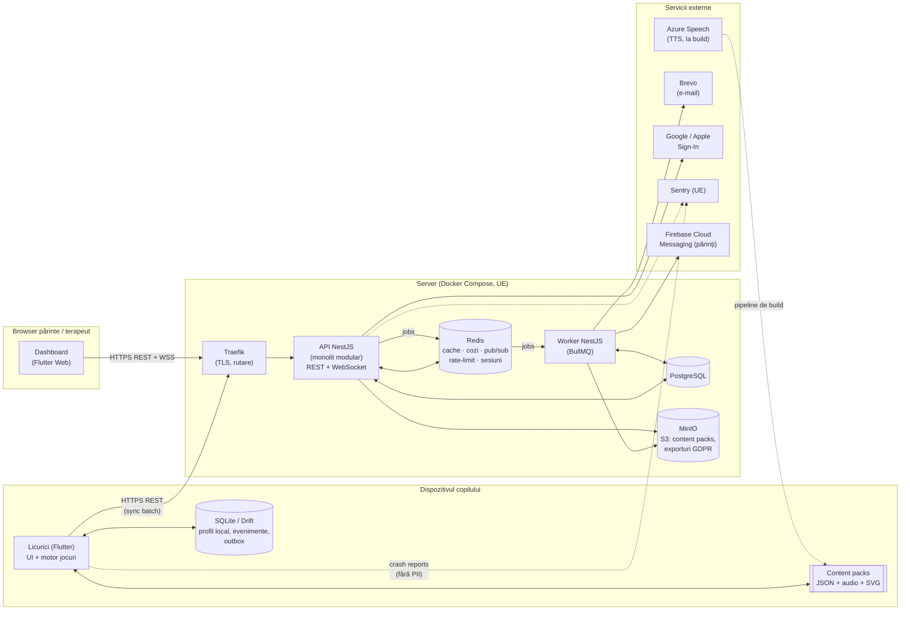

# ✨ Licurici — platformă educativă pentru copii (teză de licență)

> **Licurici** = aplicație **Flutter** pentru copii (grădiniță + clasele 1–4, curriculum Moldova/România),
> prietenoasă cu autismul, cu **~58 de jocuri educative**, care funcționează **offline** și se
> sincronizează cu un **backend dockerizat** (NestJS + PostgreSQL + Redis + BullMQ + MinIO),
> plus un **panou web pentru părinți / terapeuți**. Conform **GDPR** și **Legii RM nr. 195/2024**
> privind protecția datelor cu caracter personal.

Acest README este **sursa unică de adevăr** a proiectului: ce construim, de ce, cum, ce e gata și
ce urmează. Oricine (om sau asistent de cod) intră în repo trebuie să citească **întâi §0 și §22**.

---

## Cuprins

0. [Pe scurt — starea proiectului](#0-pe-scurt--starea-proiectului)
1. [Cerințele coordonatorului → cum le acoperim](#1-cerințele-coordonatorului--cum-le-acoperim)
2. [Viziunea produsului](#2-viziunea-produsului)
3. [Prototipul existent (Electron) — ce păstrăm](#3-prototipul-existent-electron--ce-păstrăm)
4. [Arhitectura sistemului](#4-arhitectura-sistemului)
5. [Structura repo-ului (monorepo țintă)](#5-structura-repo-ului-monorepo-țintă)
6. [Stack tehnologic](#6-stack-tehnologic)
7. [Decizii arhitecturale argumentate (ADR)](#7-decizii-arhitecturale-argumentate-adr)
8. [Mecanisme de comunicare](#8-mecanisme-de-comunicare)
9. [Pattern-uri de proiectare](#9-pattern-uri-de-proiectare)
10. [Redis — ce, unde, de ce](#10-redis--ce-unde-de-ce)
11. [Modelul de date](#11-modelul-de-date)
12. [API (schiță)](#12-api-schiță)
13. [Protecția datelor: GDPR + Legea 195/2024](#13-protecția-datelor-gdpr--legea-1952024)
14. [Design vizual (nivel AutiSpark)](#14-design-vizual-nivel-autispark)
15. [Motorul de jocuri în Flutter + animații](#15-motorul-de-jocuri-în-flutter)
16. [Catalogul de jocuri (58)](#16-catalogul-de-jocuri-58)
17. [Servicii externe](#17-servicii-externe)
18. [Docker & rulare locală](#18-docker--rulare-locală)
19. [Testare & calitate](#19-testare--calitate)
20. [Performanță & optimizare](#20-performanță--optimizare)
21. [Roadmap (Sem. 1 = 70%)](#21-roadmap-sem-1--70)
22. [Ghid de lucru în repo (convenții + Definition of Done)](#22-ghid-de-lucru-în-repo)
23. [Cercetarea pentru teză](#23-cercetarea-pentru-teză)
24. [Surse](#24-surse)

---

## 0. Pe scurt — starea proiectului

| Zonă | Stare | Note |
|------|-------|------|
| Prototip desktop (Electron, JS) | ✅ funcțional | 44 jocuri, motor de dificultate, Aventură, voce RO. **Referință** pentru portare (vezi §3). |
| Monorepo țintă (`apps/`, `backend/`, `infra/`, `docs/`) | ⬜ de creat | Pasul 0 din roadmap: mută prototipul în `legacy/electron/`. |
| Aplicația copil — Flutter | ⬜ | Android + iOS + Windows + macOS (+ web demo). |
| Panou părinte/terapeut — Flutter Web | ⬜ | |
| Backend NestJS (API + worker) | ⬜ | |
| Docker Compose (dev + prod) | ⬜ | postgres, redis, minio, api, worker, dashboard, traefik, mailpit. |
| GDPR (consimțământ, export, ștergere, documente) | ⬜ | §13. |
| Documente ADR / cercetare pentru teză | ⬜ | `docs/adr/`, `docs/research/` — §7, §23. |

**Termen:** 70% din aplicație gata la finalul semestrului 1 (**decembrie 2026**). Teza propriu-zisă — semestrul 2.

Legendă status folosită peste tot: ⬜ neînceput · 🟨 în lucru · ✅ gata · 🔁 portat din prototip.

---

## 1. Cerințele coordonatorului → cum le acoperim

| Cerință | Unde în proiect |
|---------|-----------------|
| **Git** | Monorepo, branch-uri `feat/*`, commit-uri convenționale, PR-uri (§22). |
| **Docker** | Tot backend-ul + dashboard-ul + infrastructura rulează în `docker compose` (§18). Imagini multi-stage. |
| **Redis** | Cache, sesiuni/refresh tokens, rate limiting, cozi BullMQ, pub/sub pentru WebSocket, lock-uri, idempotență (§10). |
| **Servicii externe** | Azure Speech (TTS), Sign in with Google/Apple, Brevo (e-mail), Sentry (erori), FCM (push către părinți), opțional LLM pentru rapoarte (§17). |
| **Arhitectura sistemului** — argumentată | §4 + ADR-05 (monolit modular + worker vs microservicii). |
| **Mecanisme de comunicare** | §8 + ADR-10: REST/OpenAPI, WebSocket, cozi asincrone, sync offline. |
| **Tehnologii** (limbaj, framework, DB, message broker) | §6 + ADR-01…ADR-21. |
| **Pattern-uri** | §9 (Outbox, Idempotency Key, Cache-aside, CQRS-lite, Strategy, Adapter, Circuit Breaker, Repository…). |
| **Pentru fiecare decizie:** ce am ales, de ce, alternative, de ce nu, când ar fi alese | Format fix pentru fiecare ADR (§7). Fiecare devine un fișier în `docs/adr/`. |
| **70% gata în sem. 1** | §21 — 6 sprinturi de 2 săptămâni, sep–dec 2026. |

> Regula coordonatorului: *„Tot ce va fi depunctat e o decizie neargumentată."* → **Nicio tehnologie nu intră
> în proiect fără ADR.** Dacă adaugi o dependență importantă, adaugi și ADR-ul.

---

## 2. Viziunea produsului

**Pentru cine:**
- **Copilul** (3–10 ani): grădiniță + clasele 1–4; inclusiv copii cu TSA (autism), ADHD, întârzieri de limbaj.
- **Părintele**: vede progresul, setează profilul senzorial, timpul de joc, primește raport săptămânal.
- **Terapeutul / educatorul** (opțional, invitat de părinte): vede progresul copiilor pe care îi urmărește, poate „fixa” jocuri recomandate.

**Principii non-negociabile** (moștenite din prototip, `DESIGN.md`):
1. O singură sarcină pe ecran, ținte mari (≥ 64 dp), 2→5 variante în funcție de nivel.
2. **Fără pedeapsă** la greșeală: fără X roșu, fără buzzer, fără „Greșit!". Învățare fără eroare.
3. Recompensă imediată (< 1 s). Răsplătim efortul, nu doar corectitudinea.
4. Culori calme, „modul calm” (stimulare redusă), sunet și mișcare comutabile, `reduce motion` respectat.
5. Navigație identică și fixă; „Acasă” mereu în același loc.
6. Voce naturală română pentru toate instrucțiunile (și engleză pentru materia Engleză).
7. **Offline-first**: aplicația merge complet fără internet și **fără cont**. Contul (părintelui) e opțional, doar pentru sincronizare și panou.
8. **Fără reclame, fără cumpărături în aplicație pentru copil, fără tracking, fără clasamente între copii.**

**Diferențiatori față de AutiSpark / Otsimo:** limba română + curriculum MD/RO, dificultate procedurală infinită
(conținut nerepetitiv), episoade de explorare narativă, offline complet, confidențialitate implicită.

---

## 3. Prototipul existent (Electron) — ce păstrăm

Codul actual din `src/` (va fi mutat în `legacy/electron/`) este **specificația executabilă** pentru Flutter.
Nu îl ștergem: îl folosim ca referință de comportament și conținut.

| Din prototip | Se portează în Flutter ca | Observații |
|--------------|---------------------------|------------|
| `src/difficulty.js` — `tier()`, `optionCount()`, `distractors()`, `roundCount()`, `numMax()` | `packages/licurici_core/lib/difficulty/` | Portare 1:1 + teste unitare care compară cu valorile din JS. |
| `src/engine.js` — motor „alege răspunsul”, învățare fără eroare | `ChoiceMechanic` (§15) | Păstrează opt-out `fixedChoices` / `fixedRounds`. |
| `src/dragdrop.js`, `runDragGame` | `DragDropMechanic` | Pointer events → `Draggable`/`DragTarget` sau gesturi custom. |
| `src/explore.js` + `src/scenes.js` | `ExploreEpisode` + scene ca `CustomPainter`/SVG | Fundaluri ilustrate. |
| `src/levels.js` + Aventura | `adventure/` — niveluri infinite, hartă cu lumi, stele | |
| `src/games/*.js` (44) | câte un `GameSpec` per joc (§16) | Majoritatea = date + generator, nu UI nou. |
| `src/data/*.js` | `packages/game_content/` (JSON versionat) | Conținutul devine date, nu cod → poate fi livrat și din server (content packs). |
| `src/audio-ro/*.mp3` + `manifest.js` (~430 clipuri) | `packages/game_content/audio/` | Regenerate cu Azure Speech (ADR-16). |
| `src/art/openmoji/` (SVG) | `packages/game_content/art/` | Licență **CC BY-SA 4.0** → atribuire obligatorie în „Despre”. |
| `src/music.js` (muzică generată în cod) | `flutter_soloud` / sinteză simplă sau loop-uri pre-randate | |
| `src/mascot.js` (licuriciul SVG) | Animație **Rive** (stări: idle, bucurie, încurajare, somn) | |
| `store.js` (localStorage) | Drift/SQLite local (ADR-04) | |

---

## 4. Arhitectura sistemului

**Stil:** *offline-first client* + **monolit modular** (NestJS) + **worker asincron** + infrastructură în Docker.



**Fluxuri principale:**
1. **Joc offline** — copilul joacă; fiecare răspuns devine un `GameEvent` în SQLite + în tabela `outbox`.
2. **Sincronizare** — când e internet și există cont: `POST /sync/events` în loturi, cu `Idempotency-Key`; serverul
   confirmă ID-urile; clientul șterge din outbox. Setările se sincronizează *last-write-wins* cu `updatedAt`.
3. **Statistici** — API pune job `stats.recompute(childId)` în BullMQ; worker-ul actualizează tabelele de citire
   (`child_skill_stats`) și invalidează cache-ul Redis.
4. **Live** — terapeutul/părintele deschide „Sesiune live” în dashboard; progresul apare prin WebSocket (Redis pub/sub
   permite mai multe instanțe API).
5. **GDPR** — „Descarcă datele” → job `gdpr.export` → ZIP în MinIO + link temporar pe e-mail; „Șterge contul” → job `gdpr.erase`.
6. **Conținut** — pachete de conținut versionate (`content-pack-ro-v3.zip`) servite din MinIO; aplicația are un pachet de bază inclus.

---

## 5. Structura repo-ului (monorepo țintă)

```
Licurici/
├─ README.md                  ← acest fișier (sursa de adevăr)
├─ DESIGN.md                  principii UX pentru autism (bazate pe dovezi)
├─ apps/
│  ├─ child_app/              Flutter — aplicația copilului (Android/iOS/Win/macOS/web-demo)
│  │  └─ lib/
│  │     ├─ app/              bootstrap, router (go_router), temă
│  │     ├─ features/
│  │     │  ├─ home/          ecran principal, „Jocurile de azi”, categorii
│  │     │  ├─ adventure/     hartă, niveluri infinite, stele
│  │     │  ├─ explore/       episoade narative
│  │     │  ├─ games/         câte un folder per joc (GameSpec + generator)
│  │     │  ├─ rewards/       stickere, colecție
│  │     │  ├─ parent_zone/   poartă parentală, setări, cont, consimțământ
│  │     │  └─ sync/          outbox, client API, workmanager
│  │     └─ shared/           widget-uri comune (butoane mari, carduri, mascota)
│  └─ dashboard/              Flutter Web — panou părinte/terapeut
├─ packages/
│  ├─ licurici_core/          Dart pur: dificultate, mecanici, modele, reguli (testat 100%)
│  ├─ licurici_ui/            design system: tokeni, componente, iconițe, animații
│  ├─ licurici_api_client/    client generat din OpenAPI (openapi-generator / dart)
│  └─ game_content/           conținut: JSON (RO/EN), audio mp3, SVG OpenMoji, scene
├─ backend/
│  ├─ api/                    NestJS — module: auth, users, children, consent, sync,
│  │                          stats, content, live, gdpr, health
│  ├─ worker/                 NestJS standalone — procesoare BullMQ
│  └─ prisma/                 schema + migrări (sau typeorm/drizzle — vezi ADR-07)
├─ infra/
│  ├─ docker-compose.yml      dev
│  ├─ docker-compose.prod.yml prod (traefik, TLS, fără porturi DB expuse)
│  ├─ traefik/  postgres/  redis/  minio/
│  └─ backup/                 scripturi pg_dump + rotație
├─ tools/
│  ├─ gen-voice/              generare audio (Azure Speech) din listele de replici
│  ├─ get-openmoji/           descărcare SVG-uri
│  └─ content-lint/           validare JSON conținut (schema)
├─ docs/
│  ├─ adr/                    ADR-001-flutter.md … (un fișier per decizie, §7)
│  ├─ research/               cercetări pentru teză (§23)
│  ├─ gdpr/                   politică confidențialitate, RoPA, DPIA, proceduri
│  └─ diagrams/               C4, secvență, ER (mermaid / drawio)
└─ legacy/electron/           prototipul actual (referință, nu se mai dezvoltă)
```

Unealtă monorepo Dart: **Melos** (sau *pub workspaces*, nativ din Dart 3.6). Backend: **pnpm workspaces**.

---

## 6. Stack tehnologic

| Strat | Alegere | Versiune țintă | ADR |
|-------|---------|----------------|-----|
| Aplicația copil | **Flutter** (Dart) | stable curent (3.x) | 01 |
| Jocuri cu fizică/animație intensă | **Flame** (doar unde e nevoie) | ultima | 02 |
| State management | **Riverpod** (+ `riverpod_generator`) | 2.x/3.x | 03 |
| Routing | **go_router** | | 03 |
| Stocare locală | **Drift** (SQLite) + `flutter_secure_storage` pt. token-uri | | 04 |
| Rețea | **dio** + client generat din OpenAPI | | 10 |
| Modele | **freezed** + `json_serializable` | | — |
| Audio | **just_audio** (voce), `flutter_soloud` (efecte, latență mică) | | 16 |
| Ilustrații | **flutter_svg** (OpenMoji), `CustomPainter` pentru scene | | 19 |
| Mascota + personaje animate | **Rive** (state machines) | | 21 |
| Animații UI / efecte | **flutter_animate** + animații implicite Flutter | | 21 |
| Sincronizare în fundal | **workmanager** + `connectivity_plus` | | 11 |
| Backend | **NestJS** (TypeScript) pe **Node.js 24 LTS** | 11.x | 06 |
| ORM | **Prisma** | | 07 |
| Bază de date | **PostgreSQL** | 17/18 | 07 |
| Cache / broker | **Redis** (sau Valkey — vezi ADR-08) | 8.x | 08, 09 |
| Cozi de job-uri | **BullMQ** | 5.x | 09 |
| Timp real | **Socket.IO** + `@socket.io/redis-adapter` | | 10 |
| Stocare obiecte | **MinIO** (S3-compatibil) | | 15 |
| Reverse proxy | **Traefik** (TLS Let’s Encrypt automat) | 3.x | 17 |
| Observabilitate | **pino** (loguri JSON) + **Sentry** + `/health`, opțional Prometheus + Grafana | | 18 |
| Containere | **Docker** + **Docker Compose** | | 14 |
| CI (opțional) | GitHub Actions: lint + test + build imagini | | — |

---

## 7. Decizii arhitecturale argumentate (ADR)

**Format obligatoriu** (cerința coordonatorului) — fiecare ADR devine `docs/adr/ADR-0XX-titlu.md`:

```
# ADR-0XX: <titlu>
Status: Propus | Acceptat | Înlocuit de ADR-0YY      Data: AAAA-LL-ZZ
## Context          — ce problemă rezolvăm, ce constrângeri avem
## Decizie          — ce am ales
## De ce            — argumentele (măsurabile unde se poate)
## Alternative      — ce altceva era posibil
## De ce nu         — pentru fiecare alternativă, motivul concret
## Când am alege altfel — condițiile în care alternativa devine alegerea corectă
## Consecințe       — ce câștigăm, ce plătim (trade-off-uri), riscuri
```

Mai jos, rezumatul fiecărei decizii (baza pentru fișierele ADR și pentru susținere).

### ADR-01 — Flutter pentru aplicația copilului
- **Decizie:** Flutter.
- **De ce:** un singur cod pentru Android, iOS, Windows, macOS (și web demo); randare proprie (Skia/Impeller) → **aspect identic pe toate platformele** (esențial pentru predictibilitate la copiii cu TSA); animații la 60/120 fps; hot reload → iterație rapidă pe UI; ecosistem bun pentru jocuri 2D (Flame, Rive). Cerință a proiectului.
- **Alternative:** React Native; Kotlin Multiplatform (Compose MP); Unity; nativ (Swift + Kotlin); păstrarea Electron.
- **De ce nu:** RN — UI prin componente native → diferențe vizuale între platforme, animații complexe mai costisitoare; KMP/Compose MP — iOS/desktop încă mai puțin maturi, ecosistem de joc mic; Unity — excelent pentru jocuri 3D, dar greu pentru UI de tip aplicație (formulare, setări, accesibilitate), build-uri mari, licențiere; nativ — de 2× codul; Electron — doar desktop, ~170 MB, fără mobil (unde sunt copiii).
- **Când am alege altfel:** Unity dacă jocurile devin 3D/fizică complexă; nativ dacă avem nevoie de API-uri de platformă profunde (ex. Screen Time, AAC de sistem); RN dacă echipa e deja web/React.

### ADR-02 — Widget-uri Flutter ca bază, Flame doar unde e nevoie
- **Decizie:** majoritatea jocurilor (alege, trage-și-plasează, memorie, secvențe) = widget-uri Flutter; **Flame** doar pentru jocurile cu buclă de joc (labirint, prinde obiecte, trasare cu particule).
- **De ce:** jocurile educative sunt în mare parte „UI cu reguli”; widget-urile dau accesibilitate (Semantics), layout responsiv și teste de widget gratis. Flame adaugă game loop, coliziuni, sprite-uri — util doar unde e nevoie.
- **Alternative:** totul în Flame; totul în widget-uri; Rive state machines pentru jocuri.
- **De ce nu:** totul în Flame → pierdem accesibilitatea și testarea de widget; totul în widget-uri → labirintul/fizica devin cod stângaci.
- **Când altfel:** dacă >50% din jocuri devin arcade → Flame peste tot.

### ADR-03 — Riverpod + go_router
- **Decizie:** Riverpod pentru stare și injecție de dependențe; go_router pentru navigare declarativă (deep links în dashboard web).
- **De ce:** compile-safe, testabil fără `BuildContext`, override ușor în teste (fake repository), stare asincronă (`AsyncValue`) pentru încărcări.
- **Alternative:** BLoC; Provider; GetX; setState + InheritedWidget.
- **De ce nu:** BLoC — mult boilerplate pentru ~58 de jocuri mici; Provider — predecesorul Riverpod, limitări (dependență de context); GetX — „magie” globală, greu de testat și argumentat; setState — nu scalează.
- **Când altfel:** BLoC în echipe mari care vor fluxuri eveniment→stare foarte stricte și auditabile.

### ADR-04 — Offline-first cu Drift (SQLite) local
- **Decizie:** SQLite prin Drift; datele copilului trăiesc **întâi pe dispozitiv**.
- **De ce:** copiii folosesc tablete fără internet (mașină, grădiniță); confidențialitate implicită (fără cont = nimic nu pleacă de pe dispozitiv); Drift = SQL tipizat, migrații, stream-uri reactive, funcționează pe toate platformele (web prin WASM).
- **Alternative:** Hive/Isar (NoSQL); shared_preferences; ObjectBox; Firebase Firestore offline.
- **De ce nu:** Hive/Isar — mentenanță incertă, interogări limitate pentru statistici; shared_preferences — doar chei simple; ObjectBox — licență/sincronizare comercială; Firestore — date la Google (transfer SUA, GDPR pentru copii), vendor lock-in.
- **Când altfel:** Firestore/Supabase pentru un MVP rapid fără cerințe stricte de confidențialitate.

### ADR-05 — Monolit modular + worker (nu microservicii)
- **Decizie:** un singur serviciu API NestJS împărțit în **module cu granițe clare** (auth, children, sync, stats, gdpr, content, live) + un **worker** separat pentru job-uri.
- **De ce:** o echipă de 1 persoană, domeniu mic; o singură bază de date tranzacțională; deploy simplu; modulele comunică prin interfețe/evenimente interne → pot fi extrase ulterior. Worker-ul separat izolează munca grea (rapoarte, exporturi, e-mail) de latența API-ului și scalează independent (`docker compose up --scale worker=3`).
- **Alternative:** microservicii (auth-service, stats-service…) cu API gateway; serverless (Lambda/Cloud Functions); BaaS (Firebase/Supabase).
- **De ce nu:** microservicii — complexitate operațională (N deploy-uri, tracing distribuit, consistență eventuală, date duplicate) fără beneficiu la această scară; serverless — cold starts, WebSocket dificil, vendor lock-in, greu de rulat local în Docker; BaaS — control redus asupra datelor copiilor, locația datelor.
- **Când altfel:** microservicii când echipe diferite dețin domenii diferite sau o componentă are profil de încărcare radical diferit (ex. un serviciu de recunoaștere vocală cu GPU).

### ADR-06 — NestJS (TypeScript) pentru backend
- **Decizie:** NestJS pe Node.js 24 LTS.
- **De ce:** arhitectură modulară din fabrică (module, DI, guards, interceptors, pipes) — se potrivește cu ADR-05; suport oficial pentru BullMQ, WebSocket (Socket.IO), OpenAPI (`@nestjs/swagger`), Redis, microservicii (dacă vreodată); TypeScript = tipuri stricte; I/O asincron potrivit pentru sync/WebSocket.
- **Alternative:** ASP.NET Core (C#); Spring Boot (Java/Kotlin); Go (Gin/Fiber); FastAPI/Django (Python); Dart pe server (Serverpod, Dart Frog).
- **De ce nu:** ASP.NET/Spring — excelente, dar mai verbose pentru un proiect mic și ecosistem de cozi mai greu (ar cere RabbitMQ); Go — performanță mare dar framework-uri minimaliste (DI, validare, OpenAPI de făcut manual); Python — tipare mai slabe, concurență mai puțin naturală pentru WebSocket; Dart server — un singur limbaj (plus mare), dar ecosistem mic, comunitate mică, mai greu de argumentat pentru producție.
- **Când altfel:** Serverpod dacă vrem să partajăm modelele Dart 1:1 cu Flutter; Go dacă latența/costul pe request devin critice; .NET/Spring în medii enterprise existente.

### ADR-07 — PostgreSQL (+ Prisma)
- **Decizie:** PostgreSQL; ORM Prisma cu migrări versionate.
- **De ce:** date relaționale clare (părinte → copii → sesiuni → evenimente); tranzacții ACID (consimțământ + creare profil); **JSONB** pentru payload-ul variabil al evenimentelor de joc; indexuri parțiale, partiționare pe timp pentru `game_events`; `pgcrypto` pentru criptare la nivel de coloană.
- **Alternative:** MongoDB; MySQL/MariaDB; SQLite pe server; ORM-uri: TypeORM, Drizzle, MikroORM.
- **De ce nu:** MongoDB — relațiile și rapoartele agregate devin greoaie, tranzacțiile multi-document sunt adăugate târziu; MySQL — JSON mai slab, fără indexuri parțiale; SQLite server — un singur scriitor. TypeORM — bug-uri istorice, tipare slabe; Drizzle — foarte bun, dar mai tânăr (alternativă validă).
- **Când altfel:** Mongo pentru conținut foarte eterogen fără relații; TimescaleDB (extensie Postgres) dacă evenimentele cresc la sute de milioane.

### ADR-08 — Redis: roluri multiple, licență
- **Decizie:** Redis 8 (sau **Valkey**, fork BSD compatibil) pentru: cache, sesiuni/refresh tokens, rate limiting, cozi (BullMQ), pub/sub (WebSocket), lock-uri, idempotență. Detalii în §10.
- **De ce:** în memorie → latență sub-milisecundă; structuri de date bogate (hash, sorted set, streams); o singură piesă de infrastructură acoperă 6 nevoi → mai puține componente de operat.
- **Alternative:** Memcached; cache în proces (LRU); Postgres pentru tot (LISTEN/NOTIFY, `SKIP LOCKED` pentru cozi); KeyDB/Dragonfly.
- **De ce nu:** Memcached — doar cheie-valoare, fără persistență, fără pub/sub/streams; cache în proces — nu se partajează între instanțe; Postgres-pentru-tot — funcționează la scară mică, dar încarcă baza tranzacțională cu trafic efemer; Dragonfly — licență BSL.
- **Când altfel:** Postgres-only pentru un MVP minimal; Valkey dacă licența AGPL/RSAL a Redis 8 e o problemă pentru distribuire comercială (API-ul e identic → schimbare de imagine Docker).

### ADR-09 — Message broker: BullMQ peste Redis
- **Decizie:** **BullMQ** (cozi de job-uri peste Redis Streams/liste) pentru comunicarea asincronă API → worker.
- **De ce:** avem nevoie de **job queue** (task-uri cu retry, backoff exponențial, prioritate, întârziere, job-uri programate, dead-letter), nu de un bus de evenimente pentru zeci de servicii; refolosește Redis (deja cerut); dashboard de monitorizare (Bull Board); integrare oficială NestJS.
- **Alternative:** RabbitMQ; Apache Kafka; NATS / JetStream; Redis Streams „brut”; Postgres (pg-boss).
- **De ce nu:** RabbitMQ — rutare puternică (exchanges, topic), dar încă o componentă de operat pentru un singur consumator; Kafka — log distribuit pentru debit foarte mare și event sourcing, supradimensionat (ZooKeeper/KRaft, partiții) pentru câteva mii de evenimente/zi; NATS — excelent pentru microservicii, dar semantica de job (retry/backoff/programare) trebuie construită; Redis Streams brut — reinventăm ce oferă BullMQ; pg-boss — bun, dar încarcă Postgres.
- **Când altfel:** RabbitMQ când apar consumatori în alte limbaje sau rutare complexă; Kafka când trebuie reluat istoricul evenimentelor (event sourcing, analytics la scară); NATS în arhitectură de microservicii.
- **Cozi definite:** `stats` (recalcul statistici), `mail` (e-mailuri), `reports` (raport săptămânal, cron), `gdpr` (export/ștergere), `content` (construire pachete), `push` (notificări părinți).

### ADR-10 — Comunicare: REST + OpenAPI, WebSocket, cozi
- Vezi §8 pentru detalii. **De ce nu GraphQL:** clientul copilului face aproape doar sync în lot; GraphQL adaugă complexitate (N+1, caching) fără beneficiu. **De ce nu gRPC:** suport slab în browser (dashboard web), debugging mai greu; ar avea sens între microservicii interne.
- **Când altfel:** GraphQL dacă dashboard-ul ar avea multe ecrane cu nevoi de date foarte diferite; gRPC pentru servicii interne cu latență critică.

### ADR-11 — Sincronizare: jurnal de evenimente append-only + Outbox + Idempotency Key
- **Decizie:** rezultatele de joc sunt **evenimente imuabile** (UUIDv7 generat pe client) → nu există conflicte de scriere. Setările/profilul → *last-write-wins* pe câmp cu `updatedAt`.
- **De ce:** cel mai simplu model corect pentru offline; reîncercările sunt sigure (serverul ignoră ID-urile deja primite); UUIDv7 e ordonabil în timp → indexuri eficiente.
- **Alternative:** CRDT-uri; sincronizare de stare completă (snapshot); soluții gata (PowerSync, ElectricSQL, Firebase).
- **De ce nu:** CRDT — util pentru editare colaborativă, aici nu există editare concurentă a aceluiași obiect; snapshot — pierde istoricul, trafic mare; soluții gata — dependență externă, locația datelor.
- **Când altfel:** CRDT dacă părintele și terapeutul ar edita simultan același plan de lucru.

### ADR-12 — Autentificare: doar părinții au conturi
- **Decizie:** conturile sunt ale **adulților** (e-mail + parolă Argon2id, sau Google/Apple Sign-In). Copilul are un **profil** (poreclă + avatar), fără credențiale, fără e-mail. Access token JWT scurt (15 min) + refresh token opac, rotit, stocat în Redis (revocare imediată). **Poartă parentală** în aplicație (ex. „ține apăsat 3 s” + întrebare pentru adulți) pentru zona de setări/cont.
- **De ce:** minimizarea datelor copilului (GDPR art. 5, 8, 25); consimțământul trebuie dat de părinte sub 14 ani (Legea 195/2024); cerințele Google Play Families și Apple Kids (poartă parentală înainte de link-uri externe/cumpărături).
- **Alternative:** conturi pentru copii; sesiuni server clasice (cookie); Auth-as-a-service (Auth0, Firebase Auth, Keycloak).
- **De ce nu:** conturi copii — date în plus fără beneficiu; sesiuni cookie — mai puțin potrivite pentru aplicația mobilă; Auth0/Firebase — date în SUA, cost; Keycloak — foarte bun dar greu (JVM, configurare) pentru un proiect mic.
- **Când altfel:** Keycloak dacă apar instituții (grădinițe) cu SSO propriu.

### ADR-13 — Dashboard în Flutter Web
- **Decizie:** panoul părinte/terapeut în Flutter Web.
- **De ce:** refolosim `licurici_ui`, `licurici_core`, modelele și clientul API; un singur limbaj; grafice cu `fl_chart`.
- **Alternative:** React/Next.js; Angular; Vue.
- **De ce nu:** ar dubla modelele, componentele și testele; SEO nu contează (panou autentificat).
- **Când altfel:** React/Next dacă panoul devine un site public cu SEO sau o echipă web separată îl dezvoltă. Dezavantaj asumat: bundle inițial mai mare (~2 MB) → mitigat prin caching și `--wasm`.

### ADR-14 — Docker Compose (nu Kubernetes)
- **Decizie:** Docker pentru toate serviciile; Compose pentru dev și prod (un VPS).
- **De ce:** mediu reproductibil („la mine merge” dispare), onboarding cu o comandă, paritate dev/prod, imagini multi-stage mici (Node alpine/distroless).
- **Alternative:** Kubernetes (k3s); PaaS (Render, Fly.io, Railway); instalare directă pe VM.
- **De ce nu:** K8s — supradimensionat pentru un nod; PaaS — cost, date în afara controlului; instalare directă — nereproductibil.
- **Când altfel:** k3s/K8s când avem nevoie de auto-scalare pe mai multe noduri sau zero-downtime la scară.

### ADR-15 — MinIO (S3) pentru conținut și exporturi
- **Decizie:** fișierele mari (pachete de conținut, audio, exporturi GDPR) stau în MinIO, servite prin URL-uri pre-semnate cu expirare.
- **De ce:** API S3 standard → migrare ușoară la orice cloud; nu încărcăm Postgres cu blob-uri; link-uri temporare = securitate pentru exporturi.
- **Alternative:** sistem de fișiere local; AWS S3 / Cloudflare R2; Postgres `bytea`.
- **Când altfel:** R2/S3 în producție la scară (CDN, durabilitate), cu regiune UE.

### ADR-16 — Voce: TTS neural pre-generat la build (Azure Speech)
- **Decizie:** replicile se generează **la build** cu Azure AI Speech (voce `ro-RO-AlinaNeural`, `en-US-JennyNeural`) și se livrează ca MP3/OGG în pachetele de conținut. Replicile dinamice (ex. numele copilului) se compun din fragmente.
- **De ce:** voce naturală fără internet; **nicio dată a copilului nu pleacă spre un serviciu extern la rulare**; cost ~0 (nivelul gratuit acoperă generarea). Prototipul folosea `edge-tts` (endpoint neoficial) — pentru un produs/teză folosim API-ul oficial, cu cheie și termeni clari.
- **Alternative:** TTS de pe dispozitiv (`flutter_tts`); TTS în cloud la rulare; înregistrări cu actor.
- **De ce nu:** TTS dispozitiv — vocile românești lipsesc sau sună robotic pe multe dispozitive; cloud la rulare — necesită internet + trimite text (posibil numele copilului) la terți; actor — cost, greu de extins.
- **Când altfel:** TTS on-device neural (ex. modele Piper) dacă devine suficient de bun în română → elimină complet serviciul extern.

### ADR-17 — Traefik ca reverse proxy
- **Decizie:** Traefik (TLS automat Let’s Encrypt, rutare pe etichete Docker, rate limit de bază, headere de securitate).
- **Alternative:** Nginx; Caddy; HAProxy.
- **De ce nu:** Nginx — configurare manuală a certificatelor/rutelor; Caddy — la fel de valid (mai simplu), Traefik câștigă prin descoperirea automată a containerelor.
- **Când altfel:** Nginx pentru control fin/performanță la fișiere statice mari.

### ADR-18 — Observabilitate
- **Decizie:** loguri JSON structurate (pino) cu `requestId`, **fără PII**; Sentry (regiune UE, scrubbing PII) pentru erori; endpoint `/health` (liveness/readiness pentru Postgres, Redis, MinIO); Bull Board pentru cozi; opțional Prometheus + Grafana (metrici HTTP, lungimea cozilor).
- **Alternative:** ELK/Loki stack complet; OpenTelemetry + Jaeger; nimic.
- **Când altfel:** OpenTelemetry + tracing distribuit dacă trecem la microservicii.

### ADR-19 — Jocuri ca date + mecanici reutilizabile
- **Decizie:** fiecare joc = `GameSpec` (metadate + generator de runde) peste un număr mic de **mecanici** (§15). Conținutul (cuvinte, imagini, audio) = JSON versionat în `game_content`.
- **De ce:** 58 de jocuri peste ~9 mecanici → UI/accesibilitate/recompense scrise o singură dată; conținutul poate fi actualizat fără release în magazin (content packs); testare pe generator (pur Dart).
- **Alternative:** fiecare joc scris de la zero; un DSL/scripting (Lua); jocuri web încapsulate (WebView).
- **Când altfel:** jocuri scrise individual doar pentru cele cu mecanici unice (labirint, colorare).

### ADR-20 — Găzduire în UE
- **Decizie:** VPS în UE (ex. Hetzner, Germania) sau furnizor din RM; backup-uri criptate în altă locație UE.
- **De ce:** Legea 195/2024 și GDPR permit liber transferul către SEE; evităm transferuri în SUA pentru datele copiilor.
- **Când altfel:** găzduire în RM dacă o instituție publică (ex. minister) o cere.

### ADR-21 — Animații: Rive + flutter_animate + Flame (strat pe strat)
- **Decizie:** Rive pentru personaje și obiecte cu stări (mascota, emoții, ceas); `flutter_animate` și animațiile implicite pentru efectele de UI; Flame doar pentru jocurile cu buclă (ADR-02). Toate trec prin `MotionPolicy`, ca modul calm să funcționeze peste tot.
- **De ce:** Rive are **state machines** (idle → bucurie → încurajare, controlate din cod), fișiere mici (zeci de KB) și randare vectorială clară la orice rezoluție. `flutter_animate` înlocuiește sute de `AnimationController` cu cod declarativ scurt.
- **Alternative:** Lottie; sprite sheets (PNG); doar animații Flutter scrise manual; Spine.
- **De ce nu:** Lottie redă doar „filme” After Effects, fără state machine interactivă, și are fișiere mai mari. Sprite sheets sunt grele în MB și se pixelizează pe tablete mari. Animațiile manuale înseamnă mult cod repetitiv. Spine e licență comercială, gândit pentru jocuri.
- **Când altfel:** Lottie dacă primim animații gata făcute de la un designer în After Effects; sprite sheets pentru stil pixel-art.
- **Consecințe:** trebuie învățat editorul Rive (gratuit pentru uz individual). Animațiile personajelor sunt active separate și se versionează în `game_content`.

---

## 8. Mecanisme de comunicare

| Canal | Între | Protocol | Sincron? | De ce acesta |
|-------|-------|----------|----------|--------------|
| **REST + JSON** (OpenAPI 3.1) | App copil ↔ API; Dashboard ↔ API | HTTPS | sincron | Simplu, cacheabil, client generat automat pentru Dart, ușor de testat (curl/Postman). |
| **Sync în lot** | App copil → API | `POST /sync/events` (max 500 ev./lot, gzip) | sincron, dar tolerant la eșec | Un singur request în loc de sute; idempotent. |
| **WebSocket** (Socket.IO) | API → Dashboard | WSS | asincron, push | Sesiune live, notificări în timp real; Socket.IO = reconectare automată + rooms (`child:{id}`). |
| **Redis Pub/Sub** | API ↔ API (instanțe) | Redis | asincron | Adapterul Socket.IO distribuie evenimentele pe toate instanțele. |
| **Cozi BullMQ** | API → Worker | Redis | asincron, *at-least-once* | Muncă grea în afara ciclului request/response; retry + backoff; job-urile trebuie să fie **idempotente**. |
| **Cron (repeatable jobs)** | Worker | BullMQ | programat | Raport săptămânal (duminică 18:00), curățare date expirate (zilnic), backup. |
| **Webhook-uri / HTTP externe** | Worker → Brevo, FCM | HTTPS | asincron | Prin Adapter + Circuit Breaker + retry. |
| **Evenimente interne de domeniu** | Modul ↔ modul în API | `@nestjs/event-emitter` | în proces | Decuplare între module fără broker (ex. `ChildDeleted` → gdpr, stats). |

**Garanții și erori:** timeout 10 s la HTTP extern; retry exponențial (1s, 4s, 16s…, max 5); după eșec final → coadă *failed* + alertă Sentry. Clientul copilului: backoff exponențial cu jitter pentru sync; nimic nu blochează jocul.

---

## 9. Pattern-uri de proiectare

| Pattern | Unde | De ce e necesar / ce optimizează |
|---------|------|----------------------------------|
| **Transactional Outbox** | Client (tabela `outbox` în SQLite); server (tabela `outbox` → publicare job) | Nu pierdem evenimente dacă aplicația se închide sau rețeaua cade; pe server, job-ul se publică doar dacă tranzacția DB a reușit. |
| **Idempotency Key** | `POST /sync/events`, `POST /gdpr/*` | Retry-urile nu dublează datele. Cheie în Redis cu TTL 24h. |
| **Cache-aside** | Catalog jocuri, manifest conținut, statistici dashboard | Citiri rapide; invalidare explicită după recalcul. |
| **CQRS-lite (read models)** | `game_events` (scriere) → `child_skill_stats` (citire), calculate de worker | Dashboard-ul nu agregă milioane de rânduri la fiecare vizită. |
| **Strategy** | Mecanicile de joc; strategiile de dificultate; providerii de e-mail/TTS | Schimbăm comportamentul fără `if`-uri mari. |
| **Template Method** | `GameMechanic` (intro → runde → feedback → final) | Toate jocurile respectă aceeași structură predictibilă (TEACCH). |
| **Registry / Factory** | `GameRegistry` (ca `registry.js` din prototip) | Adăugarea unui joc = o intrare; meniul se construiește singur. |
| **Repository** | Flutter (Drift/API); NestJS (Prisma) | Logica nu depinde de sursa datelor; fake-uri în teste. |
| **Adapter** | `MailProvider`, `PushProvider`, `SpeechProvider`, `StorageProvider` | Schimbăm Brevo cu alt furnizor fără să atingem domeniul. |
| **Circuit Breaker** | Apeluri externe (Brevo, FCM, OAuth) | Un serviciu extern căzut nu blochează API-ul. |
| **Retry + Exponential Backoff + Jitter** | Sync client, job-uri | Rezistență la erori tranzitorii fără furtună de reîncercări. |
| **Rate Limiter (token bucket / sliding window)** | Login, sync, export GDPR — în Redis | Protecție brute-force / abuz. |
| **Distributed Lock** | Recalcul statistici per copil, cron-uri | Evită două worker-e pe același copil. |
| **Observer / Streams** | Riverpod, Drift streams | UI reactiv la schimbări de date. |
| **Unit of Work** | Tranzacții Prisma (consimțământ + profil) | Consistență. |
| **Feature Flags** | Tabel `feature_flags` + cache Redis | Activăm jocuri/funcții treptat. |
| **Soft delete + purge job** | Ștergere cont → marcare → ștergere definitivă după 30 zile | Permite anularea greșelilor și respectă termenul GDPR. |

---

## 10. Redis — ce, unde, de ce

| Utilizare | Chei / structură | TTL | Motiv |
|-----------|------------------|-----|-------|
| Refresh tokens (sesiuni) | `rt:{tokenHash}` → hash `{userId, deviceId, family}` | 30 zile | Revocare instantă, detectarea reutilizării (rotire pe familie). |
| Deny-list access tokens | `jwt:deny:{jti}` | = durata rămasă a tokenului | Logout imediat. |
| Rate limiting | `rl:{route}:{ip\|userId}` (sorted set / sliding window) | fereastra | Brute force login, abuz sync. |
| Idempotență | `idem:{key}` → răspunsul salvat | 24 h | Retry sigur. |
| Cache catalog/conținut | `cache:catalog:{locale}:{ver}` | 1 h / invalidare | Citit la fiecare pornire. |
| Cache statistici | `cache:stats:{childId}` | 10 min / invalidare la recalcul | Dashboard rapid. |
| „Jocurile de azi” | `today:{childId}:{date}` (listă) | până la miezul nopții | 5 jocuri zilnice (stil AutiSpark), calculate o dată. |
| Cozi BullMQ | `bull:{queue}:*` | gestionat de BullMQ | Job-uri asincrone. |
| Pub/Sub WebSocket | canale `socket.io#/*` | — | Scalare orizontală API. |
| Prezență live | `live:{childId}` (hash) | 60 s, reîmprospătat | „Copilul joacă acum”. |
| Lock-uri | `lock:stats:{childId}` (SET NX PX) | 30 s | Un singur recalcul simultan. |
| Coduri de invitație terapeut | `invite:{code}` | 72 h | Legare părinte → terapeut. |

**Configurare:** `maxmemory-policy noeviction` pentru instanța cu cozi (BullMQ o cere); AOF activat (persistență job-uri); parolă + ACL; **nu se expune în afara rețelei Docker**. Dacă vrem cache cu evicție LRU → a doua instanță Redis dedicată cache-ului (decizie documentată).

**Nu stocăm în Redis** date personale în clar pe termen lung — doar ID-uri și date efemere.

---

## 11. Modelul de date

```mermaid
erDiagram
  USER ||--o{ CHILD : "are (părinte)"
  USER ||--o{ CONSENT : "dă"
  USER ||--o{ DEVICE : "înregistrează"
  CHILD ||--o{ GAME_SESSION : joacă
  GAME_SESSION ||--o{ GAME_EVENT : conține
  CHILD ||--o{ CHILD_SKILL_STATS : "agregat"
  CHILD ||--|| CHILD_SETTINGS : "profil senzorial"
  CHILD ||--o{ ADVENTURE_PROGRESS : "stele/niveluri"
  CHILD ||--o{ CARE_LINK : "partajat cu"
  USER ||--o{ CARE_LINK : "terapeut"
  USER ||--o{ AUDIT_LOG : "acțiuni"

  USER { uuid id; string email; string passwordHash; string role; string locale; timestamptz deletedAt }
  CHILD { uuid id; uuid parentId; string nickname; string avatar; smallint birthYear; string grade }
  CONSENT { uuid id; uuid userId; string purpose; string policyVersion; bool granted; timestamptz at; inet ipHash }
  CHILD_SETTINGS { uuid childId; bool calmMode; float musicVol; float sfxVol; float voiceVol; bool reduceMotion; jsonb extra; timestamptz updatedAt }
  GAME_SESSION { uuid id; uuid childId; string gameId; int tier; timestamptz startedAt; int durationSec; int stars }
  GAME_EVENT { uuid id; uuid sessionId; string type; jsonb payload; timestamptz at }
  CHILD_SKILL_STATS { uuid childId; string skill; float accuracy; int attempts; timestamptz lastPlayed }
  CARE_LINK { uuid childId; uuid therapistId; string scope; timestamptz expiresAt }
```

- `CHILD` **nu** are nume real, dată de naștere completă, fotografie, școală sau diagnostic (vezi §13).
- `GAME_EVENT.payload` = ce s-a întrebat, ce a ales, câte încercări, timp de răspuns — **fără text liber**.
- `game_events` partiționat lunar; retenție 24 luni (job de curățare).

---

## 12. API (schiță)

Prefix `/api/v1`. Documentație automată: `/api/docs` (Swagger UI, doar în dev).

| Metodă | Rută | Descriere |
|--------|------|-----------|
| POST | `/auth/register` | Cont părinte (e-mail + parolă) + consimțăminte obligatorii |
| POST | `/auth/login` · `/auth/refresh` · `/auth/logout` | JWT + refresh rotit |
| POST | `/auth/oauth/{google\|apple}` | Sign-In extern |
| POST | `/auth/verify-email` · `/auth/forgot` · `/auth/reset` | |
| GET/POST/PATCH/DELETE | `/children` · `/children/{id}` | Profiluri copii (doar ale părintelui) |
| PUT | `/children/{id}/settings` | Profil senzorial (LWW) |
| POST | `/sync/events` | Lot de evenimente (Idempotency-Key) |
| GET | `/sync/state?since=` | Setări + progres Aventură modificate după `since` |
| GET | `/children/{id}/stats?from&to` | Statistici pe abilități (read model) |
| GET | `/children/{id}/today` | Jocurile de azi |
| GET | `/content/manifest` | Versiuni pachete conținut + URL-uri pre-semnate |
| POST | `/care-links/invite` · `/care-links/accept` | Partajare cu terapeut |
| GET/POST | `/consents` | Istoric + retragere consimțământ |
| POST | `/gdpr/export` | Export date (job → e-mail cu link 7 zile) |
| DELETE | `/me` | Ștergere cont (soft → purge 30 zile) |
| GET | `/health` · `/health/ready` | Liveness / readiness |
| WS | `/live` (rooms `child:{id}`) | Sesiune live, notificări |

Erori în format **RFC 9457 (Problem Details)**. Validare cu `class-validator`. Versionare în URL.

---

## 13. Protecția datelor: GDPR + Legea 195/2024

### 13.1 Cadrul legal aplicabil
| Act | Aplicabilitate |
|-----|----------------|
| **Legea RM nr. 195/2024** privind protecția datelor cu caracter personal — **în vigoare din 23.08.2026** (înlocuiește Legea 133/2011) | Operator/utilizatori în Republica Moldova. Transpune substanțial GDPR. |
| **Regulamentul (UE) 2016/679 (GDPR)** | Utilizatori din România/UE (art. 3 — ofertă de servicii către persoane din UE). |
| Autoritatea de supraveghere RM | **CNPDCP** — Centrul Național pentru Protecția Datelor cu Caracter Personal (datepersonale.md). |
| Autoritatea RO | ANSPDCP (dacă avem utilizatori în România). |
| Politici magazine | Google Play **Families Policy** (inclusiv doar SDK-uri auto-certificate pentru familii), Apple **Kids Category** (fără tracking, fără reclame terțe, poartă parentală). |

Puncte-cheie din Legea 195/2024 relevante pentru noi:
- **Vârsta consimțământului digital = 14 ani.** Sub 14 ani (toți utilizatorii noștri), consimțământul îl dă **reprezentantul legal**. Operatorul face „eforturi rezonabile” să verifice că e dat de părinte.
- Consimțământ activ, specific, separat pe scopuri; fără căsuțe pre-bifate; retragere la fel de ușoară ca acordarea.
- Drepturile persoanei: acces, rectificare, ștergere, restricționare, opoziție, portabilitate — răspuns în **1 lună** (prelungibil cu 2).
- Încălcarea securității → notificare la CNPDCP în **72 de ore**; persoanele vizate — dacă riscul e ridicat.
- Registrul/notificarea către autoritate a fost înlocuit de **responsabilizare** (evidențe interne: registrul activităților de prelucrare, DPIA etc.).
- Transferuri către SEE fără autorizare; către alte state — clauze contractuale standard sau garanții echivalente.
- Amenzi până la 2 000 000 lei sau 2% din cifra de afaceri (introduse gradual).

> ⚠️ Nu suntem juriști. Documentele finale (politica de confidențialitate, DPIA) trebuie verificate pe textul oficial
> (legis.md, LP195/2024) și, ideal, de un specialist. Această secțiune e planul tehnic de conformare.

### 13.2 Roluri
- **Operator:** autorul aplicației (persoană fizică/juridică ce publică Licurici).
- **Persoane împuternicite (procesatori):** furnizorul VPS, Brevo, Sentry, Google (FCM/Sign-In), Apple (Sign-In), Microsoft (Azure Speech — **nu primește date personale**, doar texte fixe la build). Cu fiecare: DPA (acord de prelucrare) semnat/acceptat.
- **Terapeutul** invitat: primește acces doar la copiii pentru care părintele a dat acces explicit, cu scop și expirare.

### 13.3 Inventarul datelor (minimizare)

| Date | Persoana | Scop | Temei legal | Retenție |
|------|----------|------|-------------|----------|
| E-mail, hash parolă | Părinte | Cont, autentificare | Contract | Cât există contul |
| Consimțăminte (scop, versiune politică, dată, hash IP) | Părinte | Dovada consimțământului | Obligație legală | Durata contului + 3 ani |
| Poreclă, avatar, anul nașterii, clasa | Copil | Adaptarea conținutului | Consimțământ parental | Cât există profilul |
| Setări senzoriale, volum, modul calm | Copil | Personalizare | Consimțământ parental | Cât există profilul |
| Evenimente de joc, progres | Copil | Progres, dificultate adaptivă, raport pentru părinte | Consimțământ parental | 24 luni rulant |
| Token dispozitiv FCM | Părinte | Notificări | Consimțământ (opțional) | Până la dezactivare |
| Loguri tehnice (fără PII, IP trunchiat) | — | Securitate | Interes legitim | 30 zile |
| Rapoarte de eroare (Sentry, fără PII) | — | Stabilitate | Interes legitim | 90 zile |

**Ce NU colectăm, prin design:** numele real al copilului, data completă a nașterii, fotografii, înregistrări
audio/video ale copilului, locație, contacte, identificatori de publicitate, **diagnostic medical** (autismul
este o dată privind sănătatea — categorie specială; aplicația oferă „modul calm” și setări senzoriale **fără**
să întrebe de diagnostic). Fără SDK-uri de analytics/reclame în aplicația copilului.

### 13.4 Confidențialitate prin design și implicit (implementare)
- [ ] **Mod fără cont** implicit: totul local, zero trafic de rețea (în afară de descărcarea opțională de conținut).
- [ ] Ecran de consimțământ parental (după poarta parentală): scopuri separate (sincronizare, raport pe e-mail, partajare cu terapeut, notificări), fiecare comutabil.
- [ ] Verificarea e-mailului părintelui înainte de activarea sincronizării (efort rezonabil de verificare).
- [ ] Politica de confidențialitate: versiune pentru părinți + **versiune pentru copii** (limbaj simplu, cu imagini), în RO/EN; versionată; re-consimțământ la schimbări majore.
- [ ] „Datele mele” în zona părintelui: vizualizare, export (JSON + CSV într-un ZIP), ștergere profil copil, ștergere cont, retragere consimțământ.
- [ ] Ștergere: soft-delete imediat (acces blocat) → purge definitiv în ≤ 30 zile (job) → backup-urile expiră în ≤ 35 zile (rotație).
- [ ] Criptare: TLS 1.2+ peste tot; volum DB criptat pe server; câmpuri sensibile (e-mail) criptate cu `pgcrypto` + hash pentru căutare; SQLite local criptat (SQLCipher) opțional; token-uri în `flutter_secure_storage`.
- [ ] Pseudonimizare: statisticile folosesc `childId` (UUID); rapoartele către LLM/terți (dacă există) — doar agregate, fără poreclă.
- [ ] Control acces: fiecare interogare filtrată pe `parentId` (guard NestJS + teste); terapeutul doar prin `CARE_LINK` activ; jurnal de audit pentru accesările terapeutului.
- [ ] Parole Argon2id; rate limiting; blocare temporară după încercări eșuate; 2FA opțional pentru terapeuți.
- [ ] Fără link-uri externe/cumpărături în zona copilului; orice link extern trece prin poarta parentală.
- [ ] Sentry: `sendDefaultPii=false`, scrubbing pe server, regiune UE.

### 13.5 Documente de produs (în `docs/gdpr/`)
- [ ] `politica-confidentialitate.md` (+ versiunea pentru copii)
- [ ] `termeni.md`
- [ ] `registrul-activitatilor-de-prelucrare.md` (RoPA)
- [ ] `dpia.md` — **evaluarea impactului** (recomandată: date ale copiilor = persoane vulnerabile + tehnologie nouă + monitorizarea progresului)
- [ ] `procedura-incident.md` — detectare → evaluare → notificare CNPDCP în 72 h → notificare părinți dacă risc ridicat → registru incidente
- [ ] `procedura-drepturi.md` — cum răspundem în ≤ 1 lună
- [ ] `lista-imputerniciti.md` — procesatori, țară, DPA, garanții de transfer
- [ ] `politica-retentie.md`
- [ ] Declarațiile *Data safety* (Google Play) și *Privacy Nutrition Label* (App Store)

### 13.6 Etica în testarea cu copii (pentru teză)
Testele de utilizabilitate cu copii se fac **doar** cu acordul scris al părinților, anonimizat, fără înregistrări
video ale feței, cu drept de retragere oricând. Se documentează în teză.

---

## 14. Design vizual (nivel AutiSpark)

Ținta: aspect **la fel de îngrijit și prietenos ca AutiSpark** (carduri mari ilustrate, personaje simpatice,
culori vesele dar calme), **fără a copia** grafica, numele sau brandul lor — doar ca referință de calitate.

**Ce preluăm ca idei (dovedit util):**
- Ecran principal cu **„Jocurile de azi”** (5 jocuri alese zilnic) + **„Explorează”** (categorii mari ilustrate).
- ~16 categorii cu carduri mari: Sortare & potrivire, Litere & cuvinte, Numere, Trasare, Memorie, Puzzle, Da/Nu, Direcția privirii, Activități zilnice, Emoții, Sunete…
- Recompense: stickere/colecție, mascota care se bucură, confetti (dezactivabile).
- Zona părintelui încuiată (poartă parentală), rapoarte simple.

**Design system (`packages/licurici_ui`):**
- **Tokeni:** culori pe materii (8), neutre calde, un singur „verde = corect”; spațiere pe grilă de 8; raze mari (24–32 dp); umbre moi.
- **Tipografie:** Fredoka (titluri, rotunjit) + Nunito/Andika (text, lizibil pentru cititori începători); ≥ 20 sp pentru copil; interlinie 1.5.
- **Componente:** `BigChoiceCard`, `SubjectTile`, `GameTile`, `MascotBubble` (Rive), `StarBar`, `ParentGate`, `CalmToggle`, `RoundProgressDots`, `DropZone`, `TraceCanvas`.
- **Teme:** Normal · Calm (saturație redusă, fără animații de fundal) · Contrast ridicat · Întunecat.
- **Animații:** implicite (AnimatedScale, Hero), 200–400 ms, curbe `easeOutBack` blânde; totul oprit la `reduceMotion`.
- **Accesibilitate:** `Semantics` pe fiecare țintă, contrast AA, ținte ≥ 64 dp, suport TalkBack/VoiceOver în zona părintelui, niciodată doar culoarea ca informație (icon + text + voce).
- **Ilustrații:** OpenMoji (CC BY-SA 4.0, atribuire în „Despre”) + scene desenate în cod; mascota Licurici în Rive.
- **Responsiv:** telefon portret/landscape, tabletă (principal), desktop; layout-uri adaptive pe `LayoutBuilder`.

---

## 15. Motorul de jocuri în Flutter

```dart
// packages/licurici_core — Dart pur, fără Flutter (testabil rapid)
abstract class GameSpec {
  String get id;                 // 'adunam'
  Subject get subject;           // Subject.matematica
  Set<Grade> get grades;         // {clasa1, clasa2, clasa3}
  Mechanic get mechanic;         // Mechanic.choice
  Set<Skill> get skills;         // pentru statistici
  List<Round> generate(GameContext ctx);   // folosește Difficulty(ctx.tier)
}

enum Mechanic { choice, dragDrop, memoryCards, sequence, trace, puzzle, maze, freePlay, explore }
```

| Mecanică | Descriere | Jocuri (exemple) |
|----------|-----------|------------------|
| `choice` | Alege răspunsul (2→5 variante, învățare fără eroare) — port `engine.js` | alfabetul, adunam, emotii, culori… |
| `dragDrop` | Trage și plasează în zone (sortare, potrivire, grupare) — port `dragdrop.js` | sortare, grupam, habitate, umbre |
| `memoryCards` | Cărți întoarse, perechi | perechi |
| `sequence` | Ordonează pași / repetă secvența (Simon) | secventa, memorie, ordonam |
| `trace` | Trasare cu degetul pe traseu ghidat | trasare-litere, trasare-cifre |
| `puzzle` | Piese de puzzle (jigsaw simplu 2→9 piese) | puzzle |
| `maze` | Labirint (Flame) | labirint |
| `freePlay` | Fără corect/greșit | colorare, respira, comunicare (AAC) |
| `explore` | Episod narativ cu hartă + opriri | explorare-* |

**Dificultate:** `Difficulty(tier)` portat din `difficulty.js`: `optionCount` 2→5, `roundCount` 5→8, `numMax`,
`distractors`. Aventura: tier nemărginit (+1 la 4 niveluri). Joc liber: tier din clasă + ușor/mediu.
**Adaptiv (nou):** dacă acuratețea pe o abilitate < 60% pe ultimele 20 de încercări → tier −1; > 90% → +1 (regula stă în `licurici_core`, testată).

**Fluxul unei runde (Template Method):** instrucțiune vocală → afișare → răspuns → feedback imediat
(corect: recompensă < 1 s; greșit: indiciu neutru, estompare distractori) → următoarea → final cu stele.

### 15.1 Animații și interactivitate

Jocurile nu sunt „carduri statice”: fiecare obiect reacționează la atingere, lumea din jocul respectiv e vie,
iar mascota participă. Totuși, animația **servește învățarea** și nu trebuie să distragă atenția. Totul se reduce automat în modul calm.

**Unelte:**
| Unealtă | Pentru ce |
|---------|-----------|
| `flutter_animate` | Efecte declarative pe widget-uri: apariție, săritură, tremur blând, strălucire, înlănțuiri (`.animate().scale().then().shake()`) |
| Animații implicite Flutter (`AnimatedScale`, `AnimatedSlide`, `Hero`, `TweenAnimationBuilder`) | Tranziții între stări, fără cod suplimentar |
| **Rive** (state machines) | Mascota Licurici și personajele din jocuri: idle, privește spre răspuns, bucurie, încurajare, somn; obiecte animate (floare care crește, ceas cu ace) |
| `CustomPainter` + `AnimationController` | Scene desenate în cod (fundaluri cu nori care plutesc, apă, iarbă în vânt), trasee de trasare |
| **Flame** (+ `flame_forge2d` unde e fizică) | Jocuri cu buclă: labirint, obiecte care cad/plutesc, particule |
| Particule ușoare (`flame` sau painter propriu) | Steluțe, confetti, sclipiri de licurici, limitate la ≤ 40 de particule |
| Haptic (`HapticFeedback.lightImpact`) | Vibrație scurtă la plasare corectă, cu comutator în setări |

**Straturi de animație (în fiecare joc):**
1. **Atingere:** orice țintă se „apasă” (scale 0.94 → 1.0, 120 ms) și scoate un sunet moale. Copilul vede imediat că a atins ceva.
2. **Viață ambientală (idle):** obiectele respiră ușor (scale 1.0↔1.03, 2–3 s), clipesc sau se leagănă, iar fundalul are elemente lente (nori, bule). Se opresc în modul calm.
3. **Ghidaj:** după 5 s de inactivitate, ținta corectă „pulsează” sau o mânuță animată arată gestul (trage, trasează). Ajutorul crește treptat, ca în învățarea fără eroare.
4. **Feedback corect:** obiectul sare (easeOutBack), mascota se bucură, apar 5–8 steluțe, iar o notă muzicală urcă. Totul durează sub 1 s.
5. **Feedback greșit:** varianta aleasă se clatină scurt și blând (±4 px, fără roșu), distractorii se estompează, iar mascota spune „Mai încearcă”. Fără sunete de eșec.
6. **Tranziții:** runda nouă intră glisând din dreapta; bara de progres (bulinele) se umple animat.
7. **Final:** stelele zboară una câte una în bară, mascota dansează, iar stickerul câștigat se lipește în colecție.

**Mecanici → interacțiuni animate:**
| Mecanică | Ce se mișcă |
|----------|-------------|
| `choice` | Cardurile intră în cascadă (stagger 60 ms); cel corect „sare” și zboară spre mascotă |
| `dragDrop` | Obiectul se ridică la apucare (umbră + scale 1.1), urmează degetul cu inerție, se „magnetizează” când e aproape de zonă; plasarea corectă → „plop” + zona se luminează; plasarea greșită → alunecă blând înapoi |
| `memoryCards` | Întoarcere 3D a cărților (`Transform` + `rotateY`); perechile găsite se ridică și se strâng în colț |
| `sequence` | Elementele se aprind pe rând, cu sunet (Simon); pașii rutinei se așază pe o „bandă” animată |
| `trace` | O steluță merge înaintea degetului, iar traseul se colorează cu „cerneală magică”; la final litera prinde viață (ex. **A** devine albină care zboară) |
| `puzzle` | Piesele se „lipesc” cu snap și ușoară vibrație; imaginea completă se animă (Rive) |
| `maze` | Personajul se mișcă cu degetul, cu coliziuni moi (fără „game over”); la ieșire îl așteaptă o surpriză |
| `freePlay` | Colorare: umplere cu „val” de culoare. Respiră: balonul/floarea crește și scade în ritmul respirației. AAC: cardul atins crește și este rostit |
| `explore` | Autobuzul lui Licurici merge pe hartă între opriri; scene cu parallax (3 straturi) |

**Animații semnătură (exemple per joc):**
- `numaram`: obiectele numărate sar pe rând și se aprind cu cifra deasupra.
- `adunam` / `scadem`: merele intră în coș sau ies din coș în animație, iar ecuația se scrie singură.
- `ceasul`: acele se rotesc animat până la oră, iar copilul le poate trage cu degetul.
- `bani`: monedele se rostogolesc în pușculiță.
- `emotii`: fața personajului (Rive) trece lin de la o emoție la alta.
- `habitate`: animalul plasat corect „intră” în habitat (peștele înoată, pasărea zboară în cuib).
- `anotimpuri`: copacul își schimbă frunzele animat (înflorește, cad frunzele, ninge).
- `culori`: pata de culoare se împrăștie și colorează un desen alb-negru.
- `forme`: forma intră în „sita” potrivită.
- `sortare` / `grupam`: obiectele plutesc în coșuri care se clatină ușor la primire.
- `da-nu`: capul mascotei dă din cap (da) sau clatină (nu).
- `privirea`: ochii personajului se mișcă spre obiect.
- `umbre`: obiectul se „topește” în umbra lui când se potrivește.
- `respira`: floarea se deschide la inspirație și se închide la expirație (4-4 s).

**Reguli pentru animații (obligatorii):**
- Durate: micro-interacțiuni 100–200 ms, feedback 300–600 ms, sărbătoare ≤ 1,5 s. Nu blocăm niciodată jocul mai mult de 1,5 s.
- **Modul calm / `reduceMotion`:** fără idle și parallax, fără particule; feedbackul devine o simplă estompare sau schimbare de culoare. O singură clasă `MotionPolicy` (în `licurici_ui`) decide intensitatea: `full` / `gentle` / `off`. Toate animațiile o citesc, niciuna nu ocolește setarea.
- Fără clipiri rapide (> 3/s) și fără tremur puternic, pentru siguranța copiilor cu epilepsie fotosensibilă și sensibilitate senzorială.
- O singură animație „mare” pe ecran la un moment dat, ca atenția să rămână pe sarcină.
- Performanță: 60 fps pe o tabletă Android modestă. Folosim `RepaintBoundary`, ținem Rive-ul în afara listelor lungi și măsurăm cu DevTools.
- Testabil: animațiile sunt deterministe în teste (`tester.pump(duration)`), iar golden tests se fac cu `MotionPolicy.off`.

---

## 16. Catalogul de jocuri (58)

44 portate din prototip (🔁) + 14 noi (🆕), inspirate din categoriile dovedite (AutiSpark, Otsimo, literatura ABA/TEACCH).
Clase: G = grădiniță, 1–4 = clasa. Faza: S1 = semestrul 1, S2 = semestrul 2.

### Limba română
| # | id | Nume | Clase | Mecanică | Abilitate | Tip | Faza |
|---|----|------|-------|----------|-----------|-----|------|
| 1 | alfabetul | Alfabetul | G12 | choice | litere, MARE↔mică | 🔁 | S1 |
| 2 | silabe | Silabe | 123 | choice | despărțire în silabe | 🔁 | S1 |
| 3 | cuvinte | Cuvinte | 1234 | choice | citire globală | 🔁 | S1 |
| 4 | opuse | Opuse | G1234 | choice | vocabular (antonime) | 🔁 | S1 |
| 5 | gramatica | Gramatica | 34 | choice | substantiv/verb/adjectiv | 🔁 | S1 |
| 6 | plural | Singular-plural | 234 | choice | morfologie | 🔁 | S1 |
| 7 | trasare-litere | Scriem literele | G12 | trace | grafomotricitate | 🆕 | S1 |
| 8 | sunetul-initial | Primul sunet | G1 | choice | conștiință fonologică | 🆕 | S2 |

### Matematică
| # | id | Nume | Clase | Mecanică | Abilitate | Tip | Faza |
|---|----|------|-------|----------|-----------|-----|------|
| 9 | numaram | Numărăm | G1 | choice | numărare | 🔁 | S1 |
| 10 | ordonam | În ordine | G1 | sequence | ordinea numerelor | 🔁 | S1 |
| 11 | comparam | Comparăm | G1 | choice | mai mult/mai puțin | 🔁 | S1 |
| 12 | adunam | Adunăm | 123 | choice | adunare | 🔁 | S1 |
| 13 | scadem | Scădem | 123 | choice | scădere | 🔁 | S1 |
| 14 | zeci | Zeci și unități | 12 | choice | valoare pozițională | 🔁 | S1 |
| 15 | semne | Semnele < > = | 123 | choice | comparare numere | 🔁 | S1 |
| 16 | lipsa | Numărul lipsă | 123 | choice | ecuații simple | 🔁 | S1 |
| 17 | inmultim | Înmulțim | 234 | choice | înmulțire (grupe) | 🔁 | S1 |
| 18 | tabla | Tabla înmulțirii | 234 | choice | automatizare | 🔁 | S1 |
| 19 | impartim | Împărțim | 34 | choice | împărțire | 🔁 | S1 |
| 20 | probleme | Probleme | 234 | choice | probleme cu text | 🔁 | S1 |
| 21 | trasare-cifre | Scriem cifrele | G1 | trace | grafomotricitate | 🆕 | S1 |

### Timp & bani
| # | id | Nume | Clase | Mecanică | Abilitate | Tip | Faza |
|---|----|------|-------|----------|-----------|-----|------|
| 22 | ceasul | Ceasul | 1234 | choice | citirea orei | 🔁 | S1 |
| 23 | bani | Banii | 1234 | choice / dragDrop | lei și bani | 🔁 | S1 |
| 24 | calendar | Zilele și lunile | G12 | sequence | săptămâna, lunile | 🆕 | S2 |

### Forme, culori & logică
| # | id | Nume | Clase | Mecanică | Abilitate | Tip | Faza |
|---|----|------|-------|----------|-----------|-----|------|
| 25 | culori | Culori | G1 | choice | culori | 🔁 | S1 |
| 26 | forme | Forme | G12 | choice | forme geometrice | 🔁 | S1 |
| 27 | modele | Modele | G12 | choice | continuarea șirului | 🔁 | S1 |
| 28 | potriveste | Potrivește | G1 | choice | potrivire vizuală | 🔁 | S1 |
| 29 | intrusul | Intrusul | G1234 | choice | categorii, excludere | 🔁 | S1 |
| 30 | perechi | Perechi | G1234 | memoryCards | memorie vizuală | 🔁 | S1 |
| 31 | memorie | Memorie (Simon) | G1234 | sequence | memorie de lucru | 🔁 | S1 |
| 32 | grupam | Grupăm | G1234 | dragDrop | clasificare | 🔁 | S1 |
| 33 | puzzle | Puzzle | G123 | puzzle | percepție spațială | 🆕 | S2 |
| 34 | umbre | Umbre | G1 | dragDrop | figură–fond | 🆕 | S1 |
| 35 | labirint | Labirint | G1234 | maze | planificare, motricitate | 🆕 | S2 |
| 36 | marimi | Mare-mijlociu-mic | G | dragDrop | seriere după mărime | 🆕 | S1 |
| 37 | pozitii | Sus, jos, stânga, dreapta | G1 | choice | relații spațiale | 🆕 | S2 |

### Științe
| # | id | Nume | Clase | Mecanică | Abilitate | Tip | Faza |
|---|----|------|-------|----------|-----------|-----|------|
| 38 | habitate | Unde trăiesc? | G1234 | dragDrop | habitate animale | 🔁 | S1 |
| 39 | anotimpuri | Anotimpuri | G1234 | choice | anotimpuri | 🔁 | S1 |
| 40 | corpul | Corpul meu | G1234 | choice | părțile corpului | 🔁 | S1 |
| 41 | sortare | Sortare | G1234 | dragDrop | categorii | 🔁 | S1 |
| 42 | sunete | Ce se aude? | G1 | choice | discriminare auditivă | 🆕 | S2 |
| 43 | explorare-stiinte | Călătorie în natură | G1234 | explore | științe | 🔁 | S1 |

### Istorie & societate
| # | id | Nume | Clase | Mecanică | Abilitate | Tip | Faza |
|---|----|------|-------|----------|-----------|-----|------|
| 44 | simboluri | Simboluri naționale | G1234 | choice | identitate | 🔁 | S1 |
| 45 | trecut | Trecut și prezent | G1234 | choice | timp istoric | 🔁 | S1 |
| 46 | personalitati | Personalități | 34 | choice | cultură | 🔁 | S2 |
| 47 | explorare-istorie | Călătorie în timp | G1234 | explore | istorie | 🔁 | S1 |

### Emoții, comunicare & viață de zi cu zi
| # | id | Nume | Clase | Mecanică | Abilitate | Tip | Faza |
|---|----|------|-------|----------|-----------|-----|------|
| 48 | emotii | Emoții | G1234 | choice | recunoașterea emoțiilor | 🔁 | S1 |
| 49 | social | Situații | G1234 | choice | abilități sociale | 🔁 | S1 |
| 50 | secventa | Ce urmează? | G12 | sequence | rutine, independență | 🔁 | S1 |
| 51 | comunicare | Vorbește (AAC) | G1 | freePlay | comunicare PECS/AAC | 🔁 | S1 |
| 52 | respira | Respiră | G1234 | freePlay | autoreglare | 🔁 | S1 |
| 53 | explorare-viata | Emoții & viață | G1234 | explore | viață socială | 🔁 | S1 |
| 54 | da-nu | Da sau nu? | G1 | choice | conceptul da/nu | 🆕 | S1 |
| 55 | privirea | Unde se uită? | G1 | choice | atenție comună, direcția privirii | 🆕 | S2 |
| 56 | imbracam | Ne îmbrăcăm | G1 | dragDrop | haine după vreme, autonomie | 🆕 | S2 |

### Engleză & creativ
| # | id | Nume | Clase | Mecanică | Abilitate | Tip | Faza |
|---|----|------|-------|----------|-----------|-----|------|
| 57 | engleza | English | 1234 | choice | vocabular EN | 🔁 | S1 |
| 58 | colorare | Colorăm | G1234 | freePlay | creativitate, motricitate fină | 🆕 | S2 |

**Total S1:** 48 de jocuri (≈ 83%) — țintă suficientă pentru „70% din aplicație”. **S2:** 10 jocuri + rafinare.

**Cum adaugi un joc:** 1) `apps/child_app/lib/features/games/<id>/` cu `GameSpec` + generator; 2) conținut în
`packages/game_content/<locale>/<id>.json`; 3) replici audio în `tools/gen-voice` → rulează generatorul;
4) înregistrează în `GameRegistry`; 5) teste pentru generator (runde valide la tier 0, 5, 20); 6) bifează în §16.

---

## 17. Servicii externe

| Serviciu | Rol | Date trimise | GDPR | Alternativă |
|----------|-----|--------------|------|-------------|
| **Azure AI Speech** | Generare voce la build | Doar texte fixe (fără date personale) | Nicio prelucrare de date personale | Google Cloud TTS, ElevenLabs, Piper (local) |
| **Google / Apple Sign-In** | Login părinte | Identificator, e-mail (părinte) | DPF/SCC; opțional (există și e-mail + parolă) | doar e-mail |
| **Brevo** (Franța, UE) | E-mail tranzacțional + raport săptămânal | E-mail părinte, statistici agregate ale copilului (poreclă) | Procesator UE, DPA | Mailgun EU, Amazon SES (eu-central-1), Postmark |
| **Sentry** (regiune UE) | Erori app + API | Stack trace, fără PII | DPA, scrubbing | GlitchTip (self-hosted, în Docker) |
| **Firebase Cloud Messaging** | Push **doar către aplicația/panoul părintelui** | Token dispozitiv părinte | SCC/DPF, opțional, consimțământ separat | Web Push (VAPID), ntfy self-hosted |
| **Let’s Encrypt** | Certificate TLS | Domeniu | — | ZeroSSL |
| **(Opțional) LLM** — ex. Claude API | Text prietenos pentru raportul săptămânal al părintelui | **Doar statistici agregate, fără poreclă/ID** | Minimizare + DPA; dezactivat implicit | Șabloane de text fără LLM |

Toate prin **Adapter** + **Circuit Breaker** + chei în variabile de mediu (niciodată în cod, `.env` în `.gitignore`).

---

## 18. Docker & rulare locală

**Servicii (`infra/docker-compose.yml`):**

| Serviciu | Imagine | Port (dev) | Note |
|----------|---------|-----------|------|
| `postgres` | `postgres:17-alpine` | 5432 | volum `pgdata`, healthcheck `pg_isready` |
| `redis` | `redis:8-alpine` (sau `valkey/valkey`) | 6379 | AOF, parolă, `noeviction` |
| `minio` | `minio/minio` | 9000 / 9001 (consolă) | bucket-uri `content`, `exports` |
| `api` | build `backend/api` (multi-stage, node:24-alpine) | 3000 | depinde de postgres/redis healthy; rulează migrările |
| `worker` | build `backend/worker` | — | scalabil `--scale worker=N` |
| `dashboard` | build `apps/dashboard` (Flutter web → nginx:alpine) | 8080 | |
| `mailpit` | `axllent/mailpit` | 8025 | prinde e-mailurile în dev |
| `bullboard` | build mic | 3001 | doar dev, monitorizare cozi |
| `traefik` | `traefik:v3` | 80/443 | doar în prod |

**Comenzi (după ce există infrastructura):**
```bash
cp infra/.env.example infra/.env          # completează secretele
docker compose -f infra/docker-compose.yml up -d --build
docker compose -f infra/docker-compose.yml logs -f api
docker compose -f infra/docker-compose.yml exec api npx prisma migrate deploy
docker compose -f infra/docker-compose.yml down        # -v șterge și volumele!
```

**Aplicația Flutter** (nu rulează în Docker — rulează pe dispozitiv/emulator):
```bash
cd apps/child_app
flutter pub get
flutter run -d windows            # sau: -d chrome / emulator Android / iOS
flutter test
```

**Prototipul Electron** (referință):
```bash
cd legacy/electron && npm install && npm start
```

**Reguli Docker:** imagini multi-stage (build ≠ runtime), utilizator non-root, `HEALTHCHECK`, `.dockerignore`,
fără secrete în imagini, versiuni fixate (nu `latest`), în prod doar Traefik are porturi expuse.
**Backup:** `pg_dump` zilnic criptat (age/gpg) → alt bucket UE, rotație 35 zile, test de restaurare lunar.

---

## 19. Testare & calitate

| Nivel | Unelte | Țintă |
|-------|--------|-------|
| Unit — `licurici_core` (dificultate, generatoare, reguli adaptive) | `package:test` | ≥ 90% acoperire |
| Widget — mecanici, ecrane | `flutter_test`, golden tests pentru design system | toate mecanicile |
| Integrare — flux complet joc + sync | `integration_test` | fluxurile principale |
| Backend unit + e2e | Jest + Supertest + **Testcontainers** (Postgres, Redis reali) | module critice: auth, sync, gdpr |
| Contract API | OpenAPI generat → client Dart regenerat în CI; test că nu se strică | |
| Securitate | `npm audit`, OWASP ZAP baseline pe API, teste de autorizare (părinte A nu vede copilul lui B) | |
| Încărcare | k6: 200 sync/s | p95 < 200 ms |
| Accesibilitate | `flutter test` cu `meetsGuideline(textContrastGuideline)`, `androidTapTargetGuideline` | |
| Lint | `flutter_lints`/`very_good_analysis`, ESLint + Prettier | 0 avertismente |

---

## 20. Performanță & optimizare

- **App:** pornire < 2 s; 60 fps constant; imagini SVG pre-cache-uite per joc; audio pre-încărcat per rundă; `const` widgets; `RepaintBoundary` pe animații; build `--split-debug-info --obfuscate`; APK per ABI (< 60 MB), conținut suplimentar în pachete descărcabile.
- **Conținut:** audio OGG/Opus mono 32–48 kbps (vs MP3 → ~40% mai mic); SVG-uri optimizate (svgo); pachete versionate cu hash (descărcăm doar ce s-a schimbat).
- **Sync:** loturi + gzip; doar evenimente noi; backoff; pe Wi-Fi implicit.
- **API:** indexuri pe `(childId, at)`; partiționare lunară `game_events`; read models pentru statistici; cache Redis; paginare cursor-based; pool de conexiuni Prisma; răspunsuri comprimate.
- **Worker:** concurență configurabilă per coadă; job-uri idempotente; lock-uri per copil.

---

## 21. Roadmap (Sem. 1 = 70%)

Sprinturi de 2 săptămâni. Bifează pe măsură ce avansezi.

### Sprint 0–1 · 28 sep – 11 oct 2026 — Fundația
- [ ] Monorepo: mută prototipul în `legacy/electron/`, creează `apps/`, `packages/`, `backend/`, `infra/`, `docs/`
- [ ] `infra/docker-compose.yml` cu postgres, redis, minio, mailpit (healthchecks, volume, `.env.example`)
- [ ] Schelet NestJS (api + worker), `/health`, config validat (zod/joi), pino, Prisma + prima migrare
- [ ] Schelet Flutter `child_app` + `licurici_core` + `licurici_ui` (Melos/pub workspaces)
- [ ] `docs/adr/` — ADR-01…ADR-09 scrise în format complet
- [ ] Documentele de cercetare §23 începute (arhitectură, comunicare)

### Sprint 2 · 12 – 25 oct — Design system + primul joc
- [ ] Tokeni, teme (normal/calm/contrast), componente de bază, mascota Rive (idle + bucurie + încurajare)
- [ ] `MotionPolicy` (full/gentle/off) + cele 7 straturi de animație din §15.1 în `ChoiceMechanic`
- [ ] Home: „Jocurile de azi” + categorii; alegerea clasei; navigație fixă
- [ ] Port `difficulty.js` → Dart + teste de paritate
- [ ] `ChoiceMechanic` + audio + recompense + final cu stele
- [ ] 10 jocuri `choice` (alfabetul, numaram, adunam, scadem, culori, forme, emotii, opuse, comparam, da-nu)
- [ ] Drift: profil local, setări, evenimente, outbox

### Sprint 3 · 26 oct – 8 nov — Conturi + sincronizare
- [ ] Auth părinte (e-mail + Argon2id, verificare e-mail prin Mailpit/Brevo), JWT + refresh în Redis, rate limit
- [ ] Poarta parentală + ecran consimțământ pe scopuri + tabel `consents`
- [ ] Profiluri copii (CRUD), `/sync/events` cu Idempotency-Key, `/sync/state`
- [ ] Sync client: outbox + workmanager + backoff
- [ ] Teste e2e (Testcontainers) pentru auth + sync + autorizare

### Sprint 4 · 9 – 22 nov — Mecanici + cozi
- [ ] `DragDropMechanic`, `SequenceMechanic`, `MemoryCardsMechanic`, `TraceMechanic` — cu interacțiunile animate din §15.1 (ridicare, magnet, flip 3D, cerneală magică)
- [ ] +15 jocuri (sortare, grupam, habitate, umbre, marimi, perechi, memorie, secventa, ordonam, trasare-litere, trasare-cifre, ceasul, bani, zeci, semne)
- [ ] BullMQ: cozi `stats`, `mail`; read model `child_skill_stats`; Bull Board
- [ ] Pipeline voce Azure Speech (`tools/gen-voice`), pachet de conținut în MinIO + `/content/manifest`
- [ ] Aventura: hartă, niveluri infinite, stele

### Sprint 5 · 23 nov – 6 dec — Dashboard + timp real
- [ ] Dashboard Flutter Web: login, copii, statistici pe abilități (grafice), setări senzoriale la distanță
- [ ] WebSocket live (Socket.IO + Redis adapter), prezență
- [ ] Raport săptămânal (cron BullMQ → e-mail)
- [ ] Partajare cu terapeut (invitație, `CARE_LINK`, audit)
- [ ] +12 jocuri (restul `choice` din S1 + explorare-stiinte, explorare-istorie, explorare-viata)

### Sprint 6 · 7 – 20 dec — GDPR + producție = **70%**
- [ ] Export date (job → ZIP în MinIO → link pe e-mail), ștergere cont (soft + purge), retragere consimțământ
- [ ] `docs/gdpr/*` (politică, RoPA, DPIA, proceduri)
- [ ] `docker-compose.prod.yml` + Traefik + TLS + backup; deploy pe VPS UE
- [ ] Sentry (app + API), testare de încărcare k6, audit accesibilitate
- [ ] Toate cele 48 de jocuri S1 funcționale; ADR-10…ADR-21 scrise
- [ ] Demo pentru coordonator

### Semestrul 2 · feb – mai 2027
- [ ] 10 jocuri S2 (puzzle, labirint/Flame, colorare, sunete, privirea, imbracam, calendar, pozitii, sunetul-initial, personalitati)
- [ ] Dificultate adaptivă pe abilități, recomandări „Jocurile de azi” mai inteligente
- [ ] Prometheus + Grafana, optimizări, build-uri pentru magazine (Families/Kids), semnare
- [ ] Testare cu copii/educatori (cu acord parental), iterații UX
- [ ] Redactarea tezei (§23) + prezentare

---

## 22. Ghid de lucru în repo

**Citește înainte de orice modificare:** §0 (stare), §7 (decizii), §15 (motor jocuri), §13 (reguli de date), §21 (ce urmează).

**Reguli:**
1. **Nicio tehnologie nouă fără ADR** în `docs/adr/` (format din §7).
2. **Datele copilului:** nu adăuga câmpuri noi despre copil fără să actualizezi §11 + §13.3 + RoPA. Fără SDK-uri de analytics/reclame în `child_app`. Fără log-uri cu PII.
3. **UX copil:** respectă principiile din §2 și `DESIGN.md` — o sarcină pe ecran, fără pedeapsă, ținte mari, totul dezactivabil.
4. **Jocuri noi:** urmează pașii din §16; generatorul are teste; conținutul e în JSON, nu în cod.
5. **Emoji/ilustrații:** folosește OpenMoji din `game_content/art` (niciodată emoji de sistem); lipsește un SVG → `tools/get-openmoji`.
6. **Voce:** orice text rostit nou → adaugă în `tools/gen-voice` și regenerează (incremental).
7. **Secrete:** doar în `.env` (ignorat de git); actualizează `.env.example`.
8. **Limba:** interfața și documentația în română; identificatorii de cod în engleză (excepție: `id`-urile jocurilor, în română).
9. **Actualizează README-ul:** la finalul fiecărei sarcini bifează în §0/§16/§21 ce s-a terminat.

**Git:**
- Branch-uri: `feat/<zona>-<descriere>`, `fix/…`, `docs/…`, `chore/…`. `main` rămâne mereu funcțional.
- Commit-uri convenționale: `feat(games): adauga jocul umbre`, `fix(sync): retry la 503`, `docs(adr): ADR-09 broker`.
- Mesajele de commit conțin doar descrierea schimbării.

**Definition of Done:** compilează fără avertismente · teste noi trec · lint curat · funcționează offline · respectă modul calm și reduce-motion · fără PII în loguri · documentația/README actualizate · ADR dacă e o decizie nouă.

---

## 23. Cercetarea pentru teză

Coordonatorul va întreba, pentru fiecare subiect: **ce ai ales, de ce, ce alternative existau, de ce nu, când le-ai alege.**
Fiecare subiect = un document în `docs/research/` (devine capitol/subcapitol în teză):

| Document | Conținut | ADR-uri legate |
|----------|----------|----------------|
| `01-arhitectura.md` | Monolit vs monolit modular vs microservicii vs serverless; offline-first; diagrame C4 (context, containere, componente) | 04, 05, 11, 14 |
| `02-comunicare.md` | REST vs GraphQL vs gRPC; WebSocket vs SSE vs polling; sync/async; garanții (at-least-once, idempotență) | 09, 10, 11 |
| `03-tehnologii.md` | Flutter vs RN vs KMP vs Unity; NestJS vs .NET vs Spring vs Go vs Serverpod; Postgres vs Mongo; Redis vs Valkey vs Memcached; BullMQ vs RabbitMQ vs Kafka vs NATS | 01, 06, 07, 08, 09 |
| `04-patternuri.md` | Fiecare pattern din §9: problema, soluția, unde l-am aplicat, ce se întâmpla fără el, cost | — |
| `05-securitate-gdpr.md` | Legea 195/2024 + GDPR aplicate la copii; privacy by design; DPIA; autentificare | 12, 20 |
| `06-ux-autism.md` | ABA, TEACCH, PECS, învățare fără eroare, WCAG; comparație AutiSpark/Otsimo; decizii de design | — |
| `07-dificultate-adaptiva.md` | Modelul de tier, reguli adaptive, (opțional) comparație cu Elo/BKT (Bayesian Knowledge Tracing) | 19 |
| `08-evaluare.md` | Metrici: performanță (k6), acoperire teste, accesibilitate, test cu utilizatori | — |

**Șablon de răspuns la susținere (60 de secunde):** *Problema* → *Constrângerile noastre* (1 dezvoltator, offline, date de
copii, buget 0) → *Ce am ales* → *2 alternative și de ce nu* → *Când aș schimba decizia* → *Cum am verificat* (măsurătoare/test).

---

## 24. Surse

- Legea nr. 195/2024 privind protecția datelor cu caracter personal — [legis.md](https://www.legis.md/cautare/getResults?doc_id=144681&lang=ro) · [text PDF, CNPDCP](https://datepersonale.md/wp-content/uploads/2026/03/Legea-nr.1952024.pdf) · [principalele prevederi, CNPDCP](https://datepersonale.md/legea-nr-195-2024-privind-protectia-datelor-cu-caracter-personal-principalele-prevederi-si-noutati-legislative/)
- [Moldova's data protection law 195/2024 — ecom.md](https://ecom.md/en/blog/protectia-datelor-lege-195-2024) (vârsta 14 ani, 72h, amenzi graduale)
- [Moldova’s GDPR-aligned data protection law takes effect — Digital Watch](https://dig.watch/updates/moldovas-gdpr-aligned-data-protection-law-takes-effect)
- [DLA Piper — Data Protection Laws of the World: Moldova](https://www.dlapiperdataprotection.com/?t=law&c=MD)
- [GDPR art. 8 — consimțământul copiilor](https://www.dataprotectionromania.ro/articolul-8-conditii-aplicabile-in-ceea-ce-priveste-consimtamantul-copiilor-in-legatura-cu-serviciile-societatii-informationale)
- AutiSpark — [Google Play](https://play.google.com/store/apps/details?id=com.iz.autispark.kids.autism.games.special.needs.educational.learning.therapy.social.skills.speech&hl=en_US) · [Educational App Store review](https://www.educationalappstore.com/app/autispark-autism-games-app) · [Academics' Choice](https://www.academicschoice.com/apps/autispark.php)
- Google Play Families Policy · Apple App Store Review Guidelines (Kids Category, 1.3 și 5.1.4)
- Cercetarea UX pentru autism: vezi `DESIGN.md` (surse la final)
- OpenMoji — licență CC BY-SA 4.0 (openmoji.org)
