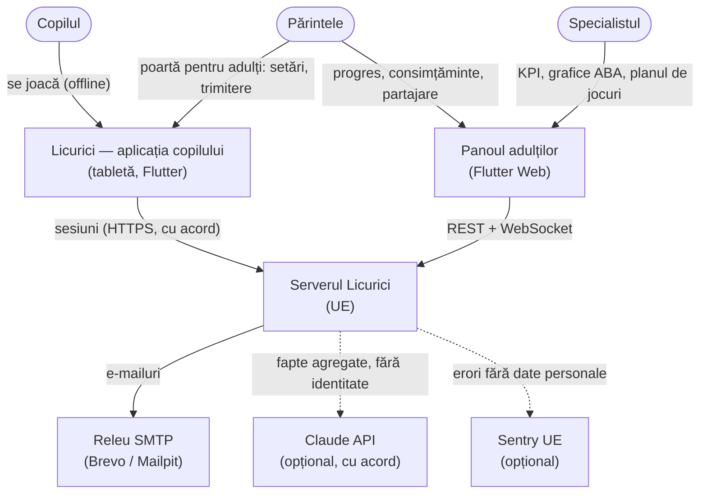
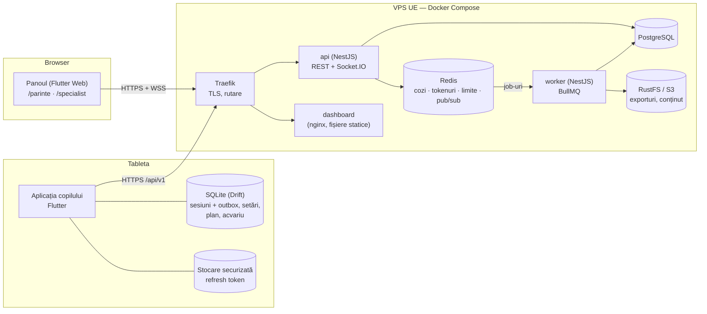
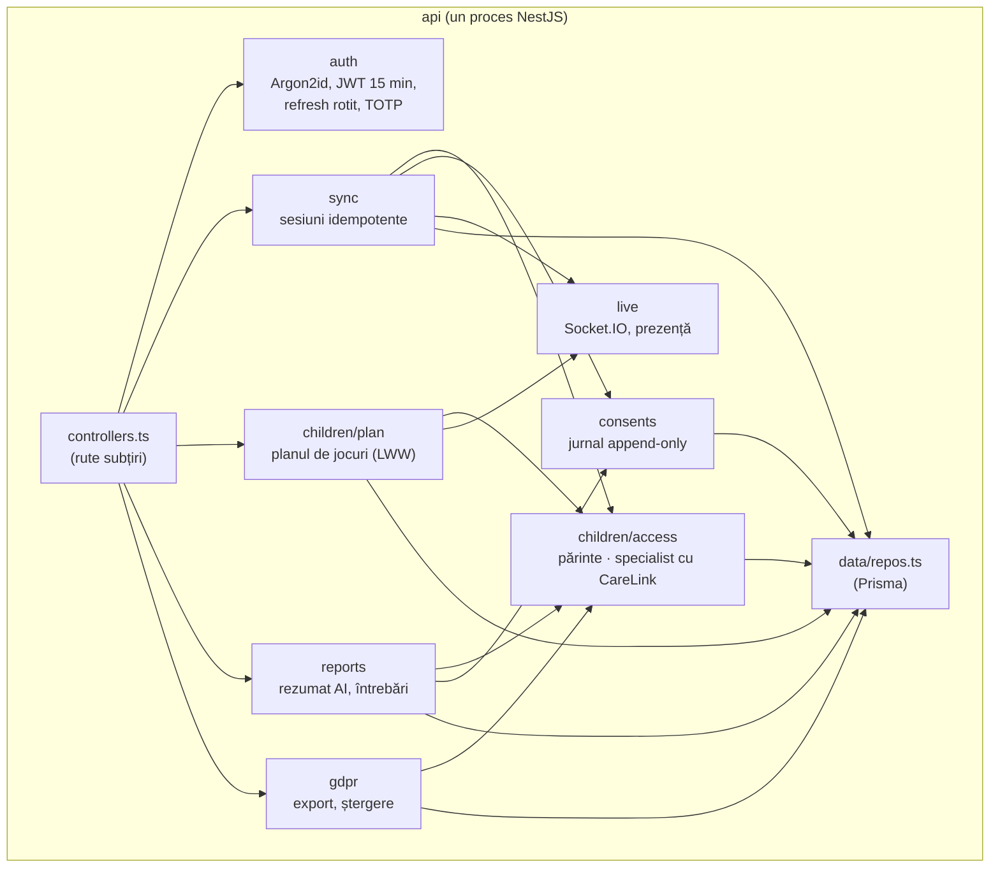

# 01 · Arhitectura: client offline-first, monolit modular, worker asincron

*Capitol de cercetare pentru teză (README §23). Starea din sesiunea a unsprezecea (11.10.2026). ADR-uri legate: 004, 005, 011, 014.*

## 1. Problema și constrângerile

Licurici are trei feluri de utilizatori care nu stau niciodată în același loc:

- **copilul** (2–12 ani, adesea cu TSA) se joacă pe o tabletă, de multe ori **fără internet** (în mașină, la bunici, în cabinet cu Wi-Fi slab);
- **părintele** vede progresul pe telefon sau calculator, ocazional;
- **specialistul** (logoped, psiholog, terapeut ABA) urmărește mai mulți copii, între ședințe.

Constrângerile care decid arhitectura:

| Constrângere | Consecință |
|---|---|
| Un singur dezvoltator, termen de un semestru pentru 70% | Cât mai puține piese de operat; un singur limbaj pe server. |
| Datele sunt despre **copii** (GDPR art. 8, Legea 195/2024) | Nimic nu pleacă de pe tabletă fără cont de părinte + consimțământ; găzduire în UE; minimizare. |
| Copilul nu are voie să aștepte rețeaua | Jocul nu poate depinde de server. Nicio eroare de rețea pe ecranul copilului. |
| Buget aproape zero | Un VPS, Docker Compose, servicii open-source. |
| Panoul trebuie să arate sesiunea „aproape live” | Un canal push pentru adulți. |
| Munca grea (rapoarte, e-mailuri, ștergeri GDPR) | Nu în ciclul cerere/răspuns. |

## 2. Opțiunile analizate

### 2.1 Stilul serverului

| Variantă | Pentru | Împotrivă (la scara noastră) |
|---|---|---|
| **Monolit clasic** (un proces, module amestecate) | Cel mai simplu | Munca grea concurează cu cererile; granițele se erodează. |
| **Monolit modular + worker** (ales, ADR-005) | Un deploy, o bază de date tranzacțională, granițe clare; munca grea separată | Scalarea e pe proces, nu pe modul. |
| **Microservicii** | Scalare și deploy independente, echipe independente | N servicii de operat, tracing distribuit, consistență eventuală, date duplicate — fără beneficiu pentru o echipă de 1. |
| **Serverless** (Lambda / Cloud Functions) | Zero servere de administrat | WebSocket greu, cold start, greu de rulat local, legare de furnizor, locația datelor. |
| **BaaS** (Firebase / Supabase) | Foarte rapid la început | Control redus asupra datelor copiilor; regulile de acces (părinte/specialist cu termen) se exprimă greu în reguli de securitate declarative. |

### 2.2 Clientul copilului

| Variantă | Pentru | Împotrivă |
|---|---|---|
| **Client subțire** (totul pe server) | O singură sursă de adevăr | Fără internet nu merge; latența strică feedback-ul imediat (esențial în ABA). |
| **Offline-first** (ales, ADR-004) | Jocul merge oricând; latență zero; datele rămân pe tabletă dacă părintele nu vrea cont | Sincronizare, conflicte, două locuri cu date. |
| **Cache offline** (online-first cu fallback) | Mai simplu decât offline-first | Comportament diferit online/offline — imprevizibil, iar predictibilitatea e un principiu de design pentru TSA (README §2). |

## 3. Ce am ales

**Client offline-first** (Flutter + SQLite/Drift) + **monolit modular NestJS** cu **două procese** (API și worker) din aceeași imagine Docker + **PostgreSQL** (adevărul) + **Redis** (cozi, sesiuni, limite, pub/sub) + **Docker Compose** pe un VPS din UE.

### 3.1 C4 — nivelul 1: contextul

### 3.2 C4 — nivelul 2: containerele

`infra/docker-compose.yml` (dezvoltare) are exact aceste containere plus `migrate` (rulează `prisma migrate deploy` o dată), `mailpit` și `bullboard`; `docker-compose.prod.yml` adaugă Traefik cu Let's Encrypt și nu expune decât 80/443.

### 3.3 C4 — nivelul 3: componentele API-ului

Regula de dependență: **serviciile de domeniu sunt TypeScript simplu** (clase cu interfețe în constructor — `SessionRepo`, `LiveEvents`, `ConsentService`), legate între ele într-un singur loc (`api/api.module.ts`). Nest e doar „cablajul”. Două motive, unul de principiu și unul practic: (1) domeniul se testează fără framework, cu fake-uri în memorie (backend: 81 de teste); (2) NestJS 12 este ESM și nu se încarcă în Jest — fără această separare, testele n-ar fi rulat deloc.

## 4. De ce așa — argumentele

1. **Copilul nu așteaptă niciodată.** Fiecare rundă se scrie întâi în SQLite (`SessionRecorder` → Drift). Serverul e un *destinatar*, nu o dependență. Testul cap-coadă (`integration_test/flow.dart`, sesiunea 10) o verifică: sesiunea se joacă, se salvează, iar fără acord **nu pleacă nimic** pe rețea.
2. **Confidențialitatea e implicită în arhitectură, nu o setare.** Fără cont, aplicația funcționează complet, iar datele nu părăsesc tableta. Cu cont, sincronizarea cere consimțământul `SYNC` (verificat pe server la fiecare lot — `SyncService.push`).
3. **O singură bază tranzacțională.** Accesul (părinte / specialist cu termen), consimțămintele și auditul trebuie să fie consistente între ele. Într-o arhitectură cu microservicii, „specialistul are acces la copilul X acum?” ar fi o întrebare distribuită.
4. **Munca grea iese din cerere.** E-mailurile, raportul săptămânal, ștergerea definitivă după 7 zile și retenția rulează în worker. API-ul răspunde fără să aștepte furnizorul SMTP (care poate cădea).
5. **Scalare suficientă, cu pași cunoscuți.** API-ul e fără stare (JWT + Redis), deci poate rula în N instanțe în spatele lui Traefik; Socket.IO are adapterul Redis tocmai pentru asta (`live/redis-io.adapter.ts`). Worker-ul scalează cu `--scale worker=N`; lock-urile Redis per copil previn dubla procesare.

## 5. Consecințele — ce plătim

| Cost | Cum îl gestionăm |
|---|---|
| Datele există în două locuri (tabletă + server) | Tableta e sursa pentru sesiuni (append-only, id UUID generat pe tabletă); serverul e sursa pentru conturi, acorduri, partajări. Singura dată editată în ambele locuri — **planul de jocuri** — e „ultimul câștigă” după dată (ADR-011, `hiddenGamesAt`). |
| Sincronizarea poate eșua la jumătate | Sesiunile se marchează trimise **abia după confirmare**; retrimiterea e idempotentă (upsert după id). Vezi `02-comunicare.md`. |
| Schema pe tabletă și pe server trebuie să coincidă | Un singur contract: `SessionRecord.toJson()` din `licurici_core` ↔ schema zod `sessionRecordSchema` (`.strict()` — un câmp necunoscut e respins). Test de contract cu JSON generat din Dart. |
| Monolitul poate deveni „bilă de noroi” | Granițe explicite: un modul nu atinge tabelele altuia decât prin interfața lui de repository. |
| Un singur VPS = un singur punct de cădere | Acceptat la această scară; backup zilnic criptat (`infra/backup.sh`, age, 35 de zile) și procedura de restaurare în [docs/operare.md](../operare.md). Tableta continuă să funcționeze dacă serverul e jos. |

## 6. Ce s-a schimbat față de planul inițial (și de ce)

Arhitectura din README §4 a fost scrisă înaintea codului. Trei abateri, toate intenționate:

1. **Sincronizăm sesiuni întregi, nu evenimente individuale.** Planul era `POST /sync/events` cu evenimente de joc. În practică, unitatea care contează clinic e **sesiunea** (încercări + pauze + dispoziția înainte/după), iar faptele derivate (independență, confuzii, oboseală) se calculează o singură dată, pe tabletă, din același cod Dart care le arată părintelui offline. Serverul primește `{record, facts}` și nu recalculează. Avantaj: un singur loc cu logica clinică (testat în `licurici_core`, ~490 de teste); dezavantaj: dacă se schimbă formula, sesiunile deja trimise păstrează faptele vechi (rămân totuși recalculabile, pentru că serverul păstrează și `record`, jurnalul brut al încercărilor).
2. **Fără Firebase / Google / Apple Sign-In deocamdată.** E-mail + parolă (Argon2id) + 2FA opțional acoperă cerința; fiecare furnizor extern adaugă un împuternicit GDPR.
3. **Fără `@nestjs/event-emitter`.** Comunicarea între module e prin interfețe injectate (`LiveEvents.publish`), care se testează cu o listă în memorie. Un bus intern ar fi ascuns dependențele.

## 7. Când am alege altfel

- **Microservicii**: când o componentă are un profil de încărcare radical diferit (de exemplu recunoaștere vocală pe GPU pentru exerciții de pronunție) sau când echipe separate dețin domenii separate.
- **Kubernetes în loc de Compose** (ADR-014): peste ~3 servere sau când e nevoie de deploy fără întrerupere pe mai multe noduri.
- **Online-first**: dacă aplicația ar fi folosită doar în cabinete cu rețea garantată și ar avea nevoie de colaborare în timp real între copil și terapeut pe același ecran.
- **BaaS**: pentru un prototip de o săptămână fără date reale despre copii.

## 8. Cum am verificat

| Afirmație | Dovada |
|---|---|
| Jocul merge fără rețea | Cele ~300 de teste ale aplicației rulează fără niciun server; serverul apare doar în testul cap-coadă, la pasul de trimitere. |
| Nimic nu pleacă fără acord | `flow_test.dart`: „Trimite pe server” întâi fără bifa de acord → nu pleacă nicio sesiune; pe server, `SyncService.push` fără consimțământ `SYNC` (sau după retragere) → 403, nimic salvat (`sync.spec.ts`). |
| Retrimiterea nu dublează | `sync.spec.ts`: „idempotent: retrimiterea nu dublează sesiunile”. |
| Contractul tabletă ↔ server | `sync.spec.ts`: fixtura generată de `licurici_core/tool/sync_fixture.dart` e acceptată exact; un câmp în plus (de exemplu un nume) e respins. |
| Pornirea modulelor | Testul de pornire a API-ului și worker-ului (a prins o dependență lipsă între module, sesiunea 4). |
| **Încă neverificat** | Rularea cu Postgres și Redis reale în Docker, încărcarea (k6, 200 sync/s, p95 < 200 ms) — depind de instalarea Docker (README §0.0 A). |

## 9. Rezumat pentru susținere (60 s)

*Problema:* copii care se joacă des fără internet, date sensibile, un singur dezvoltator. *Constrângeri:* fără așteptare pentru copil, nimic pe server fără acord, buget zero. *Ales:* tabletă offline-first cu SQLite, server monolit modular NestJS cu un worker separat, Postgres + Redis, Docker Compose în UE. *Alternative:* microservicii — cost operațional fără beneficiu la scara asta; Firebase — control slab asupra datelor copiilor și regulilor de acces. *Aș schimba* când apare o componentă cu încărcare diferită (GPU) sau mai multe echipe. *Verificat* prin testul cap-coadă copil → SQLite → server și testele de contract.
